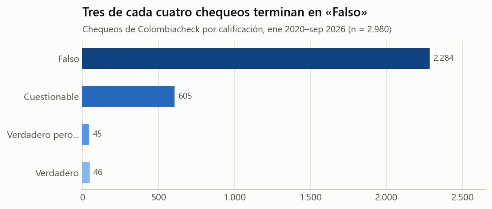
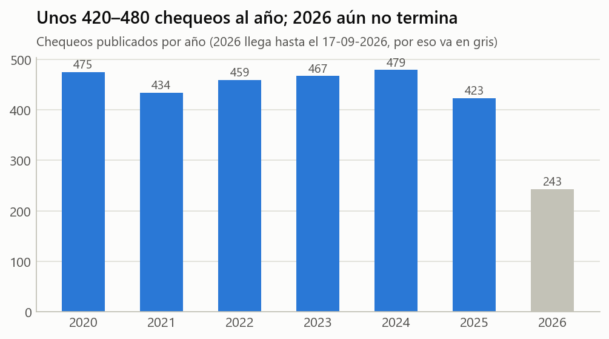
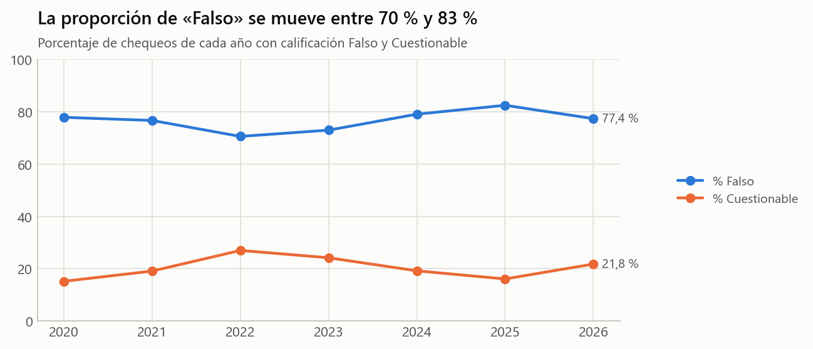
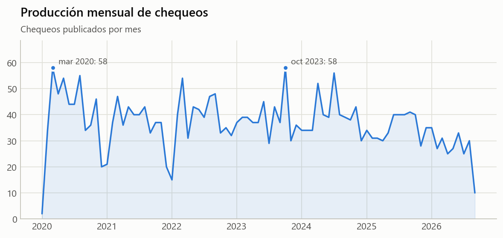
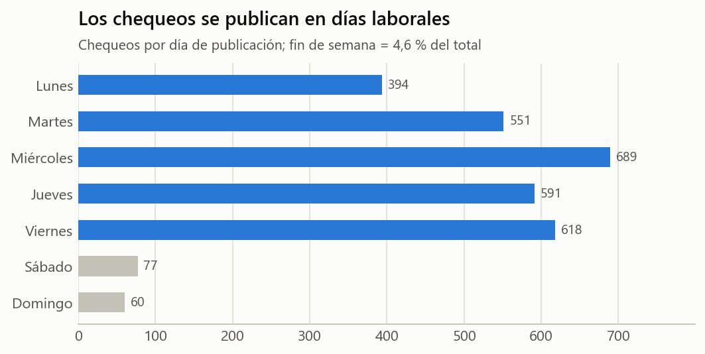
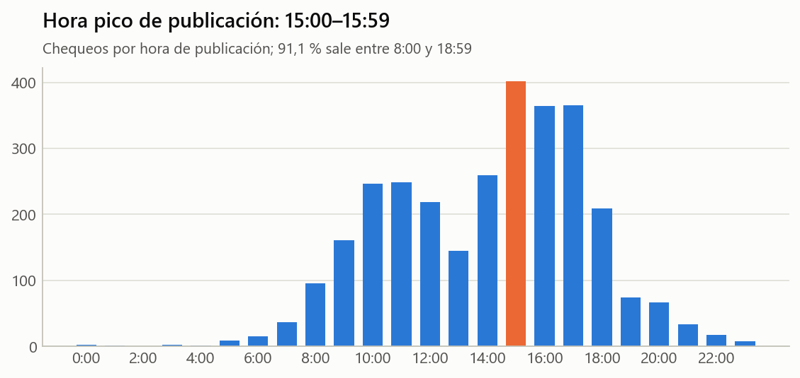
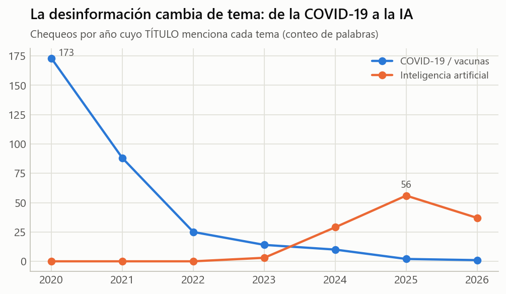
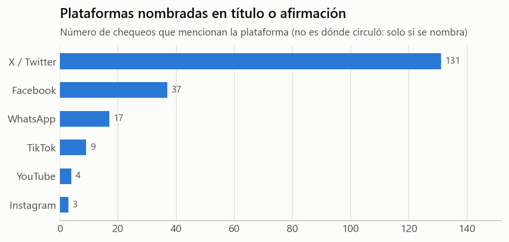
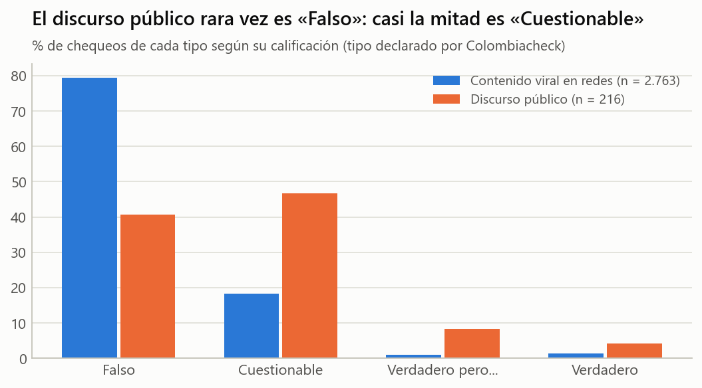
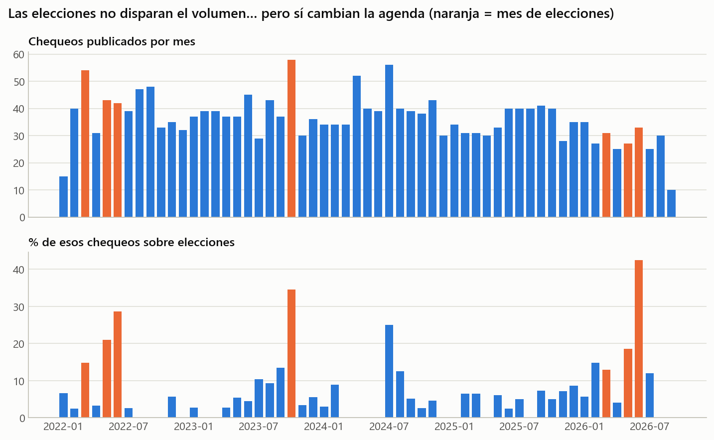

# Colombiacheck — chequeos verificados (2020–2026)

| Ficha rápida | |
|---|---|
| **Qué es** | Las verificaciones (*fact-checks*) publicadas por Colombiacheck, medio de verificación del Consejo de Redacción |
| **Unidad de análisis** | Un chequeo: una afirmación que circuló y el veredicto del verificador |
| **Registros** | 2.980 chequeos |
| **Cobertura** | 25-01-2020 a 17-09-2026 |
| **De dónde salen las cifras** | Marcado `ClaimReview` (schema.org) que el propio medio publica en cada artículo |
| **Archivo limpio** | `datos/colombiacheck_verificado_limpio.csv` |
| **Origen en el proyecto** | `data/processed/colombiacheck_verificado.csv` (ver `reports/FUENTES.md`) |

> **La advertencia más importante.** Este dataset describe **lo que Colombiacheck decidió
> verificar**, no toda la desinformación que circuló en Colombia. Un verificador elige
> contenidos virales y sospechosos. Por eso, cualquier conclusión debe decir «entre los
> chequeos de Colombiacheck…», nunca «en las redes colombianas…». Esta idea es una de las
> preguntas del reto (sesgo de selección).

## 1. ¿Qué contiene?

Cada fila es un artículo de verificación. El medio declara, en datos estructurados, la
afirmación que revisó, el veredicto y la fecha exacta con hora. Por eso es la fuente más
sólida del proyecto: nada de eso lo interpretamos nosotros.

| Variable | Qué es | Ejemplo |
|---|---|---|
| `url` | Enlace al chequeo (permite comprobar cualquier fila) | colombiacheck.com/chequeos/… |
| `fecha`, `hora` | Fecha y hora de publicación declaradas por el medio | 2025-05-16, 09:33 |
| `anio`, `mes`, `dia_semana` | Derivadas de la fecha | 2025, 2025-05, Viernes |
| `titulo` | Titular del chequeo (ya dice qué se encontró) | Video de supuesta anaconda gigante en el río Amazonas fue creado con IA |
| `afirmacion_verificada` | Lo que circulaba, tal como lo resume el medio | Una enorme Anaconda fue captada deslizándose majestuosa por las aguas del r |
| `calificacion` | Veredicto: Falso, Cuestionable, Verdadero pero…, Verdadero | Falso |
| `calificacion_valor` | Veredicto en número (1 = Falso … 5 = Verdadero) | 1 |
| `autor_chequeo` | Periodista que firmó el chequeo | — |

Completitud: todas las variables tienen dato en el 100 % de las filas (una fila «Falso» no
trae el valor numérico). La afirmación verificada llega recortada a 75 caracteres
(mediana 66), así la publica el medio en `ClaimReview`.

## 2. ¿Cómo se comportan los datos?

### 2.1 El veredicto: abrumadoramente «Falso»

| calificacion | chequeos | porcentaje |
|---|---:|---:|
| Falso | 2.284 | 76,6 % |
| Cuestionable | 605 | 20,3 % |
| Verdadero pero... | 45 | 1,5 % |
| Verdadero | 46 | 1,5 % |

- **76,6 %** de los chequeos terminan en *Falso* y
  **20,3 %** en *Cuestionable*. Solo
  **3,0 %** confirman algo como verdadero.
- **Ojo:** esto **no** significa que el 77 % de lo que circula en redes sea falso. Significa
  que el verificador dedica su tiempo a lo que ya parece sospechoso (sesgo de selección).

### 2.2 Volumen por año: estable

| año | Falso | Cuestionable | Verdadero pero... | Verdadero | total | pct_falso | pct_cuestionable |
|---:|---:|---:|---:|---:|---:|---:|---:|
| 2020 | 370 | 72 | 23 | 10 | 475 | 77,9 % | 15,2 % |
| 2021 | 333 | 83 | 6 | 12 | 434 | 76,7 % | 19,1 % |
| 2022 | 324 | 124 | 7 | 4 | 459 | 70,6 % | 27,0 % |
| 2023 | 341 | 113 | 4 | 9 | 467 | 73,0 % | 24,2 % |
| 2024 | 379 | 92 | 2 | 6 | 479 | 79,1 % | 19,2 % |
| 2025 | 349 | 68 | 3 | 3 | 423 | 82,5 % | 16,1 % |
| 2026 | 188 | 53 | 0 | 2 | 243 | 77,4 % | 21,8 % |

- Entre 2020 y 2025 el medio publicó entre 423 y
  479 chequeos al año; el máximo fue 2024.
- **2026 parece bajar, pero es un año incompleto** (los datos llegan al 17-09-2026).
  Comparar un año parcial con años completos es un error clásico de lectura de datos.

- El porcentaje de *Falso* va de 70,6 % (2022) a
  82,5 % (2025). *Cuestionable* tuvo su
  máximo en 2022 (27,0 %).

### 2.3 Mes a mes

- Promedio: 36,8 chequeos por mes (mínimo 2, máximo 58).
- Mes(es) con más chequeos: **mar 2020 y oct 2023** (58 cada uno). Marzo de 2020 coincide con la llegada de la COVID-19 a Colombia.
- Los meses extremos de la serie (ene 2020 y sep 2026)
  están incompletos y no deben leerse como caídas reales.

### 2.4 Cuándo se publica: horario de oficina

- Solo **4,6 %** de los chequeos sale en sábado o domingo, y
  91,1 % entre las 8:00 y las 18:59. La hora pico es
  15:00–15:59 (402 chequeos).
- Esto describe **el horario de trabajo de la redacción**, no el horario de la
  desinformación: los rumores no descansan el fin de semana; los periodistas sí.

### 2.5 La desinformación cambia de tema

| año | Inteligencia artificial (IA) | COVID-19 / vacunas | Estafas | Video | Foto / imagen | total_chequeos |
|---:|---:|---:|---:|---:|---:|---:|
| 2020 | 0 | 173 | 6 | 29 | 34 | 475 |
| 2021 | 0 | 88 | 2 | 37 | 52 | 434 |
| 2022 | 0 | 25 | 6 | 57 | 48 | 459 |
| 2023 | 3 | 14 | 6 | 104 | 52 | 467 |
| 2024 | 29 | 10 | 4 | 115 | 59 | 479 |
| 2025 | 56 | 2 | 6 | 86 | 57 | 423 |
| 2026 | 37 | 1 | 7 | 80 | 34 | 243 |

*Conteo de chequeos cuyo título contiene ciertas palabras (por ejemplo «IA» o «inteligencia
artificial»). Es un conteo transparente de palabras, no una clasificación temática validada.*

- Los títulos que mencionan **COVID-19 o vacunas** pasan de 173 en 2020 a
  1 en 2026.
- Los que mencionan **inteligencia artificial** aparecen por primera vez en 2023 y
  llegan a 56 en 2025. En 2026 (año incompleto) ya son 37 de
  243 chequeos (15,2 %).
- Lectura: los temas de la desinformación siguen la actualidad (pandemia, luego imágenes y
  videos fabricados con IA). Las habilidades para detectarla deben actualizarse igual de rápido.

### 2.6 Plataformas mencionadas

Solo indica si la plataforma **se nombra** en el título o la afirmación. Que se nombre poco
TikTok no prueba que allí circule poca desinformación: los titulares rara vez dicen dónde
circuló el contenido.

### 2.7 Quién verifica

261 firmas distintas; las 10 más frecuentes firman el 73,0 % de los
chequeos (la más frecuente, 531). La verificación es trabajo de un equipo
pequeño: por eso no se puede verificar todo, y por eso importa que cada persona aprenda a
dudar antes de compartir.

### 2.8 Dos tipos de chequeo, dos patrones distintos

Colombiacheck publica cada chequeo en una de dos secciones: **contenido viral en redes**
(2.763: publicaciones, videos y cadenas que circulan en redes y WhatsApp) o
**discurso público** (216: afirmaciones de políticos y figuras públicas).
El medio llama a la primera sección «Desinformación en redes»; aquí se nombra *contenido viral en redes*
porque la sección dice **dónde circuló** el contenido, no **si era falso**: eso lo dice la calificación,
y algunos contenidos de esa sección resultan Verdaderos.

| tipo | Falso | Cuestionable | Verdadero pero... | Verdadero |
|---|---:|---:|---:|---:|
| Contenido viral en redes | 79,4 % | 18,2 % | 1,0 % | 1,3 % |
| Discurso público | 40,7 % | 46,8 % | 8,3 % | 4,2 % |

| año | chequeos de redes | chequeos de discurso | % Falso redes | % Falso discurso | % Falso total |
|---:|---:|---:|---:|---:|---:|
| 2020 | 421 | 54 | 83,1 % | 37,0 % | 77,9 % |
| 2021 | 385 | 49 | 80,5 % | 46,9 % | 76,7 % |
| 2022 | 401 | 58 | 75,3 % | 37,9 % | 70,6 % |
| 2023 | 431 | 36 | 75,6 % | 41,7 % | 73,0 % |
| 2024 | 466 | 13 | 80,3 % | 38,5 % | 79,1 % |
| 2025 | 417 | 6 | 83,0 % | 50,0 % | 82,5 % |
| 2026 | 242 | 0 | 77,3 % | — | 77,4 % |

- El discurso público termina en «Cuestionable» el 46,8 % de las veces,
  frente al 18,2 % del contenido de redes.
- Los chequeos de discurso público casi desaparecen desde 2024. Como casi nunca son «Falso», **al
  desaparecer suben el % de Falso del total** aunque el contenido de redes no cambie tanto: es un
  **efecto de composición**. Comparar el total de distintos años sin mirar la mezcla puede engañar.
- No permite decir que «los políticos mienten menos»: el verificador escoge qué afirmaciones revisar
  y con criterios distintos según el tipo.

### 2.9 Elecciones: el volumen no se dispara, la agenda sí

- En los meses de votación (2022–2026) se publicaron en promedio 41,1 chequeos,
  frente a 35,7 en los demás meses: apenas 15 % más.
- Pero la parte de chequeos sobre elecciones pasa de 4,6 % en meses sin votación a
  24,7 % en meses con votación (máximo 42,4 % en
  2026-06).
- Lectura: la capacidad del verificador es casi fija; lo que cambia es **de qué se ocupa**. Estos datos no
  dicen si circuló más desinformación electoral: dicen que se verificó más.
- «Tema electoral» = el título o la afirmación contiene palabras como elección, voto, candidato,
  registraduría, jurado, escrutinio, tarjetón o consulta (conteo de palabras, no clasificación validada).

## 3. Calidad y limitaciones

1. **Sesgo de selección** (la principal): muestra editorial, no aleatoria.
2. **Cobertura parcial de 2026** y de los meses extremos de la serie.
3. Solo entran los chequeos con marcado `ClaimReview` completo (2.989 de 4.829 artículos; se
   excluyeron 9 de antes de 2020). Detalle en `data/processed/colombiacheck_verificado_resumen.txt`.
4. **Fuente única**: un solo verificador. Otros (La Silla Vacía, AFP Factual) podrían
   priorizar temas distintos.
5. Las palabras clave de títulos (sección 2.5–2.6) son conteos, no categorías validadas.
6. Financiación: Meta figura entre los financiadores del medio (declarado por Colombiacheck);
   conviene mencionarlo como posible conflicto de interés.

## 4. Relación con la desinformación y con el estudio de Nature

El estudio de Arechar et al. (2023) en *Nature Human Behaviour* usó titulares verdaderos y
falsos sobre COVID-19 en 16 países (Colombia no estaba). Este dataset permite **repetir la
idea con titulares colombianos reales**: en el reto, los estudiantes deciden si compartirían
y si creen ciertas afirmaciones verificadas por Colombiacheck, y la clase compara su
«brecha entre creer y compartir» con la del estudio. Ver `../06_Marco_estudio_Nature_Arechar2023/`.

## 5. Dónde se usa en el reto

- **Exp. 01 – ¿Lo compartirías?**: afirmaciones reales (verdaderas y falsas) como publicaciones.
- **Exp. 02 – Detectives de chequeos**: títulos de chequeos para identificar la trampa y el veredicto.
- **Casos estadísticos**: Caso 1 (elecciones, sección 2.9), Caso 2 (redes vs. discurso público y
  efecto de composición, sección 2.8), Caso 3 (IA: conteo vs. proporción, año incompleto y proyección,
  sección 2.5), Caso 5 (probabilidad condicional IA × Falso) y Caso 7 (*cherry picking* en la serie
  del % Falso y media vs. mediana de chequeos por periodista, sección 2.7).

## 6. Archivos de esta carpeta

| Archivo | Contenido |
|---|---|
| `datos/colombiacheck_verificado_limpio.csv` | Dataset limpio (día de la semana en español) |
| `tablas/calificacion.csv` | Conteo y % por calificación |
| `tablas/calificacion_por_anio.csv` | Calificación por año, con % Falso y % Cuestionable |
| `tablas/chequeos_por_mes.csv` | Serie mensual |
| `tablas/chequeos_por_dia_semana.csv`, `tablas/chequeos_por_hora.csv` | Cuándo se publica |
| `tablas/palabras_en_titulos_por_anio.csv` | Conteo de palabras clave en títulos por año |
| `tablas/plataformas_mencionadas.csv` | Plataformas nombradas |
| `tablas/autores.csv` | Chequeos por firma |
| `tablas/calificacion_por_tipo.csv`, `tablas/tipo_por_anio.csv` | Redes vs. discurso público y efecto de composición |
| `tablas/tema_electoral_por_mes.csv` | Chequeos y % de tema electoral por mes, con meses de votación |
| `figuras/*.png` | Las 10 gráficas de este documento |
