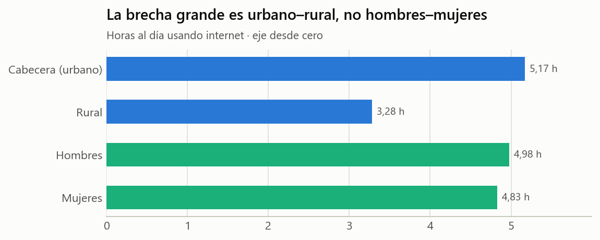
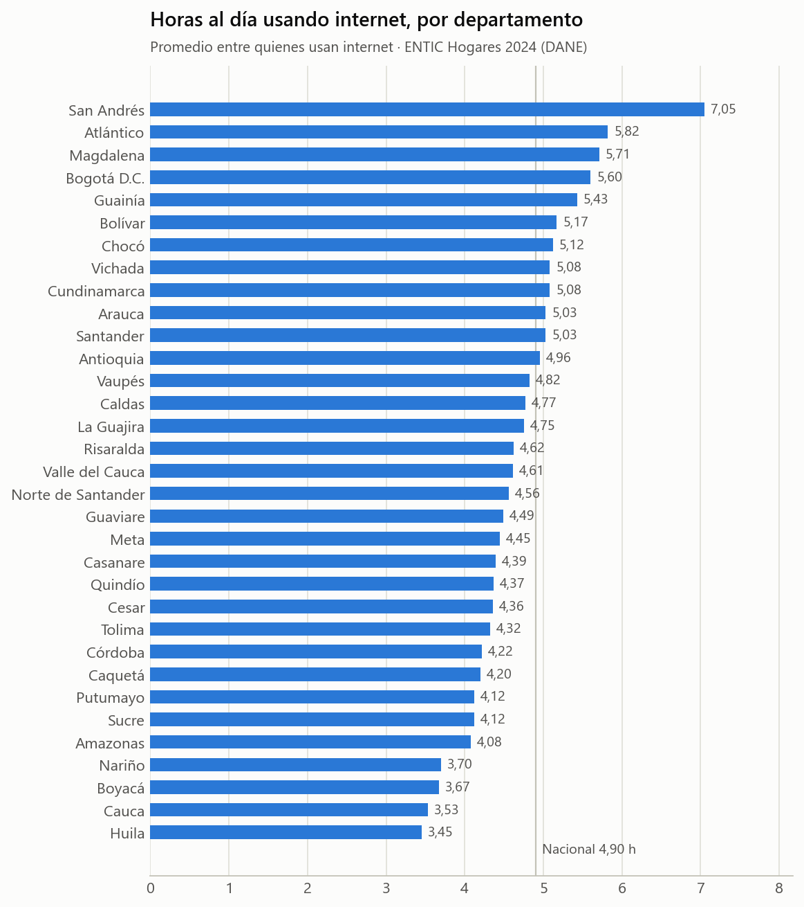
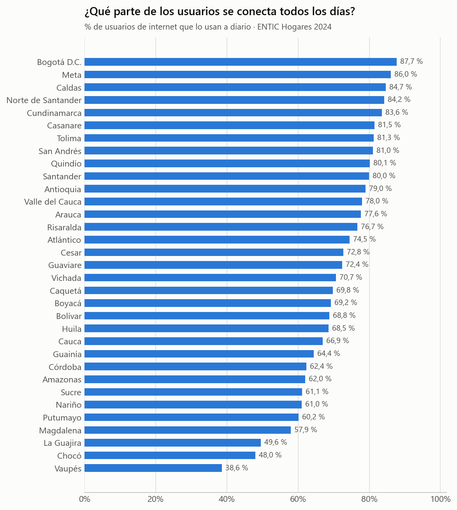
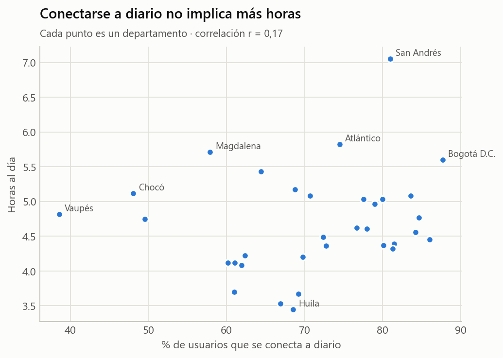

# DANE · ENTIC Hogares 2024 — horas de uso de internet

| Ficha rápida | |
|---|---|
| **Qué es** | Encuesta oficial del DANE sobre uso de tecnologías en los hogares (cuadro Mod. 4-3 del anexo) |
| **Población** | Personas de 5 años y más que usan internet |
| **Unidad** | Estimaciones agregadas (nacional, área urbano/rural, 33 departamentos; por sexo) |
| **Registros** | 108 filas = 36 territorios × 3 (total, hombres, mujeres) |
| **Archivo limpio** | `datos/dane_entic2024_horas_uso_internet_limpio.csv` |
| **Origen** | `Datasets - Tiempo en redes sociales Colombia/2. Datos listos para analizar/` (extraído del anexo oficial del DANE) |

## 1. ¿Qué contiene?

| Variable | Qué es |
|---|---|
| `nivel`, `ambito`, `sexo` | Territorio (nacional, área o departamento) y desagregación por sexo |
| `usuarios_internet` (+ `_ic`) | Personas que usan internet (estimación expandida) y su intervalo de confianza |
| `usan_todos_los_dias`, `pct_usan_todos_los_dias` (+ `_ic`) | Cuántas y qué % lo usan a diario |
| `horas_dia_promedio`, `horas_dia_ic` | **Promedio de horas al día usando internet** y margen (IC 95 %) |
| `horas_dia_cve_pct` | Coeficiente de variación: <10 % = alta precisión (criterio oficial DANE) |

La limpieza quitó las filas de notas al pie que traía el CSV y convirtió las cifras a números.

> **Muy importante para el reto:** el DANE mide **horas de uso de INTERNET**, no horas en
> redes sociales. Un titular que diga «los colombianos pasan 5 horas al día en redes» confunde
> las dos cosas. Detectar ese error es una de las preguntas del reto.

## 2. ¿Cómo se comportan los datos?

- **Total nacional: 4,90 horas al día** (IC ± 0,07;
  CVE 0,8 %), es decir, el valor real está muy probablemente entre
  4,83 y 4,97 horas.
- **39.023.409** personas usan internet y el **77,1 %**
  lo hace todos los días.
- **Urbano vs rural:** 5,17 h en cabeceras frente a
  3,28 h en zona rural: 113
  minutos más al día en la ciudad. En uso diario: 81,5 % vs 57,9 %.
- **Hombres vs mujeres:** 4,98 h vs
  4,83 h, una diferencia de apenas
  9 minutos.
  (En el reto se muestra un gráfico **tramposo** que exagera esta diferencia cortando el eje.)

### Por departamento

- Más horas: **San Andrés** (7,05 h), Atlántico
  (5,82 h) y Magdalena (5,71 h).
- Menos horas: **Huila** (3,45 h), Cauca
  (3,53 h) y Boyacá (3,67 h).
- Rango: 3,60 horas entre el
  primero y el último.

- Uso diario más alto: Bogotá D.C. (87,7 %); más bajo: Vaupés
  (38,6 %).

- La correlación entre «% que se conecta a diario» y «horas al día» es baja (r = 0,17).
  Por ejemplo, Vaupés tiene el uso diario más bajo y aun así sus usuarios
  promedian 4,82 horas. Son dos cosas distintas:
  **frecuencia** (cuántos días) e **intensidad** (cuántas horas).

Tabla completa: `tablas/horas_por_departamento.csv`.

## 3. Calidad y limitaciones

- Es una **encuesta por muestreo**: cada cifra trae intervalo de confianza. Todos los CVE de
  horas están entre 0,8 % y 6,2 % (alta precisión).
- Es autodeclarado: las personas estiman sus propias horas.
- Es una foto de 2024; no hay serie anual de horas (los anexos TICH 2022–2023 no traen horas).

## 4. Relación con la desinformación

Más horas conectados = más exposición posible a contenidos, incluidos los falsos. Pero
este dataset **no mide desinformación** ni horas en redes: sirve como contexto de
exposición. Su uso en el reto es de **lectura crítica**: distinguir internet de redes
sociales, leer intervalos de confianza y no dejarse engañar por gráficos con el eje cortado.

## 5. Dónde se usa en el reto

Caso 4 (dispersión por departamento y promedio ponderado urbano–rural), Caso 6 (intervalos de
confianza por departamento, porcentaje vs. cantidad de personas) y Caso 7 (gráfico con el eje cortado).
