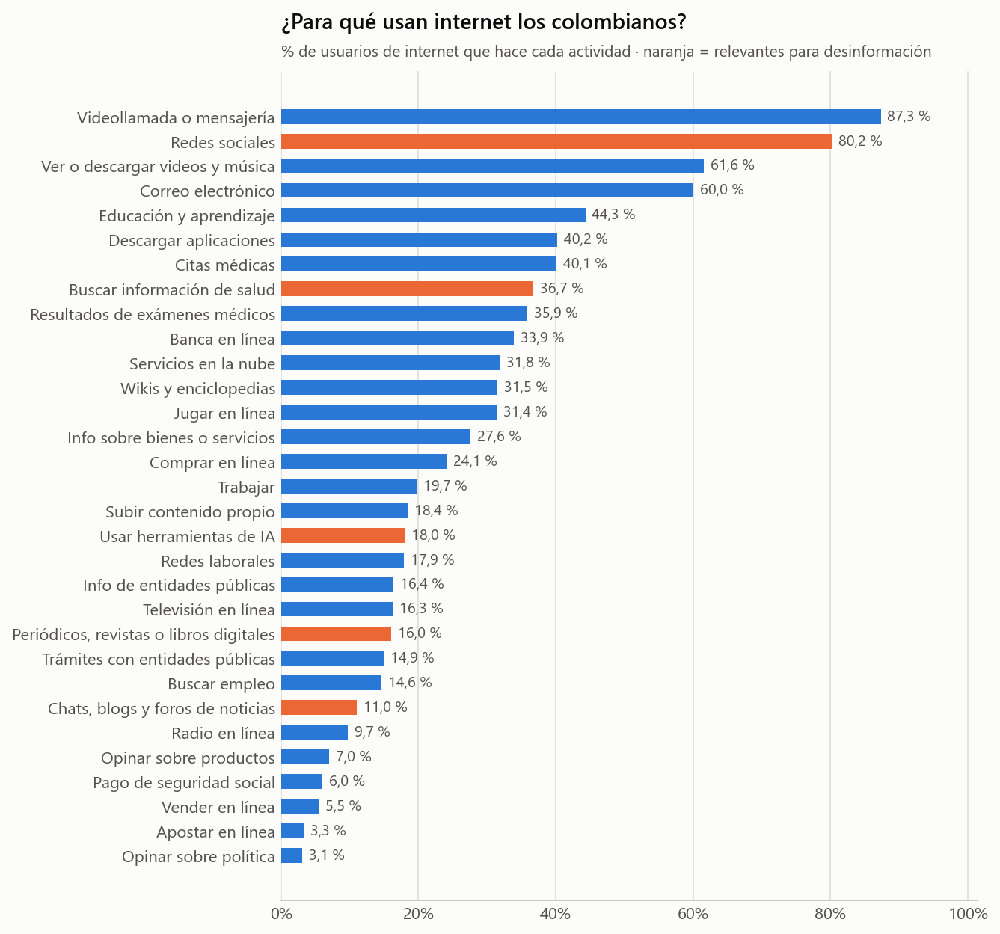
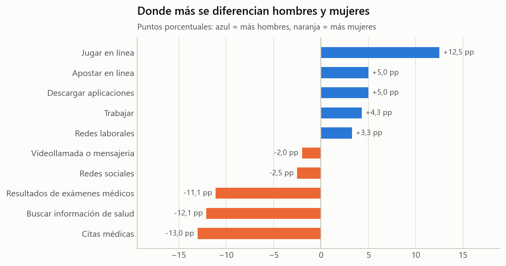
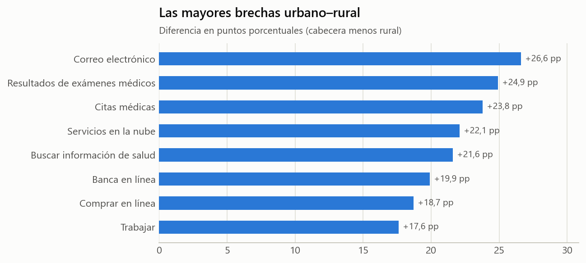

# DANE · ENTIC Hogares 2024 — actividades en internet

| Ficha rápida | |
|---|---|
| **Qué es** | Qué hacen en internet las personas que lo usan (cuadro Mod. 4-7 del anexo ENTIC 2024) |
| **Población** | 39.023.408 usuarios de internet de 5 años y más |
| **Unidad** | % de usuarios que realiza cada actividad (una persona puede hacer varias) |
| **Registros** | 108 filas (nacional, urbano/rural y 33 departamentos × total/hombres/mujeres) × 31 actividades |
| **Archivo limpio** | `datos/dane_entic2024_actividades_internet_limpio.csv` (nombres cortos; el diccionario está en `tablas/diccionario_actividades.csv`) |

## 1. ¿Cómo se comportan los datos?

- Lo más común: **Videollamada o mensajería** (87,3 %), **Redes sociales** (80,2 %)
  y Ver o descargar videos y música (61,6 %).
- **Redes sociales: 80,2 %** de los usuarios de internet, frente a solo
  **16,0 %** que lee periódicos, revistas o libros
  digitales y 11,0 % que entra a foros de noticias.
  Muchas más personas pasan por las redes que por los medios.
- **36,7 %** busca información de salud en internet: la
  salud es justamente uno de los temas con más desinformación (COVID-19, curas milagrosas).
- **18,0 %** ya usa herramientas de inteligencia artificial,
  la misma tecnología con la que hoy se fabrican videos e imágenes falsas.

- Las mujeres usan más internet para **salud** (citas médicas, resultados, información:
  entre 11 y 13 puntos más). Los hombres, para **jugar** (+12,5 pp)
  y **apostar** (5,9 % vs 0,9 %).
- En redes sociales casi no hay diferencia (78,9 % hombres,
  81,4 % mujeres).

- La zona rural se parece a la urbana en **redes sociales** (78,8 % vs
  80,5 %) y en **mensajería**, pero se queda muy atrás en
  correo, banca y trámites. Es decir: en el campo, las redes y la mensajería son la puerta
  principal a la información.

Tabla completa (nacional, por sexo y por área): `tablas/actividades_nacional_sexo_area.csv`.

## 2. Calidad y limitaciones

- Encuesta por muestreo (los porcentajes son estimaciones). El CSV de trabajo solo trae la
  proporción; los intervalos están en el anexo oficial del DANE (`1. Datos en bruto/`).
- No mide **qué** se ve en redes ni si es falso; mide si la persona hace la actividad.

## 3. Relación con la desinformación

Mide las **puertas de entrada**: cuántas personas están expuestas a las redes (la vía por la
que circulan casi todas las piezas que verifica Colombiacheck) frente a cuántas leen medios.

## 4. Dónde se usa en el reto

Caso 4 de los casos estadísticos (qué se hace en internet en la ciudad y en el campo).
