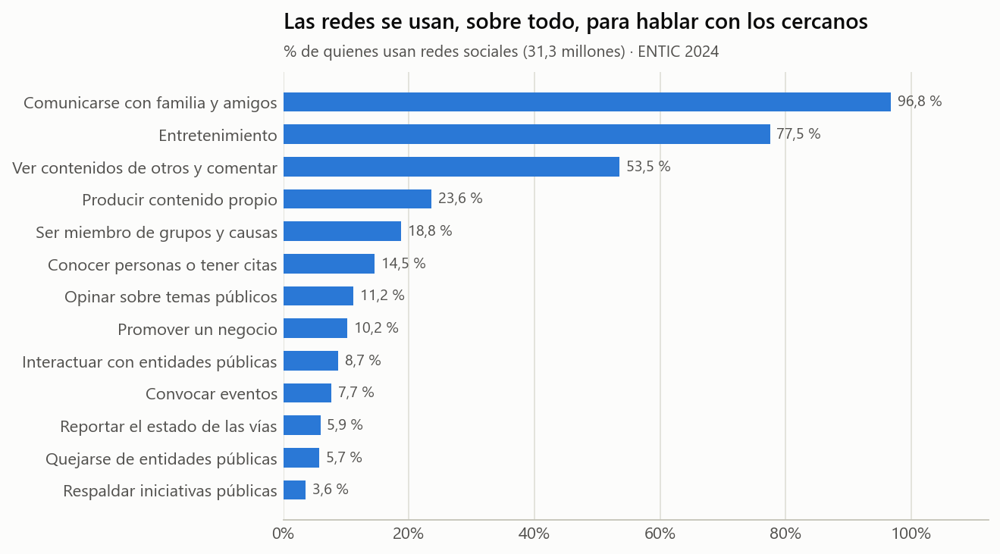

# DANE · ENTIC Hogares 2024 — actividades dentro de las redes sociales

| Ficha rápida | |
|---|---|
| **Qué es** | Para qué usan las redes sociales quienes las usan (cuadro Mod. 4-8 del anexo ENTIC 2024) |
| **Población** | 31.295.791 personas de 5 años y más que usan redes sociales |
| **Unidad** | % de usuarios de redes que realiza cada actividad (no suman 100 %: son varias a la vez) |
| **Registros** | 108 filas × 13 actividades |
| **Archivo limpio** | `datos/dane_entic2024_actividades_redes_sociales_limpio.csv` |

## 1. ¿Cómo se comportan los datos?

| actividad | Total | Hombres | Mujeres | Cabecera (urbano) | Rural |
|---|---:|---:|---:|---:|---:|
| Comunicarse con familia y amigos | 96,8 % | 96,4 % | 97,1 % | 96,7 % | 97,0 % |
| Entretenimiento | 77,5 % | 77,5 % | 77,6 % | 78,5 % | 73,4 % |
| Ver contenidos de otros y comentar | 53,5 % | 53,1 % | 53,9 % | 54,3 % | 49,9 % |
| Producir contenido propio | 23,6 % | 22,5 % | 24,6 % | 24,9 % | 17,8 % |
| Ser miembro de grupos y causas | 18,8 % | 18,7 % | 18,8 % | 18,9 % | 18,2 % |
| Conocer personas o tener citas | 14,5 % | 16,9 % | 12,4 % | 14,3 % | 15,6 % |
| Opinar sobre temas públicos | 11,2 % | 11,8 % | 10,8 % | 12,2 % | 7,0 % |
| Promover un negocio | 10,2 % | 11,6 % | 9,1 % | 11,4 % | 5,0 % |
| Interactuar con entidades públicas | 8,7 % | 9,2 % | 8,3 % | 9,7 % | 4,4 % |
| Convocar eventos | 7,7 % | 8,2 % | 7,2 % | 8,0 % | 6,1 % |
| Reportar el estado de las vías | 5,9 % | 7,5 % | 4,4 % | 6,3 % | 4,1 % |
| Quejarse de entidades públicas | 5,7 % | 6,0 % | 5,5 % | 6,4 % | 2,7 % |
| Respaldar iniciativas públicas | 3,6 % | 4,0 % | 3,3 % | 4,1 % | 1,7 % |

- **96,8 %** usa las redes para **comunicarse con familia y amigos** y
  77,5 % para entretenimiento. Ver lo que publican otros y comentar:
  53,5 %.
- Solo **23,6 %** produce contenido propio y
  **11,2 %** opina sobre temas públicos: **la mayoría consume y
  reenvía; pocos producen.**
- Urbano y rural casi no se diferencian en comunicarse (96,7 %
  vs 97,0 %).
- Opinar sobre temas públicos varía por departamento: de 20,5 % (Arauca) a
  1,1 % (Vichada).

## 2. Calidad y limitaciones

Encuesta por muestreo; la tabla solo trae la proporción (sin intervalos en este CSV). No dice
en qué red social ni qué contenido.

## 3. Relación con la desinformación

Es el dato que mejor explica **por qué las cadenas funcionan**: casi todos usan las redes para
hablar con personas de confianza. Un mensaje falso que llega por el grupo de la familia
viene «avalado» por alguien cercano, y por eso se reenvía sin verificar. El estudio de
Nature encontró justamente que la gente comparte titulares que **reconocería como falsos si
se detuviera a pensarlo**: el problema no es solo no saber, es no prestar atención a la
exactitud en el momento de compartir.

## 4. Dónde se usa en el reto

En la versión actual del reto no tiene preguntas propias: es contexto para la discusión final (por qué
las cadenas falsas llegan «avaladas» por personas de confianza).
