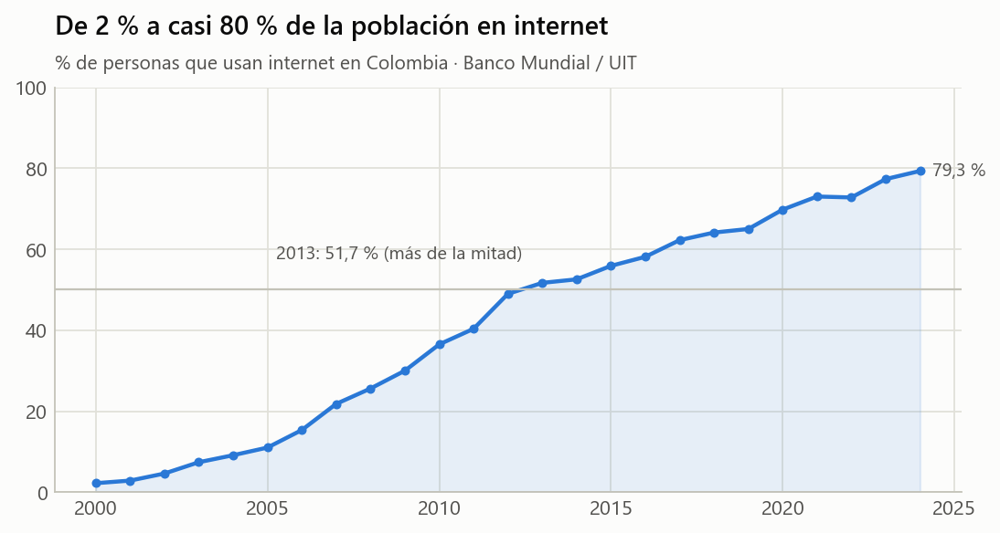
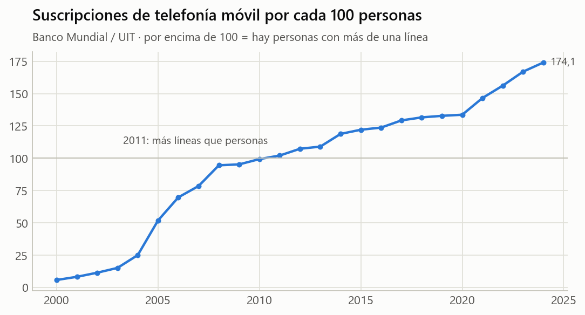

# Banco Mundial / UIT — conectividad en Colombia (2000–2024)

| Ficha rápida | |
|---|---|
| **Qué es** | Dos indicadores oficiales de la Unión Internacional de Telecomunicaciones publicados por el Banco Mundial |
| **Indicadores** | `IT.NET.USER.ZS` (% de personas que usan internet) y suscripciones móviles por cada 100 personas |
| **Unidad** | Colombia, un dato por año |
| **Registros** | 25 años (2000–2024) |
| **Archivo limpio** | `datos/banco_mundial_conectividad_colombia_limpio.csv` |

## 1. ¿Cómo se comportan los datos?

- En 2000 solo el **2,2 %** de las personas usaba internet; en 2024, el
  **79,3 %**.
- **2013** es el primer año en que más de la mitad de la población usa internet
  (51,7 %; un año antes era 49,0 %).
- Mayor salto anual: 2012
  (+8,6 puntos). Entre 2014 y 2024 subió
  26,8 puntos porcentuales.
- Casi nunca baja: solo 1 año con caída
  (2022).

- Desde **2011** hay más suscripciones móviles que personas (hoy 174,1 por cada 100):
  hay gente con más de una línea o SIM, así que este indicador **no** es «% de personas con celular».
- Crecimiento 2000–2024: × 30,2.

## 2. Calidad y limitaciones

- Cifras oficiales, comparables entre países; algunos años son estimaciones de la UIT.
- Se muestran en **dos gráficas separadas** a propósito: tienen escalas distintas y ponerlas
  en un mismo gráfico con dos ejes inventaría una relación visual que los datos no prueban.
- Que ambas series suban juntas no prueba que una cause la otra (correlación ≠ causalidad).

## 3. Relación con la desinformación

Muestra la **velocidad** del cambio: en una sola generación Colombia pasó de casi nadie
conectado a 8 de cada 10 personas. La desinformación digital alcanza hoy a muchas más
personas que hace 15 años, y muchas aprendieron a usar internet sin formación en
verificación.

## 4. Dónde se usa en el reto

En la versión actual del reto no tiene preguntas propias: es contexto para la guía docente y para la
discusión final (la desinformación digital alcanza hoy a 8 de cada 10 personas).
