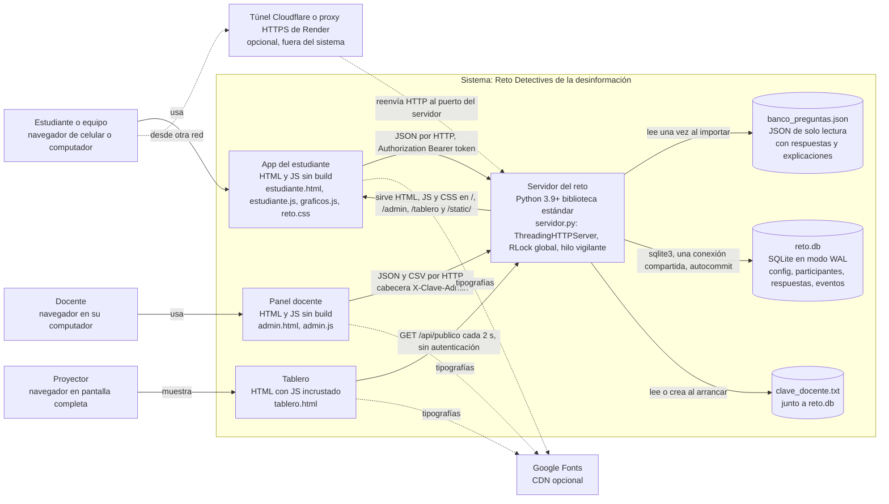
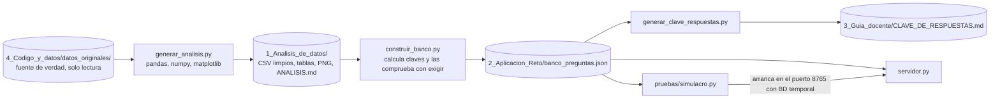
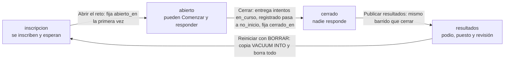
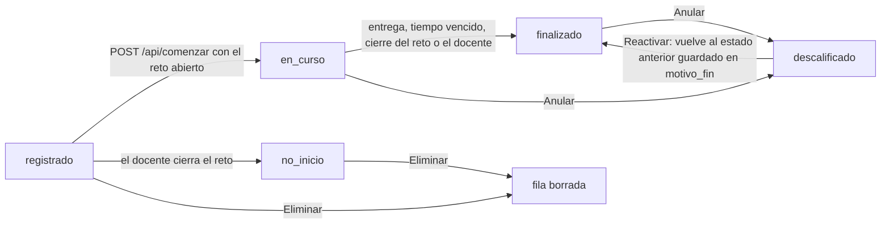
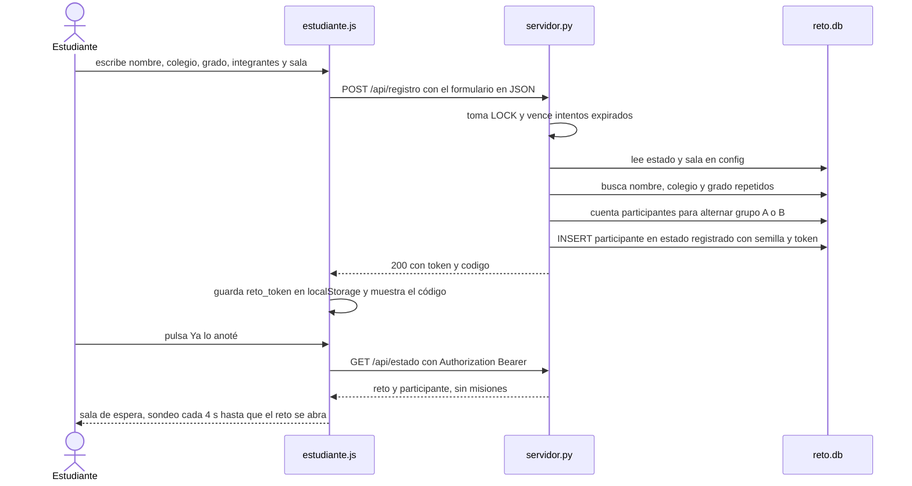
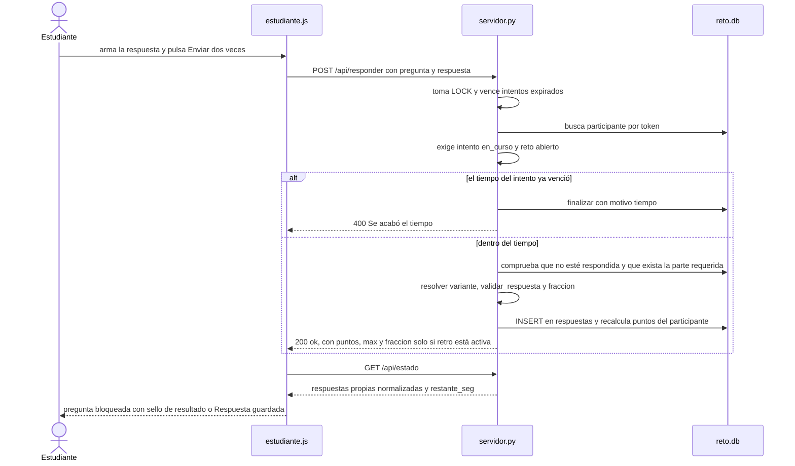
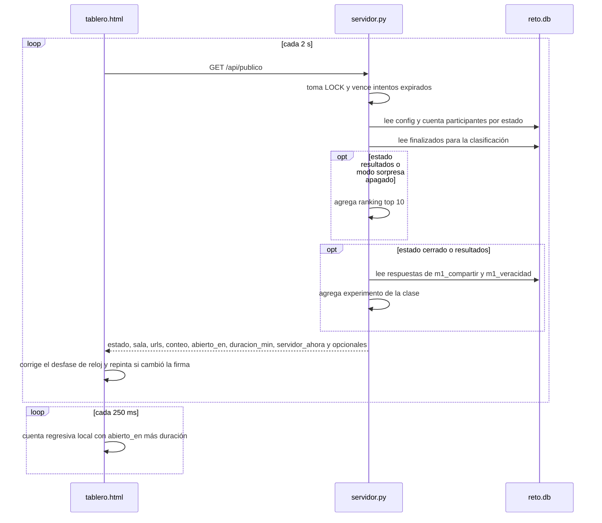
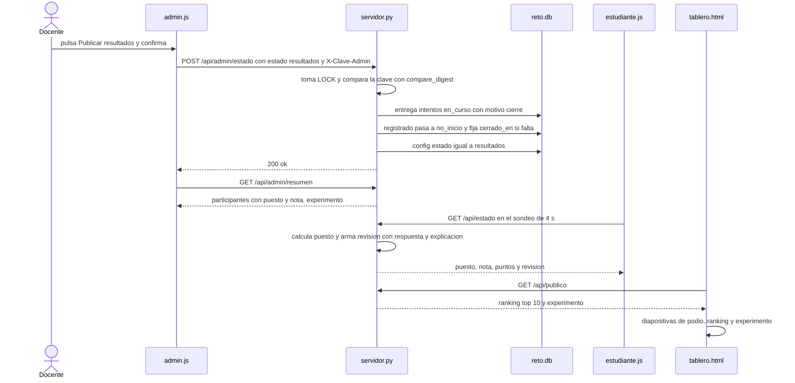

# Arquitectura

Arquitectura actual del reto «Detectives de la desinformación» en el commit
`99462c96268e29bde1738af0b4817d96df9a3989`. Describe lo que hay; no decide cómo publicarlo en la nube.

## Architecture Analysis

### System Overview

Un **monolito de un solo proceso** en Python con solo la biblioteca estándar
(`2_Aplicacion_Reto/servidor.py`) sirve a la vez:

- tres páginas web estáticas sin build (estudiante `/`, panel docente `/admin`, tablero `/tablero`) y
  sus recursos en `/static/`;
- una API JSON propia bajo `/api/` (ver `api-documentation.md`);
- la persistencia en un archivo SQLite (`datos/reto.db`, o `$RETO_DATOS/reto.db`);
- un hilo de fondo («vigilante») que entrega los intentos vencidos cada 3 segundos.

El banco de preguntas (`banco_preguntas.json`) es un artefacto **generado fuera de línea** por un
pipeline de datos en pandas (`4_Codigo_y_datos/scripts/`) y el servidor lo carga una vez, al importar
el módulo (`servidor.py` líneas 45-48).

### Architectural Style

- **Monolito modular por secciones dentro de un solo archivo** (913 líneas). Las secciones están
  marcadas con comentarios `# ====… base de datos`, `examen por participante`, `calificación`,
  `participantes`, `experimento de clase`, `vistas`, `acciones`, `HTTP`, `arranque`.
- **Cliente delgado de sondeo (polling)**: los navegadores no reciben eventos; consultan la API cada
  2 s (tablero), 3 s (panel), 4 s / 20 s (estudiante, según su estado).
- **Servidor autoritativo**: tiempo, calificación, barajado y bloqueo de respuestas ocurren en el
  servidor; el navegador solo dibuja y envía (comentario inicial de `estudiante.js`).
- **Concurrencia por exclusión mutua global**: `ThreadingHTTPServer` crea un hilo por conexión, pero
  todo el trabajo de API corre dentro de `with LOCK:` (un `threading.RLock` de módulo, línea 50), así
  que las peticiones de API se atienden de una en una. Los estáticos se sirven fuera del lock.

### Component Relationships

Diagrama C4 de nivel 2 (contenedores) del sistema en ejecución:

Texto alternativo: tres personas usan tres aplicaciones de navegador. El estudiante usa la app del
estudiante, que habla con el servidor por JSON con un token Bearer; el docente usa el panel, que
envía la clave en la cabecera `X-Clave-Admin` y descarga CSV; el proyector muestra el tablero, que
consulta `/api/publico` cada 2 segundos sin autenticación. El servidor del reto, un solo proceso de
Python, entrega esas páginas, lee una vez el banco de preguntas al arrancar, guarda todo en SQLite
(`reto.db`) mediante una sola conexión compartida y guarda la clave docente en `clave_docente.txt`.
Opcionalmente, un túnel de Cloudflare o el proxy HTTPS de Render se ponen delante del servidor para
que entren estudiantes de otra red. Las páginas descargan tipografías de Google Fonts si hay internet.

Pipeline fuera de línea que produce el banco (no corre durante el reto):

Texto alternativo: los datos originales se limpian con `generar_analisis.py`, que escribe
`1_Analisis_de_datos/`. De ahí `construir_banco.py` calcula cada pregunta y su clave, verifica con
`exigir(...)` que la clave coincide con los datos y que todo suma 1.000 puntos, y escribe
`banco_preguntas.json`. Con ese banco, `generar_clave_respuestas.py` escribe la clave para docentes, el
servidor lo carga al arrancar y el simulacro lo usa para construir respuestas correctas e
incorrectas mientras arranca un servidor real en el puerto 8765. `REGENERAR_TODO.*` ejecuta los cuatro
pasos en orden.

### Data Flow

**Modelo de datos (SQLite, `servidor.py` `conectar`, líneas 58-76):**

| Tabla | Columnas | Uso |
|---|---|---|
| `config` | `clave` PK, `valor` (texto) | Estado del reto, sala, `modo_sorpresa`, `retro`, `duracion_min`, `evento`, `reloj_global`, `abierto_en`, `cerrado_en` |
| `participantes` | `id` autoincremental, `codigo` único, `token` único, `nombre`, `colegio`, `grado`, `integrantes`, `grupo` (A/B), `semilla`, `creado`, `inicio`, `fin`, `estado`, `motivo_fin`, `puntos`, `bono`, `total`, `tiempo_usado`, `tiempo_respuestas`, `salidas` | Un intento por participante; puntos cacheados |
| `respuestas` | PK (`participante_id`, `pregunta_id`), `variante`, `respuesta` (JSON), `fraccion`, `puntos`, `max_puntos`, `momento` | La PK impide responder dos veces |
| `eventos` | `participante_id`, `tipo`, `momento` | Salidas de pestaña |

No hay índices adicionales ni claves foráneas declaradas; tampoco migraciones (solo `CREATE TABLE IF NOT EXISTS`).

**Dónde vive cada pieza de estado:**

| Estado | Dónde vive | Sobrevive a un reinicio |
|---|---|---|
| Estado del reto, sala, opciones, `abierto_en`, `cerrado_en` | SQLite `config` | Sí |
| Reloj de cada intento (`inicio`) y reloj global (`abierto_en`) | SQLite, como hora de época (`time.time()`) | Sí; al volver, el vigilante entrega lo vencido |
| Respuestas, puntos, bono, total | SQLite | Sí |
| Clasificación | Se recalcula en cada petición desde `participantes` (`clasificacion`) | Sí (es derivada) |
| Experimento de clase | Se recalcula en cada petición desde `respuestas` | Sí (derivado) |
| Banco de preguntas (`BANCO`, `PREGUNTAS`) | Memoria del proceso, cargado al importar | Se recarga del archivo |
| Clave docente (`CLAVE_ADMIN`) | Memoria + `clave_docente.txt` junto a la BD | Sí |
| `URLS` mostradas en tablero y panel | Memoria, calculadas en `main()` | Se recalculan |
| Exclusión mutua (`LOCK`) y vigilante | Memoria del proceso | No aplica |
| Token del estudiante | `localStorage` (`reto_token`) del navegador | Sí, en ese navegador |
| Clave docente en el panel | `sessionStorage` (`reto_clave`) de la pestaña | Solo en esa pestaña |

`PUBLICAR_EN_INTERNET.md` dice que el servidor «lleva el reloj y la clasificación en memoria». El
código dice otra cosa: ambos salen de SQLite. Lo que de verdad obliga a **una sola instancia** es que
el `RLock`, el hilo vigilante y la conexión SQLite son del proceso, y que la BD es un archivo en disco
local; dos instancias tendrían dos BD distintas o dos escritores sin coordinación.

**Flujo de estados del reto** (`ESTADOS`, `cambiar_estado`, `reiniciar`):

Texto alternativo: el reto pasa de «inscripcion» a «abierto» cuando el docente lo abre (se fija
`abierto_en`), de «abierto» a «cerrado» cuando lo cierra (se entregan los intentos en curso y los que
no empezaron pasan a «no_inicio») y de «cerrado» a «resultados» al publicar. «Reiniciar» guarda una
copia de la BD y vuelve a «inscripcion». El panel solo ofrece esos botones en ese orden, pero el
servidor **acepta cualquier transición** entre los cuatro estados: no valida el estado de origen.

**Flujo de estados del participante:**

Texto alternativo: un participante empieza «registrado», pasa a «en_curso» al pulsar «Comenzar» con
el reto abierto y termina «finalizado» al entregar, al vencerse su tiempo, al cerrar el docente el
reto o cuando el docente fuerza la entrega. Si no empezó cuando se cierra, queda «no_inicio». El
docente puede anular (estado «descalificado») y reactivar, que devuelve el estado anterior leído del
texto de `motivo_fin`; también puede eliminar inscripciones que no empezaron.

**Reloj** (`comenzar`, `finalizar`, `vencer_tiempos`): con `reloj_global` (por defecto), `inicio =
abierto_en` para todos; sin él, `inicio` es la hora de «Comenzar». El fin es `inicio + duracion_min ×
60`. Se comprueba en cada petición de API (`vencer_tiempos` al entrar al lock) y cada 3 s en el
vigilante. El navegador solo muestra una cuenta regresiva local: el estudiante con `restante_seg`, el
tablero corrigiendo el desfase con `servidor_ahora`.

**Calificación**: `responder` resuelve la variante del participante (`resolver`), valida la forma
(`validar_respuesta`), calcula la fracción (`fraccion`) y guarda `fraccion × puntos`. Al cerrar el
intento, `finalizar` calcula `bono = 20 × (puntos / 1.000) × (1 − t_última_respuesta / duración)`.

### Key Design Decisions

| Decisión | Evidencia | Implicación |
|---|---|---|
| Solo biblioteca estándar, sin build | `servidor.py` imports; `LEEME.md` | Corre con un Python recién instalado y sin internet; limita a hostings que ejecuten un proceso Python largo |
| SQLite en un archivo con WAL y una sola conexión compartida (`check_same_thread=False`, autocommit) | `conectar` | Persistencia simple y duradera; exige disco persistente y un único escritor |
| `RLock` global alrededor de toda la API | `do_GET`/`do_POST` | Sin carreras entre peticiones; el rendimiento queda limitado al trabajo serializado (probado con 60 estudiantes según `LEEME.md`) |
| Barajado y variantes deterministas por `semilla` del participante (SHA-256) | `rng_para`, `variante_de` | El mismo participante ve siempre el mismo orden, incluso tras reiniciar el servidor |
| El banco con respuestas nunca se sirve como archivo; el navegador recibe una versión filtrada | `version_publica` (lista blanca de claves), `examen_publico` | Base de la regla antitrampa; ver hallazgos en `code-quality-assessment.md` |
| Evidencia de los Casos 1 y 5 bloqueada hasta registrar la hipótesis | `examen_publico`, `dossier.revelar_tras` | El servidor manda solo título y número de piezas hasta entonces |
| Sondeo en vez de WebSockets o SSE | `setInterval` en `estudiante.js`, `admin.js`, `tablero.html` | Compatible con `http.server`; carga proporcional a clientes × frecuencia |
| Configuración por línea de comandos y variables de entorno (`PORT`, `RETO_CLAVE`, `RETO_DATOS`, `RETO_URL_PUBLICA`, `RENDER_EXTERNAL_URL`, `RETO_HOSTING`/`RENDER`) | `main()`, `Dockerfile` | El mismo código sirve en red local, túnel y Render |
| IPv6 + IPv4 en el mismo socket | `ServidorDual` | «localhost» responde sin demora en Windows |

### Improvement Opportunities

Solo se señalan; la decisión y su análisis de alternativas corresponden a etapas posteriores.

1. **Separar un núcleo puro** (calificación `a_numero`/`validar_respuesta`/`fraccion`, bono, orden de
   clasificación, experimento, versión pública del examen, transiciones de estado) de la E/S (SQLite,
   HTTP, reloj del sistema, variables de entorno). Hoy cada función de dominio lee el global `DB` o
   llama a `time.time()` y `cfg(...)`.
2. **Tabla de rutas** (`dict` de (método, ruta) a función) en lugar de las cadenas de `if` de
   `do_GET`/`do_POST`, con la autorización (`público`, `token`, `docente`) como dato de la ruta.
3. **Hacer explícito el reloj**: pasar `ahora` como parámetro a la lógica pura facilita probar el
   vencimiento sin `UPDATE … inicio - 6000` como hace hoy `simulacro.py`.
4. **Validar transiciones de estado** del reto como una tabla de transiciones permitidas.
5. **Para cualquier hosting en la nube**, los puntos de acoplamiento a resolver son: el `RLock` y el
   vigilante de proceso (requieren un único coordinador o un equivalente distribuido), el archivo
   SQLite (requiere disco persistente o una base gestionada con transacciones), el arranque que lee
   archivos locales (`banco_preguntas.json`, `clave_docente.txt`) y `http.server` (solo sirve donde
   corre un proceso Python largo). Las alternativas que el usuario pidió evaluar (Cloudflare
   Pages + Workers + D1 + Durable Object; Cloudflare Containers; Google Apps Script + Sheets; Render
   con disco; túnel de Cloudflare) cambian cuáles de esos puntos hay que reescribir.

## Interaction Diagrams

### Inscribirse

Texto alternativo: el estudiante llena el formulario; `estudiante.js` envía `POST /api/registro`. El
servidor, dentro del lock, vence intentos expirados, comprueba que las inscripciones estén abiertas y
que la sala coincida, rechaza duplicados de nombre, colegio y grado, asigna el grupo A o B alternando
por el número de inscritos e inserta al participante con una semilla y un token aleatorios. Devuelve
`token` y `codigo`; el navegador guarda el token en `localStorage`, muestra el código y luego pide
`/api/estado`, que todavía no trae misiones: el estudiante queda en la sala de espera.

### Responder una pregunta

Texto alternativo: el estudiante confirma el envío; el servidor busca al participante por el token,
exige que el intento esté en curso y el reto abierto, y si el tiempo ya venció entrega el intento y
responde 400. Si no, comprueba que la pregunta no esté respondida y que la parte previa exigida
exista, resuelve la variante del participante, valida la forma de la respuesta, calcula la fracción
de acierto, guarda la fila y recalcula los puntos. Devuelve `ok` y, solo con retroalimentación
activa, puntos y fracción. El navegador recarga `/api/estado` y muestra la pregunta bloqueada.

### Refrescar el tablero

Texto alternativo: cada 2 segundos el tablero pide `/api/publico`. El servidor vence intentos
expirados, lee la configuración y los conteos, calcula la clasificación y, si hay resultados o el
modo sorpresa está apagado, agrega el top 10; si el reto está cerrado o con resultados, agrega el
experimento de la clase. El tablero calcula el desfase entre su reloj y `servidor_ahora`, repinta la
escena si cambió algo y cada 250 ms actualiza la cuenta regresiva local.

### Publicar resultados

Texto alternativo: el docente confirma «Publicar resultados»; el panel envía el nuevo estado con la
clave en la cabecera. El servidor valida la clave, entrega los intentos en curso, marca como
«no_inicio» a quienes no empezaron, fija la hora de cierre y guarda el estado «resultados». A partir
de ahí, `/api/estado` devuelve a cada estudiante finalizado su puesto, su nota y la `revision` con la
respuesta correcta y la explicación de cada pregunta que vio, y `/api/publico` devuelve el top 10 y
el experimento para las diapositivas del tablero.
