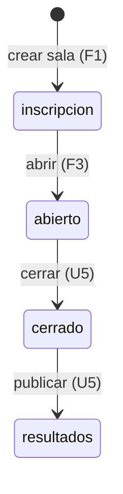
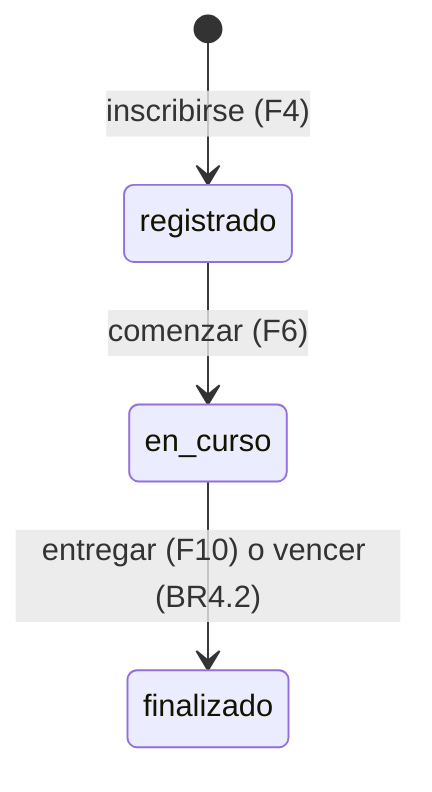
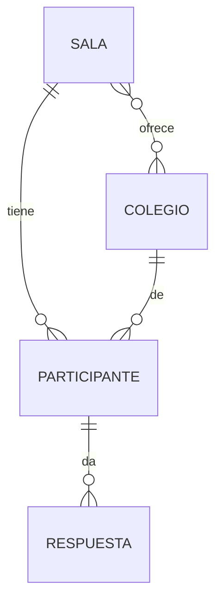

# Especificación funcional — U1 `u1-cloudflare-corte`

> **Revisión 2026-10-25 (una sola sala, solo Cloudflare).** Este corte ya está construido y se conserva
> como registro de lo que se hizo (FR11, ADR-009 a ADR-011). U5 (`../../u5-cloudflare-salas/`) reemplaza
> las partes de varias salas:
>
> - **La clave del semillero** (`CLAVE_SEMILLERO`, rol «semillero») pasa a una sola clave docente,
>   `CLAVE_DOCENTE`, que abre todo `/api/admin/*` (ADR-010).
> - **Las claves de sala** (`CÓDIGO-SECRETO`, rol «sala») desaparecen.
> - **Crear sala** (F1 y `POST /api/admin/salas/crear`) desaparece: hay un solo reto, y su código se fija
>   en el panel. La ruta da 404 desde U5.
> - **Los colegios provisionales** (F2) pasan a la lista de colegios del docente, con «Arrancar reloj»
>   (ADR-009, ADR-011).
> - **El parámetro `?sala=`** de `/api/publico`, `/api/colegios` y el tablero desaparece. `/api/publico`
>   sin parámetros devuelve el tablero.
>
> La migración 2 de U5 aparta las tablas de este corte como `v1_*` (ADR-W19 de U5). Lo demás de este
> documento (inscribirse, comenzar, responder una pregunta, fugas cerradas, pantallas de hoy) sigue
> valiendo como base de U5.

Qué hace el corte delgado de Cloudflare Workers, paso a paso. Es la fuente de los flujos y de los
estados; los datos están en `entities.md` y las reglas en `rules.md`. Sale de `unit-of-work.md` («U1, U7,
U11»), `requirements.md`, `components.md`, `contract-summary.md` y de las respuestas Q1 a Q5 (todas A).
Este alcance no tiene historias de usuario (`stories.md`).

## Qué demuestra el corte

Con la clave del semillero se crea y se abre una sala; un estudiante se inscribe con el código de la
sala, comienza y responde una pregunta. Todo detrás de un enlace fijo, con las pantallas de hoy y sin que
salga ninguna respuesta correcta al navegador.

## Flujos

### F1. Crear una sala (semillero)

1. El semillero manda `POST /api/admin/salas/crear` con su clave en `X-Clave-Admin` (BR1.2).
2. Si la clave no es la del semillero, 403 (BR2.1).
3. El servidor genera un código único y una clave `<código>-<secreto>`, guarda solo la huella y crea la
   sala en «inscripción» con la duración del banco (BR2.1).
4. Responde `{sala, clave}`. La clave no se vuelve a mostrar.

### F2. Agregar colegios provisionales (docente)

1. El docente manda `POST /api/admin/colegios?sala=<código>` con `accion: provisional` y `nombre`.
2. El nombre se normaliza; si ya existe en el servicio, 400 con la clave `existente` (BR2.3).
3. Si no, se crea el colegio provisional y la sala lo ofrece. Responde `{ok, id_colegio}`.

### F3. Abrir la sala (docente o semillero)

1. `POST /api/admin/estado` con `estado: abierto` (BR1.3).
2. Solo vale desde «inscripción» (BR2.2). Se guarda la hora de apertura del servidor.

### F4. Inscribirse (estudiante)

1. La pantalla pide `/api/colegios?sala=<código>` y muestra la lista para elegir.
2. El estudiante manda `POST /api/registro` con `nombre`, `colegio` (el `id_colegio`), `grado`,
   `integrantes` y `sala`.
3. Se revisan BR3.1 y BR3.2; sin cruzarse con otra inscripción de la misma sala se asigna el grupo A/B
   (BR3.3) y se generan código, token y semilla (BR3.4).
4. Responde `{token, codigo}`, como hoy.

### F5. Volver a entrar (estudiante)

`POST /api/entrar` con `codigo` responde `{token, codigo}` o 404 tras una espera corta (BR3.4).

### F6. Comenzar (estudiante)

`POST /api/comenzar` con el token aplica BR4.1 y responde `{ok: true}`.

### F7. Ver el estado (estudiante)

1. `GET /api/estado` con el token; primero se aplica la hora de entrega (BR4.2).
2. Responde las claves de hoy (`api-documentation.md`). Las misiones salen con ids opacos y sin
   respuesta, explicación ni tolerancia (BR6.1, BR6.2). `respuestas[].respuesta` sale también con ids
   opacos (BR6.1).

### F8. Responder (estudiante)

1. `POST /api/responder` con `pregunta` y `respuesta` (ids opacos).
2. Se aplica la hora de entrega (BR4.2); sin cruzarse con otra operación de la misma sala se revisa BR5.1.
3. Se traduce el id opaco al del banco y se califica (BR5.2, solo `opcion` en el corte).
4. Se guarda la Respuesta con los ids del banco y se suman los puntos del participante.
5. Responde `{ok}` y, con `retro`, `puntos`, `max` y `fraccion`, como hoy.

### F9. Chequeo de salud y tablero básico

`GET /api/publico` sin `?sala=` responde `{"ok": true}` (BR7.1). Con `?sala=` responde lo básico del
tablero de esa sala con las claves de hoy; el ranking y el experimento llegan con U6.

### F10. Entregar (estudiante)

`POST /api/finalizar` con el token aplica BR4.2 y BR4.3 con motivo `entrega` y responde `{ok: true}`.

### F11. Salida de pantalla (estudiante)

`POST /api/evento` con `tipo: salida` aplica BR4.4 y responde `{ok: true}`.

## Rutas del corte

La tabla de rutas que exige BR1.1. Todo lo que no está aquí da 404.

| Método | Ruta | Nivel | Flujo |
|---|---|---|---|
| GET | `/`, `/admin`, `/tablero`, `/static/<archivo>` | público | páginas copiadas de `web/` |
| GET | `/api/publico` | público | F9 |
| GET | `/api/colegios?sala=` | público | F4 |
| POST | `/api/registro` | público | F4 |
| POST | `/api/entrar` | público | F5 |
| GET | `/api/estado` | token | F7 |
| POST | `/api/comenzar` | token | F6 |
| POST | `/api/responder` | token | F8 |
| POST | `/api/finalizar` | token | F10 |
| POST | `/api/evento` | token | F11 |
| POST | `/api/admin/login` | clave de sala o del semillero | responde `{ok, rol, sala}` (contrato C1) |
| POST | `/api/admin/salas/crear` | clave del semillero | F1 |
| POST | `/api/admin/colegios` | clave de sala o del semillero | F2 |
| POST | `/api/admin/estado` | clave de sala o del semillero | F3 |

## Forma de las «calculadoras» del corte (contrato C4, hallazgo C-05)

Las reglas puras que el corte ya necesita, con la forma de C4. Reciben datos y la hora; no leen base ni
reloj. Sus casos van en `despliegues/prueba_comun/casos_reglas.json`, una lista de objetos
`{regla, funcion, entrada, salida_esperada}`, donde `entrada` es un objeto con los nombres de C4 y
`salida_esperada` se calcula con la versión local, nunca a mano.

| Regla de C4 | Función | Entrada | Salida | BR |
|---|---|---|---|---|
| Banco | `validar_banco` | banco | lista de errores | BR6.3 |
| Banco | `examen_publico` | banco, semilla, grupo, respondidas | misiones con ids opacos | BR6.1, BR6.2 |
| Banco | `opaco_de` / `traducir_opaco` | semilla, pregunta_id, id | id opaco / id del banco | BR6.1 |
| Calificacion | `validar_respuesta`, `fraccion` | pregunta resuelta, respuesta | respuesta normalizada, número 0 a 1 | BR5.2 |
| Calificacion | `bono` | puntos, tiempo_respuestas, duración | número | BR4.3 |
| CicloDeSala | `transicion_permitida` | estado actual, estado nuevo | sí o no | BR2.2 |
| CicloDeSala | `hora_de_entrega` | ahora, inicio, duración, cierre | hora y motivo, o nada | BR4.2, BR4.3 |

## Estados

Texto alternativo: la sala nace en «inscripción» y en el corte solo pasa a «abierto». Cerrar y publicar
llegan con U5.

Texto alternativo: el participante nace «registrado», pasa a «en curso» al comenzar y a «finalizado»
cuando entrega o vence su tiempo. Descalificar, reactivar y `no_inicio` llegan con U4 y U5.

## Modelo de datos (vista derivada de `entities.md`)

Texto alternativo: una sala tiene muchos participantes y ofrece varios colegios; cada participante es de
un colegio y da muchas respuestas, una por pregunta.

## Reglas (vista derivada de `rules.md`)

| Paso | Reglas |
|---|---|
| Toda ruta | BR1.1, BR1.2, BR1.3 |
| F1 crear sala | BR2.1 |
| F2 colegios | BR2.3 |
| F3 abrir | BR2.2 |
| F4 inscribirse | BR3.1, BR3.2, BR3.3, BR3.4 |
| F6 comenzar | BR4.1 |
| F7 estado | BR4.2, BR6.1, BR6.2 |
| F8 responder | BR4.2, BR5.1, BR5.2, BR6.1 |
| F9 salud y tablero | BR7.1 |
| F10 entregar | BR4.2, BR4.3 |
| F11 salida | BR4.4 |
| Códigos | BR1.4 |
| Arranque | BR6.3 |

## Pantallas

Las de `2_Aplicacion_Reto/web/` se copian sin cambios en un commit aparte (Delivery Planning, Q7-A).
En el corte cambian dos cosas, listadas en el contrato (`contract-summary.md`, «Cambios que exige el
navegador»):
- en `web/js/estudiante.js`, el campo «Colegio» pasa a ser una lista que se llena con
  `/api/colegios?sala=`;
- `web/tablero.html` lee `sala` de su URL y la pasa a `/api/publico`; sin `?sala=` muestra «Abre el
  tablero con el enlace de tu sala.».

Lo demás de `admin.js` cambia en U5 y U6. En el corte, el panel entra y cambia el estado; las secciones
que piden rutas que aún no existen muestran el error de la API.

## Prueba común mínima (Q5-A)

Vive en `despliegues/prueba_comun/src/`, en Python sin paquetes (Delivery Planning, Q6-A), y recibe la URL y
la clave por argumento o variable de entorno. Contra Workers revisa, en orden:

1. `GET /api/publico` responde `{"ok": true}`;
2. con la clave del semillero se crea una sala; con una clave mala, 403;
3. se agrega un colegio provisional con un nombre único por corrida (por ejemplo «Colegio de prueba
   <fecha y hora>»), para que una segunda corrida no choque con BR2.3, y se abre la sala;
4. se inscribe un participante y entra con su código;
5. comienza; `/api/estado` no trae respuesta, explicación, tolerancia ni veredicto;
6. responde una pregunta `opcion`; responderla otra vez da 400 «ya respondida»;
7. `/api/estado` muestra la respuesta guardada, con su id opaco;
8. entrega con `/api/finalizar` y `/api/estado` muestra `finalizado`.

Contra la versión local corre lo mismo con la clave docente y sin crear sala: el paso 1 solo exige 200,
el código de sala sale de `/api/publico`, el colegio va como texto y se salta el paso 3 de colegios. Termina en
«TODO BIEN» o con la lista de lo que falló.

## Fuera del corte

El catálogo único, cerrar y publicar, los otros 9 tipos de pregunta, la clasificación, el
tablero completo, los CSV, las copias y el paquete llegan con U4, U5 y U6 (`unit-of-work.md`).

La copia de «Reiniciar» y el paquete sin columnas secretas (C-06) los define U6 (`bolt-plan.md`, B11).
