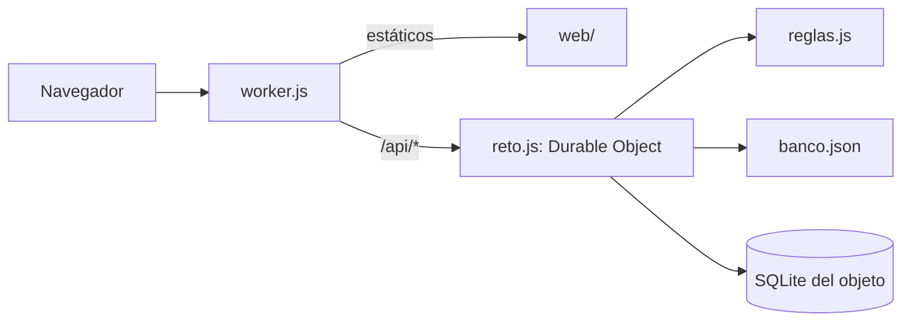

# Componentes lógicos — U1

Diseño no funcional de U1. Las decisiones están en `../decisions.md` (ADR-W1 a ADR-W5); los requisitos en `../nfr-requirements/`.

Texto alternativo: el navegador habla con `worker.js`, que sirve `web/` y pasa la API al Durable Object
de `reto.js`; el objeto usa las reglas puras, el banco y su SQLite.

| Archivo | Componentes de `components.md` |
|---|---|
| `src/worker.js` | Arranque, ApiHttp (entrada) |
| `src/reto.js` | ApiHttp (tabla de rutas), Acceso, Salas, Inscripcion, Examen, Persistencia |
| `src/reglas.js` | Banco, Calificacion, CicloDeSala (calculadoras de C4) |
| `web/` | AppEstudiante, PanelDocente, Tablero, Graficos |
