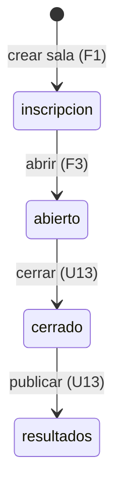
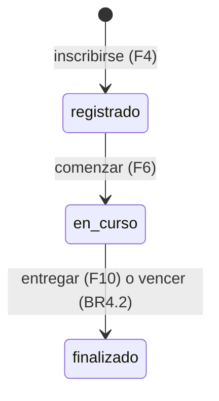
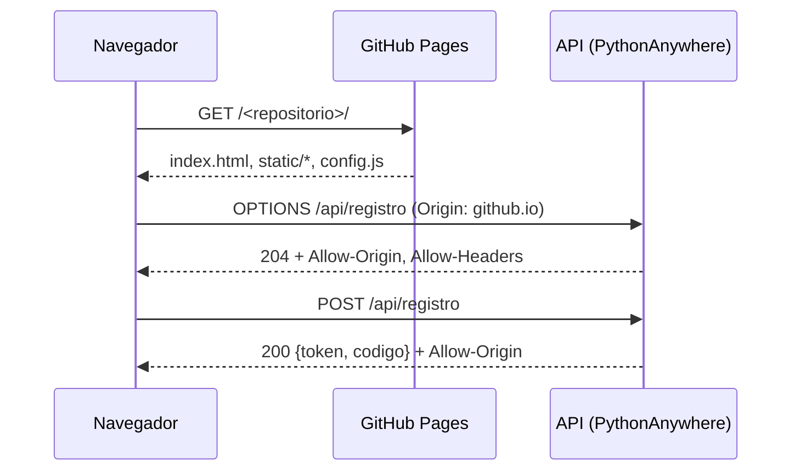

# Especificación funcional — U11 `u11-github-pages-corte`

Qué hace el corte delgado de la opción GitHub Pages, paso a paso: las pantallas se sirven desde GitHub
Pages y la API corre en PythonAnywhere (`../decisions.md`, ADR-G1 y ADR-G2). Los datos están en
`entities.md` y las reglas en `rules.md`. Sale de `unit-of-work.md` («U1, U7, U11»), `requirements.md`,
`components.md`, `contract-summary.md` (hallazgo C-04) y del diseño de U1, que fija la conducta común.
Este alcance no tiene historias de usuario.

## Qué demuestra el corte

Con la clave del semillero se crea y se abre una sala; un estudiante abre
`https://<cuenta>.github.io/<repositorio>/`, se inscribe con el código de la sala, comienza y responde
una pregunta. Las pantallas y la API están en dominios distintos y aun así el estudiante no ve nada
distinto de hoy. Ninguna respuesta correcta sale al navegador y el banco nunca llega a Pages.

## Flujos

Los flujos F1 a F11 son los de U1 (`../../u1-cloudflare-corte/functional-design/functional-spec.md`),
porque la conducta no cambia entre opciones (FR12.2). Se repiten resumidos y se agrega F0, propio de
esta opción.

### F0. Cargar una pantalla y hablar con la API (propio de esta opción)

1. El navegador pide `https://<cuenta>.github.io/<repositorio>/` (o `/admin/`, `/tablero/?sala=`). Pages
   sirve `index.html` y sus archivos con rutas relativas (BR8.3).
2. `static/js/config.js` fija `window.RETO_API`.
3. Antes de la primera petición con `Authorization` o `X-Clave-Admin`, el navegador manda
   `OPTIONS` a la API; la API responde 204 con las cabeceras de BR8.2 y el navegador la recuerda 600 s.
4. Cada `fetch` va a `window.RETO_API + ruta`; la respuesta lleva `Access-Control-Allow-Origin` con el
   origen exacto de Pages (BR8.1). Un origen distinto no recibe esas cabeceras.

### F1. Crear una sala (semillero)

`POST /api/admin/salas/crear` con la clave del semillero en `X-Clave-Admin` (BR1.2, BR2.1). Responde
`{sala, clave}`; la clave no se vuelve a mostrar.

### F2. Agregar colegios provisionales (docente)

`POST /api/admin/colegios?sala=<código>` con `accion: provisional` y `nombre` (BR2.3). Responde
`{ok, id_colegio}` o 400 con `existente`.

### F3. Abrir la sala (docente o semillero)

`POST /api/admin/estado` con `estado: abierto` (BR1.3, BR2.2). Se guarda la hora de apertura del
servidor.

### F4. Inscribirse (estudiante)

La pantalla pide `/api/colegios?sala=<código>` y muestra la lista. `POST /api/registro` con `nombre`,
`colegio` (el `id_colegio`), `grado`, `integrantes` y `sala` aplica BR3.1 a BR3.4 dentro del candado del
proceso (ADR-G5) y responde `{token, codigo}`.

### F5. Volver a entrar (estudiante)

`POST /api/entrar` con `codigo` responde `{token, codigo}` o 404 tras la espera corta fuera del candado
(BR3.4).

### F6. Comenzar (estudiante)

`POST /api/comenzar` con el token aplica BR4.1 y responde `{ok: true}`.

### F7. Ver el estado (estudiante)

`GET /api/estado` con el token aplica la hora de entrega (BR4.2) y responde las claves de hoy con ids
opacos y sin respuesta, explicación ni tolerancia (BR6.1, BR6.2).

### F8. Responder (estudiante)

`POST /api/responder` con `pregunta` y `respuesta` (ids opacos) aplica BR4.2, BR5.1, BR5.2 y BR6.1 dentro
de `BEGIN IMMEDIATE`, guarda la Respuesta con los ids del banco y responde `{ok}` y, con `retro`,
`puntos`, `max` y `fraccion`.

### F9. Chequeo de salud y tablero básico

`GET /api/publico` sin `?sala=` responde `{"ok": true}` (BR7.1). Con `?sala=` responde lo básico del
tablero de esa sala; ranking y experimento llegan con U14.

### F10. Entregar (estudiante)

`POST /api/finalizar` con el token aplica BR4.2 y BR4.3 y responde `{ok: true}`.

### F11. Salida de pantalla (estudiante)

`POST /api/evento` con `tipo: salida` aplica BR4.4 y responde `{ok: true}`.

## Rutas del corte

La tabla de rutas que exige BR1.1, en `src/wsgi.py`. Todo lo que no está aquí da 404. Las pantallas no
pasan por la API: las sirve Pages.

| Método | Ruta | Nivel | Flujo | Dónde |
|---|---|---|---|---|
| GET | `/`, `/admin/`, `/tablero/`, `/static/<archivo>` | público | F0 | GitHub Pages |
| OPTIONS | `/api/*` | público (sin clave ni token) | F0 | API (BR8.2) |
| GET | `/api/publico` | público | F9 | API |
| GET | `/api/colegios?sala=` | público | F4 | API |
| POST | `/api/registro` | público | F4 | API |
| POST | `/api/entrar` | público | F5 | API |
| GET | `/api/estado` | token | F7 | API |
| POST | `/api/comenzar` | token | F6 | API |
| POST | `/api/responder` | token | F8 | API |
| POST | `/api/finalizar` | token | F10 | API |
| POST | `/api/evento` | token | F11 | API |
| POST | `/api/admin/login` | clave de sala o del semillero | responde `{ok, rol, sala}` (contrato C1) | API |
| POST | `/api/admin/salas/crear` | clave del semillero | F1 | API |
| POST | `/api/admin/colegios` | clave de sala o del semillero | F2 | API |
| POST | `/api/admin/estado` | clave de sala o del semillero | F3 | API |

## Forma de las «calculadoras» del corte (contrato C4)

Las mismas de U1, en `src/reglas.py`, con los nombres de C4; sus casos vienen de
`despliegues/prueba_comun/casos_reglas.json` cuando U4 o U12 lo creen (hasta entonces, casos propios en
`pruebas/test_reglas.py` calculados con la versión local, nunca a mano).

| Regla de C4 | Función | Entrada | Salida | BR |
|---|---|---|---|---|
| Banco | `validar_banco` | banco | lista de errores | BR6.3 |
| Banco | `examen_publico` | banco, semilla, grupo, respondidas | misiones con ids opacos | BR6.1, BR6.2 |
| Banco | `opaco_de` / `traducir_opaco` | semilla, pregunta_id, id | id opaco / id del banco | BR6.1 |
| Calificacion | `validar_respuesta`, `fraccion` | pregunta resuelta, respuesta | respuesta normalizada, número 0 a 1 | BR5.2 |
| Calificacion | `bono` | puntos, tiempo_respuestas, duración | número | BR4.3 |
| CicloDeSala | `transicion_permitida` | estado actual, estado nuevo | sí o no | BR2.2 |
| CicloDeSala | `hora_de_entrega` | ahora, inicio, duración, cierre | hora y motivo, o nada | BR4.2, BR4.3 |

## Estados

Texto alternativo: la sala nace en «inscripción» y en el corte solo pasa a «abierto». Cerrar y publicar
llegan con U13.

Texto alternativo: el participante nace «registrado», pasa a «en curso» al comenzar y a «finalizado»
cuando entrega o vence su tiempo. Descalificar, reactivar y `no_inicio` llegan con U12 y U13.

## Dos dominios (vista propia de esta opción)

Texto alternativo: el navegador baja las pantallas de Pages, pregunta a la API con `OPTIONS` si puede
llamarla desde ese origen y luego hace la petición real; cada respuesta repite el origen permitido.

## Reglas (vista derivada de `rules.md`)

| Paso | Reglas |
|---|---|
| F0 cargar y llamar | BR8.1, BR8.2, BR8.3 |
| Toda ruta de la API | BR1.1, BR1.2, BR1.3 |
| F1 crear sala | BR2.1 |
| F2 colegios | BR2.3 |
| F3 abrir | BR2.2 |
| F4 inscribirse | BR3.1, BR3.2, BR3.3, BR3.4 |
| F6 comenzar | BR4.1 |
| F7 estado | BR4.2, BR6.1, BR6.2 |
| F8 responder | BR4.2, BR5.1, BR5.2, BR6.1 |
| F9 salud y tablero | BR7.1 |
| F10 entregar | BR4.2, BR4.3 |
| F11 salida | BR4.4 |
| Códigos | BR1.4 |
| Arranque y publicación | BR6.3 |

## Pantallas

Las de `2_Aplicacion_Reto/web/` se copian con `herramientas/copiar.sh` (la copia sin cambios va en su
propio commit, Delivery Planning Q7-A) y reciben el parche `herramientas/cambios_web.patch` propio de
esta opción, con:

- los dos cambios de U1: el campo «Colegio» como lista llenada con `/api/colegios?sala=` y el
  `tablero` que lee `sala` de su URL (sin `?sala=` muestra «Abre el tablero con el enlace de tu sala.»);
- los de esta opción (ADR-G2 y ADR-G4): `index.html`, `admin/index.html` y `tablero/index.html` con
  rutas relativas y el `<script>` de `static/js/config.js`; `estudiante.js`, `admin.js` y el script del
  tablero con `window.RETO_API + ruta`; `.nojekyll`.

Lo demás de `admin.js` cambia en U13 y U14.

## Prueba común mínima

La misma de U1 (`despliegues/prueba_comun/src/prueba.py`, 9 pasos), con un agregado de esta unidad:
`--url-web` (o `PRUEBA_URL_WEB`), por defecto igual a `--url`, para pedir las pantallas del paso 9 en el
origen de Pages y la API en el de PythonAnywhere. Además, en esta opción el paso 9 revisa el banco con
404 en los dos orígenes. En local se corre con la API en `http://localhost:8791` y las pantallas en
`http://localhost:8792` (`src/servidor_local.py`), así CORS se prueba de verdad.

## Fuera del corte

El catálogo único, cerrar y publicar, los otros 9 tipos de pregunta, la clasificación, el tablero
completo, los CSV, las copias y el paquete llegan con U12, U13 y U14 (`unit-of-work.md`). La decisión de
si esta opción se construye está en `../decisions.md`, «Recomendación para U17».
