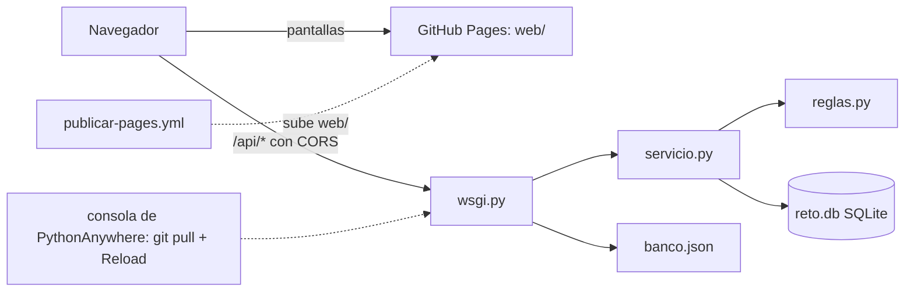

# Componentes lógicos — U11

Diseño no funcional de U11. Las decisiones están en `../decisions.md` (ADR-G1 a ADR-G7); los requisitos en `../nfr-requirements/`.

Texto alternativo: el navegador baja las pantallas de GitHub Pages y llama a la API de PythonAnywhere
con CORS; `wsgi.py` recibe, valida el banco y despacha a `servicio.py`, que usa las reglas puras y el
SQLite en disco. Las pantallas las publica un flujo manual de Actions; la API se actualiza con `git pull`
y «Reload».

| Archivo | Componentes de `components.md` |
|---|---|
| `src/wsgi.py` | Arranque (configuración, secretos, banco, apertura del SQLite) y ApiHttp (CORS, JSON, tabla de rutas, errores) |
| `src/servicio.py` | Acceso, Salas, CatalogoColegios (provisionales), Inscripcion, Examen y Persistencia (SQL dentro de cada servicio, ADR-G3) |
| `src/reglas.py` | Banco, Calificacion, CicloDeSala (calculadoras de C4) |
| `src/servidor_local.py` | Solo para probar: `wsgiref` para la API y `http.server` para `web/` |
| `web/` | AppEstudiante, PanelDocente, Tablero, Graficos, más `static/js/config.js` (URL base) |
| `herramientas/` | `copiar.sh`, `cambios_web.patch`, `config.js`, `verificar.sh`, `wsgi_pythonanywhere.ejemplo.py` |
| `.github/workflows/publicar-pages.yml` | Publicación manual de `web/` (ADR-G2) |
