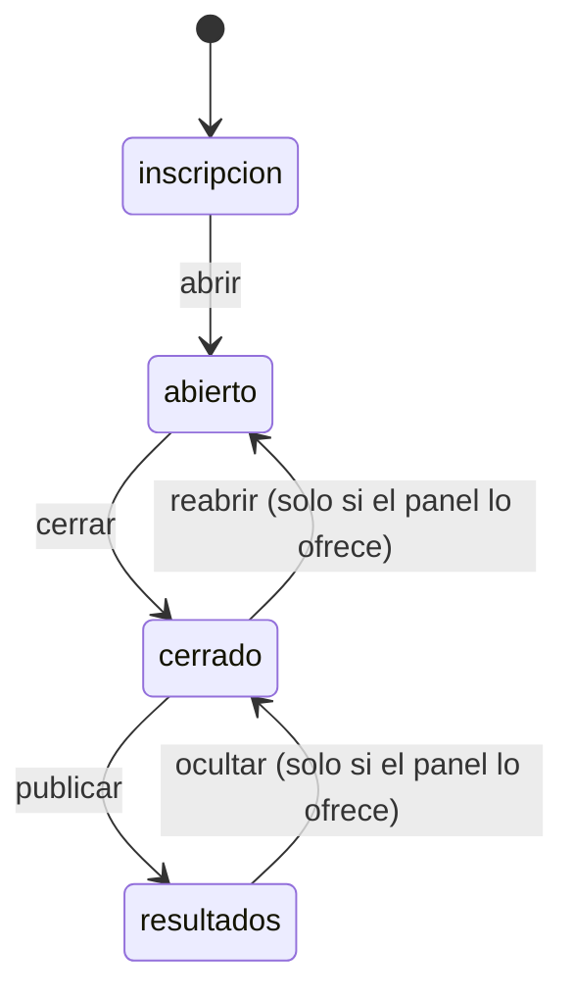
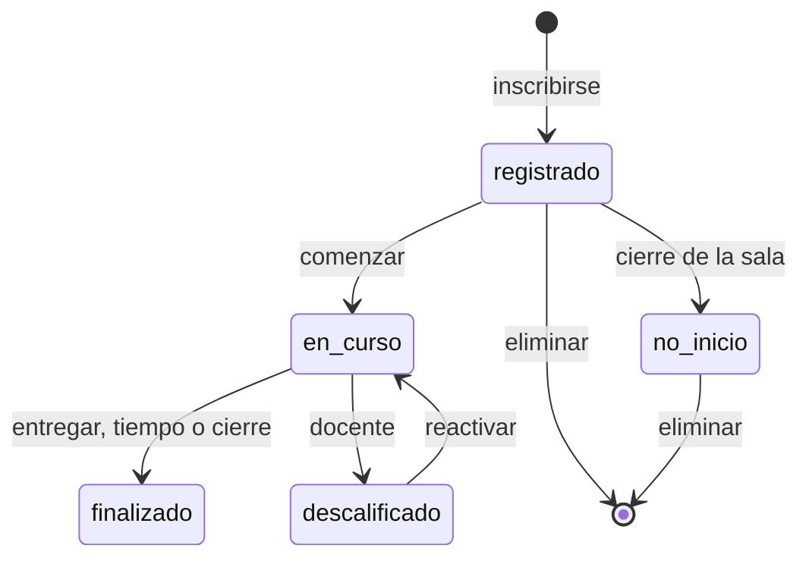

# Especificación funcional — U12 `u12-github-pages-reglas`

Qué hace la unidad de reglas de la opción GitHub Pages. Es una biblioteca dentro de la API de
PythonAnywhere (`despliegues/github-pages/src/reglas.py`) y sus pruebas (`pruebas/test_reglas.py`,
`pruebas/casos_reglas.json`). Sale de `unit-of-work.md` («U4, U8, U12»), de `contract-summary.md` (C4),
de `components.md` (las seis reglas) y de `requirements.md`. Depende de U11 (carpeta, lenguaje y runner
fijados en su ADR) y de que U4 haya empezado `despliegues/prueba_comun/casos_reglas.json`
(Delivery Planning: U4 va en la tanda 1 y U12 en la 2).

## Qué entrega

`reglas.py` completo con las seis «calculadoras» de C4, con la misma forma de entrada y salida que las
otras opciones, y que reemplaza la versión mínima del corte sin cambiar la API HTTP. Después de U12 la
opción califica los 10 tipos de pregunta y ya tiene el orden total, las transiciones completas, la
limpieza de entrada y el experimento, aunque U13 y U14 todavía no los conecten a todas las rutas.

## Funciones (contrato C4)

| Regla | Función de `reglas.py` | Entrada | Salida | BR |
|---|---|---|---|---|
| Banco | `validar_banco(banco)` | banco | lista de errores | BR9.1 |
| Banco | `examen_publico(banco, semilla, grupo, respondidas)` | banco, semilla, grupo, respondidas | misiones con ids opacos | BR9.2 |
| Banco | `opaco_de(semilla, pregunta_id, id)` | semilla, pregunta_id, id | id opaco | BR9.3 |
| Banco | `traducir_opaco(banco, semilla, pregunta_id, respuesta_opaca)` | idem | respuesta con ids del banco o `None` | BR9.3 |
| Banco | `opaco_de_respuesta(banco, semilla, pregunta_id, respuesta)` | idem | respuesta con ids opacos | BR9.3 (C-02) |
| Banco | `variante_de(semilla, pregunta)`, `resolver(pregunta, variante)` | semilla, pregunta | PreguntaResuelta | BR9.2 |
| Calificacion | `validar_respuesta(pregunta, respuesta)` | PreguntaResuelta, respuesta | RespuestaNormalizada o error | BR10.1 |
| Calificacion | `fraccion(pregunta, respuesta)` | idem | número 0 a 1 | BR10.2 |
| Calificacion | `bono(puntos, t_ultima_seg, duracion_seg)` | números | número | BR10.3 |
| Clasificacion | `ordenar(participantes_finalizados)` | lista de ParticipanteFinalizado | lista de Puesto | BR11.1 |
| Clasificacion | `nota(total)`, `podio(orden)`, `top10(orden)`, `puesto_de(id, orden)` | — | — | BR11.2 |
| CicloDeSala | `transicion_permitida(estado_actual, estado_nuevo)` | estados | booleano | BR12.1 |
| CicloDeSala | `hora_de_entrega(ahora, inicio, duracion_seg, cierre)` | horas en segundos | HoraDeEntrega o `None` | BR12.2 |
| CicloDeSala | `admite_inscripciones(estado_sala)`, `estado_participante(...)` | — | — | BR12.3 |
| LimpiezaEntrada | `normalizar_texto(texto, largo)` | texto | texto | BR13.1 |
| LimpiezaEntrada | `validar_inscripcion(campos, ids_colegios)` | campos | campos limpios o error | BR13.2 |
| LimpiezaEntrada | `normalizar_integrantes(texto)` | texto | (texto, n) | BR13.3 |
| LimpiezaEntrada | `nombre_normalizado_colegio(nombre)` | texto | texto | BR13.4 |
| Experimento | `calcular(participantes, respuestas, estado_sala)` | filas de la sala | objeto «experimento» | BR14.1 |

Todas reciben tipos de la biblioteca estándar (`dict`, `list`, `str`, `int`, `float`) y devuelven lo
mismo, para que `casos_reglas.json` se lea sin adaptadores. Ninguna importa `sqlite3`, `time` ni `wsgi`.

## Flujos

### R1. Reemplazar la versión mínima del corte

1. `servicio.py` deja de calificar solo `opcion`: `Examen.responder` llama a `validar_respuesta` y
   `fraccion` para cualquier tipo; el 400 «Tipo de pregunta aún no disponible.» desaparece.
2. `Examen.entregar` usa `bono` y `hora_de_entrega` (ya lo hacía el corte; ahora con los casos de C4).
3. `Salas.cambiar_estado` usa `transicion_permitida` con la tabla completa (BR12.1); cerrar y publicar se
   conectan en U13.
4. `Inscripcion.inscribir` usa `validar_inscripcion` y `normalizar_integrantes`; `CatalogoColegios` usa
   `nombre_normalizado_colegio`.
5. `Resultados` (U14) usará `ordenar`, `nota` y `calcular`.

### R2. Probar

1. Copiar `despliegues/prueba_comun/casos_reglas.json` a `despliegues/github-pages/pruebas/casos_reglas.json`
   (solo datos; `herramientas/copiar.sh` lo hace).
2. `python3 -m unittest despliegues/github-pages/pruebas/test_reglas.py`: una prueba por fila con
   `subTest`, más los casos válidos e inválidos propios de BR15.1.
3. Cobertura: `python3 -m trace --count --missing --coverdir=despliegues/github-pages/.trace --module unittest …`
   y leer el porcentaje de `reglas.py` (≥ 80 %).
4. Si U12 agrega casos a la tabla (por ejemplo, un tipo que ninguna opción había cubierto), los agrega a
   `despliegues/prueba_comun/casos_reglas.json` en el mismo push; las otras opciones los pasan antes de
   U17 (contrato C4, «Reglas de dueño y de cambio»).

## Estados

Texto alternativo: la tabla completa de `transicion_permitida`. Las dos transiciones marcadas «solo si
el panel lo ofrece» se confirman leyendo los botones de `admin.js` al construir; `resultados → abierto`
nunca se permite (FR7.4). «Reiniciar» no es una transición.

Texto alternativo: los estados del participante de hoy (FR1.2), que `estado_participante` aplica.

## Reglas (vista derivada de `rules.md`)

| Paso | Reglas |
|---|---|
| Arranque | BR9.1 |
| GET /api/estado | BR9.2, BR9.3 |
| POST /api/responder | BR9.3, BR10.1, BR10.2 |
| Entregar | BR10.3, BR12.2 |
| Cambiar estado de sala | BR12.1, BR12.3 |
| Inscribirse | BR13.1, BR13.2, BR13.3 |
| Colegios | BR13.4 |
| Tablero | BR11.1, BR11.2, BR14.1 |
| Pruebas | BR15.1 |

## Pantallas

Ninguna cambia en U12.

## Fuera de la unidad

Conectar cerrar, publicar, las acciones del docente y el catálogo (U13); el tablero completo, los CSV, el
paquete y las copias (U14).
