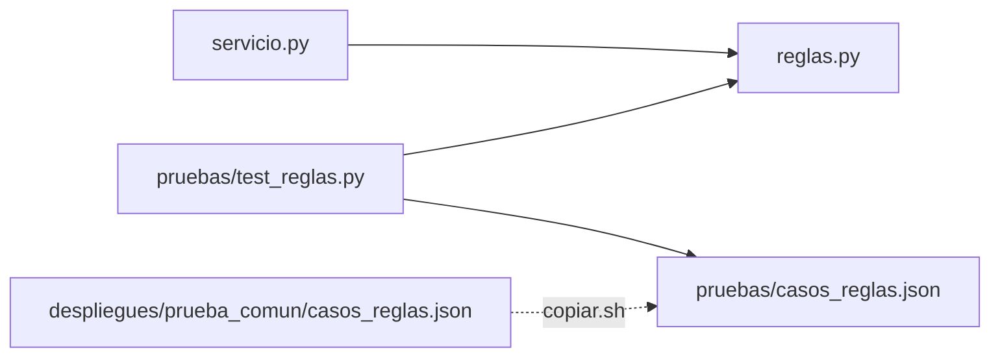

# Componentes lógicos — U12

Diseño no funcional de U12. Las decisiones son las del ADR de U11 (`../../u11-github-pages-corte/decisions.md`, ADR-G3 y ADR-G6); los requisitos en `../nfr-requirements/`.

Texto alternativo: `servicio.py` llama a `reglas.py`; las pruebas llaman a `reglas.py` con los casos
copiados de la tabla común. `reglas.py` no llama a nadie.

| Sección de `reglas.py` | Componente de `components.md` | Funciones |
|---|---|---|
| Banco | Banco | `validar_banco`, `examen_publico`, `opaco_de`, `traducir_opaco`, `opaco_de_respuesta`, `variante_de`, `resolver`, `rng_para`, `version_publica` |
| Calificacion | Calificacion | `validar_respuesta`, `fraccion`, `bono`, `a_numero` |
| Clasificacion | Clasificacion | `ordenar`, `nota`, `podio`, `top10`, `puesto_de` |
| CicloDeSala | CicloDeSala | `transicion_permitida`, `hora_de_entrega`, `admite_inscripciones`, `estado_participante` |
| LimpiezaEntrada | LimpiezaEntrada | `normalizar_texto`, `validar_inscripcion`, `normalizar_integrantes`, `nombre_normalizado_colegio` |
| Experimento | Experimento | `calcular` |
