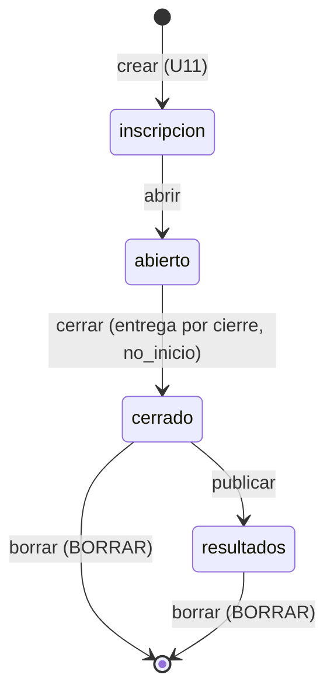
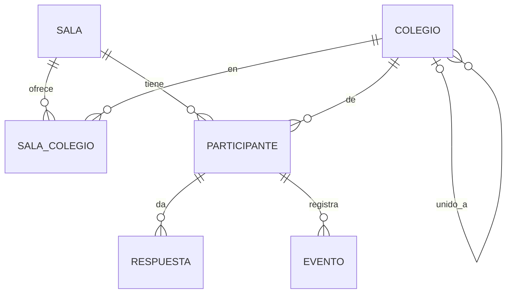

# Especificación funcional — U13 `u13-github-pages-salas`

Qué hace la unidad de salas y catálogo de la opción GitHub Pages. Sale de `unit-of-work.md` («U5, U9,
U13»), de `components.md`, del contrato C1 (`contract-summary.md`) y de `requirements.md` (FR10, FR11).
Depende de U12 (reglas completas). Después de U13 la opción tiene todo el reto salvo el tablero completo,
los CSV, el paquete y las copias (U14).

## Qué entrega

- Salas completas: regenerar clave, configurar antes de abrir, cerrar con entrega por cierre, publicar,
  listar y borrar (sin copias todavía).
- Catálogo único del semillero con provisionales, confirmación y unión; colegios de cada sala.
- Inscripción con todas las validaciones en el servidor y eliminar participante.
- Examen con los 10 tipos y las acciones del docente; el resumen del panel.
- Las pantallas del panel para todo eso, en el parche de esta opción.

## Flujos

### S1. Regenerar la clave de una sala (semillero)

`POST /api/admin/salas/clave?sala=<código>` con la clave del semillero (BR16.1). Responde
`{sala, clave}`; la clave anterior ya no entra.

### S2. Configurar la sala (docente)

`POST /api/admin/config` con las claves de hoy menos `sala` (BR16.2). Duración y reloj solo en
«inscripción»; evento, retroalimentación y modo sorpresa como hoy.

### S3. Elegir colegios (docente) y mantener el catálogo (semillero)

1. El panel pide `GET /api/admin/catalogo` y `GET /api/admin/colegios?sala=` (BR17.3, BR17.5).
2. El docente elige o quita colegios (`POST /api/admin/colegios`, solo en «inscripción») o agrega uno
   provisional el día del reto (BR17.4).
3. El semillero agrega, corrige, confirma o une colegios (`POST /api/admin/catalogo`, BR17.1, BR17.2).

### S4. Inscribirse (estudiante)

Como F4 de U11, con `validar_inscripcion` y `normalizar_integrantes` de U12 (BR18.1).

### S5. Responder cualquier tipo (estudiante)

Como F8 de U11, con `traducir_opaco`, `validar_respuesta` y `fraccion` para los 10 tipos (BR19.1).

### S6. Acciones del docente

`POST /api/admin/participante` con `id` y `accion` ∈ {finalizar, descalificar, reactivar, eliminar}
(BR19.2, BR18.2). Una transacción por acción; antes, la hora de entrega de la sala.

### S7. Cerrar y publicar (docente o semillero)

`POST /api/admin/estado` con `estado: cerrado` entrega a los que siguen en curso y pasa a `no_inicio` a
quien nunca empezó (BR16.3); con `estado: resultados` solo cambia el estado (BR16.4). Con la clave del
semillero lleva `?sala=` (BR20.1).

### S8. Listar y borrar salas (semillero)

`GET /api/admin/salas` (BR16.5); `POST /api/admin/salas/borrar?sala=` con `confirmar: "BORRAR"` solo con
la sala cerrada o en resultados (BR16.6).

### S9. Resumen del panel

`GET /api/admin/resumen` cada 3 s (BR19.3). Ranking y experimento los agrega U14.

## Rutas que agrega o completa U13

| Método | Ruta | Nivel | Flujo |
|---|---|---|---|
| POST | `/api/admin/salas/clave?sala=` | clave del semillero | S1 |
| GET | `/api/admin/salas` | clave del semillero | S8 |
| POST | `/api/admin/salas/borrar?sala=` | clave del semillero | S8 |
| POST | `/api/admin/config` | clave de sala o del semillero | S2 |
| GET | `/api/admin/catalogo` | clave de sala o del semillero | S3 |
| POST | `/api/admin/catalogo` | clave del semillero | S3 |
| GET | `/api/admin/colegios?sala=` | clave de sala o del semillero | S3 |
| POST | `/api/admin/colegios?sala=` | clave de sala o del semillero | S3 (completa F2 de U11) |
| POST | `/api/admin/estado` | clave de sala o del semillero | S7 (completa F3 de U11) |
| POST | `/api/admin/participante` | clave de sala o del semillero | S6 |
| GET | `/api/admin/resumen` | clave de sala o del semillero | S9 |
| POST | `/api/registro` | público | S4 (completa F4) |
| POST | `/api/responder` | token | S5 (completa F8) |

Todas con las reglas comunes de C1: `X-Clave-Admin`, `?sala=` con la clave del semillero, CORS de
BR8 (U11).

## Estados

Texto alternativo: la sala completa su ciclo; borrar solo desde «cerrado» o «resultados». «Reiniciar»
(vuelve a «inscripción» conservando la sala) llega con U14.

## Modelo de datos (vista derivada de `entities.md`)

Texto alternativo: el catálogo de colegios es único; cada sala ofrece algunos; un provisional puede
quedar unido a un definitivo; participantes, respuestas y eventos llevan su sala.

## Reglas (vista derivada de `rules.md`)

| Paso | Reglas |
|---|---|
| S1 | BR16.1 |
| S2 | BR16.2 |
| S3 | BR17.1, BR17.2, BR17.3, BR17.4, BR17.5 |
| S4 | BR18.1 |
| S5 | BR19.1 |
| S6 | BR18.2, BR19.2 |
| S7 | BR16.3, BR16.4, BR20.1 |
| S8 | BR16.5, BR16.6 |
| S9 | BR19.3 |

## Pantallas

Cambios en `admin.js` (copia de esta opción, `herramientas/cambios_web.patch`), todos listados en el
contrato («Cambios que exige el navegador») o en sus hallazgos:

- el código de sala se ve sin poder editarse (R-12);
- con `rol: "semillero"`: lista de salas, crear, regenerar clave, borrar (pide BORRAR) y catálogo
  (agregar, corregir, confirmar, unir); selector de sala y `api()` que agrega `?sala=` (C-07);
- elegir colegios de la sala y agregar uno provisional (FR10.3);
- las acciones del docente y la configuración, con los mensajes de la API.

El estudiante no ve ningún cambio (FR11.3): `index.html` ya tiene la lista de colegios desde U11.

## Prueba común

Después de U13 la opción pasa la parte base completa de U2 y la parte de varias salas (FR11.7): dos
salas abiertas a la vez con relojes y clasificaciones separados, 403 con clave de otra sala, clave en
minúsculas aceptada (C-03). Las comprobaciones de CSV, paquete y copias esperan a U14.

## Fuera de la unidad

Ranking y experimento en tablero y resumen, CSV, paquete, copias, reiniciar y el borrado con copias (U14).
