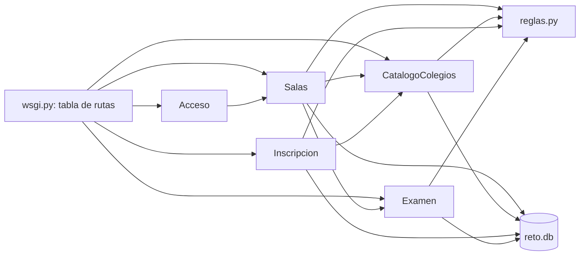

# Componentes lógicos — U13

Diseño no funcional de U13. Las decisiones son las del ADR de U11 (`../../u11-github-pages-corte/decisions.md`); los requisitos en `../nfr-requirements/`.

Texto alternativo: la tabla de rutas despacha a los cinco servicios de `servicio.py`; Salas pide a
Examen la entrega al cerrar y a CatalogoColegios los colegios; Inscripcion valida el colegio con el
catálogo; Acceso busca la sala por el prefijo de la clave; todos usan `reglas.py` y el único SQLite.

| Sección de `servicio.py` | Componente | Qué agrega U13 |
|---|---|---|
| `Acceso` | Acceso | `rol`, `?sala=` con el semillero, prefijo de sala inexistente → 403 (C-10) |
| `Salas` | Salas | regenerar clave, configurar, cerrar y publicar, listar, borrar |
| `CatalogoColegios` | CatalogoColegios | catálogo único, provisionales, confirmar, unir, nombre definitivo |
| `Inscripcion` | Inscripcion | validación completa, `n_integrantes`, eliminar |
| `Examen` | Examen | 10 tipos, acciones del docente, resumen |
