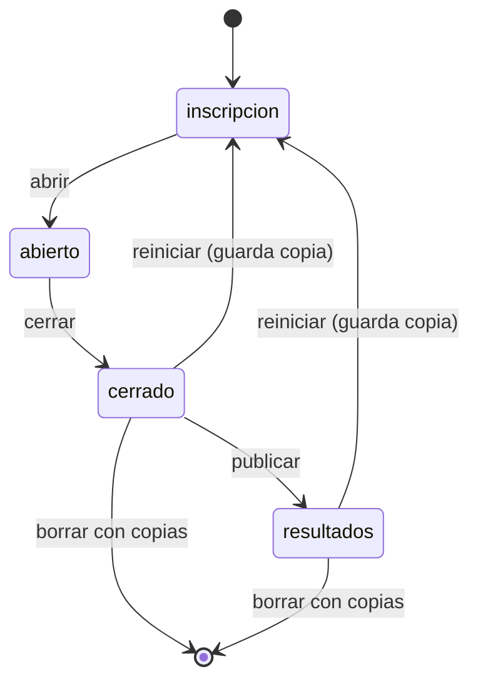

# Especificación funcional — U14 `u14-github-pages-resultados`

Qué hace la última unidad de la opción GitHub Pages: resultados y exportación. Sale de `unit-of-work.md`
(«U6, U10, U14»), `components.md` (Resultados, Exportacion, «Copias y borrado de una sala»), los
contratos C1 y C5 y `requirements.md` (FR4.3, FR6.1, FR9, FR11.4, FR11.6, NFR10.1). Depende de U13.
Al terminar, la opción pasa la prueba común completa de U2 en «TODO BIEN» (si se construye; ver
`../../u11-github-pages-corte/decisions.md`, «Recomendación para U17»).

## Qué entrega

- Tablero por sala completo (ranking y experimento), vista del participante con revisión y resumen del
  panel con ranking.
- Los dos CSV de hoy, el paquete `.zip` del semillero, la copia de «Reiniciar» como `reto.db` de una
  sola sala, la lista de copias y su descarga, y el borrado de la sala con sus copias.
- El diccionario de datos `4_Codigo_y_datos/DICCIONARIO_DATOS_RETO.md`.
- Los cambios del panel y del tablero para todo eso.

## Flujos

### E1. Tablero de una sala

`GET /api/publico?sala=<código>` cada 2 s (BR22.1). Sin `?sala=`, `{"ok": true}`. El tablero muestra el
mensaje de BR22.4 si falta la sala o no existe.

### E2. Resultados del participante

`GET /api/estado` en «resultados» trae puesto, podio, nota y la revisión con ids opacos (BR22.2).

### E3. Resumen del panel

`GET /api/admin/resumen` con ranking y experimento (BR22.3).

### E4. Descargar CSV

`GET /api/admin/resultados.csv` y `GET /api/admin/respuestas.csv` (BR23.1), con `fetch` y la cabecera
desde el panel de Pages (BR25.1).

### E5. Descargar el paquete

`GET /api/admin/paquete.zip?sala=` arma en memoria los cuatro CSV (BR23.3), la copia (BR23.5) y
`metadatos.json` (BR23.4) y responde el `.zip` (BR23.2).

### E6. Reiniciar

`POST /api/admin/reiniciar` con `confirmar: "BORRAR"`: copia y vaciado en una transacción (BR24.1). El
panel muestra la copia como fila descargable (BR25.2).

### E7. Copias

`GET /api/admin/copias?sala=` y `GET /api/admin/copia?sala=&id=` (BR24.2).

### E8. Borrar la sala con sus copias

`POST /api/admin/salas/borrar?sala=` completa BR16.6 de U13 con las copias (BR24.3). Es el último paso de
la guía de cierre, después de guardar el paquete en el lugar privado del semillero (NFR10.1; la guía la
reescribe U17 para la ganadora, FR8.2).

## Rutas que agrega o completa U14

| Método | Ruta | Nivel | Flujo |
|---|---|---|---|
| GET | `/api/publico?sala=` | público | E1 (completa F9 de U11) |
| GET | `/api/estado` | token | E2 (completa F7 de U11) |
| GET | `/api/admin/resumen` | clave de sala o del semillero | E3 (completa S9 de U13) |
| GET | `/api/admin/resultados.csv`, `/api/admin/respuestas.csv` | clave de sala o del semillero | E4 |
| GET | `/api/admin/paquete.zip?sala=` | clave de sala o del semillero | E5 |
| POST | `/api/admin/reiniciar?sala=` | clave de sala o del semillero | E6 |
| GET | `/api/admin/copias?sala=`, `/api/admin/copia?sala=&id=` | clave de sala o del semillero | E7 |
| POST | `/api/admin/salas/borrar?sala=` | clave del semillero | E8 (completa S8 de U13) |

Con eso la tabla de rutas tiene las 16 de hoy más las nuevas del contrato C1; nada fuera de la tabla
responde.

## Estados



Texto alternativo: «Reiniciar» devuelve la sala a «inscripción» después de guardar una copia, desde
cualquier estado en que el panel lo ofrezca (hoy lo ofrece siempre; la tabla exacta sale de los botones
de `admin.js`); borrar elimina todo, copias incluidas.

## Formato de la copia y del paquete (vista derivada de C5)

```text
AAAA-MM-DD_KQMT_reto.zip
├── participantes.csv     una fila por participante, sin token, semilla, codigo ni clave_huella
├── respuestas.csv        una fila por respuesta, con el id del banco (no es el CSV de hoy)
├── eventos.csv           una fila por evento, con id_evento
├── colegios.csv          colegios de la sala con su id_colegio definitivo
├── AAAA-MM-DD_HHMM_KQMT_reto.db   la copia: SQLite con solo las filas de KQMT
└── metadatos.json        inicio, fin, sala, evento, duracion_min, participantes, version_banco, version_app, opcion
```

## Reglas (vista derivada de `rules.md`)

| Paso | Reglas |
|---|---|
| E1 | BR22.1, BR22.4 |
| E2 | BR22.2 |
| E3 | BR22.3 |
| E4 | BR23.1, BR25.1 |
| E5 | BR23.2, BR23.3, BR23.4, BR23.5, BR25.1 |
| E6 | BR24.1, BR23.5, BR25.2 |
| E7 | BR24.2, BR25.1 |
| E8 | BR24.3 |
| Diccionario | BR23.6 |

## Pantallas

Cambios en la copia de esta opción (`herramientas/cambios_web.patch`), listados en el contrato y sus
hallazgos:

- `admin.js`: lista de copias con un botón de descarga cada una y botón del paquete `.zip` (R-17,
  FR9.1); el texto de la copia tras reiniciar (C-08); el nombre de archivo tomado de
  `Content-Disposition` (BR25.1).
- `tablero/index.html`: mensaje con 404 y con 5xx (C-08). El `?sala=` ya está desde U11.

El estudiante no ve ningún cambio (FR11.3).

## Prueba común

Después de U14 la opción pasa la prueba común completa (U2): base, fugas, varias salas, NFR (latencia,
reinicio, arranque en frío, consumo) y las comprobaciones de C-06 (la copia y el paquete sin columnas
secretas) y C-14 (toda clave nueva con su comprobación de fugas). En esta opción la prueba usa
`--url` y `--url-web`.

## Fuera de la unidad

La comparación, el ADR final y la guía de la ganadora (U17).
