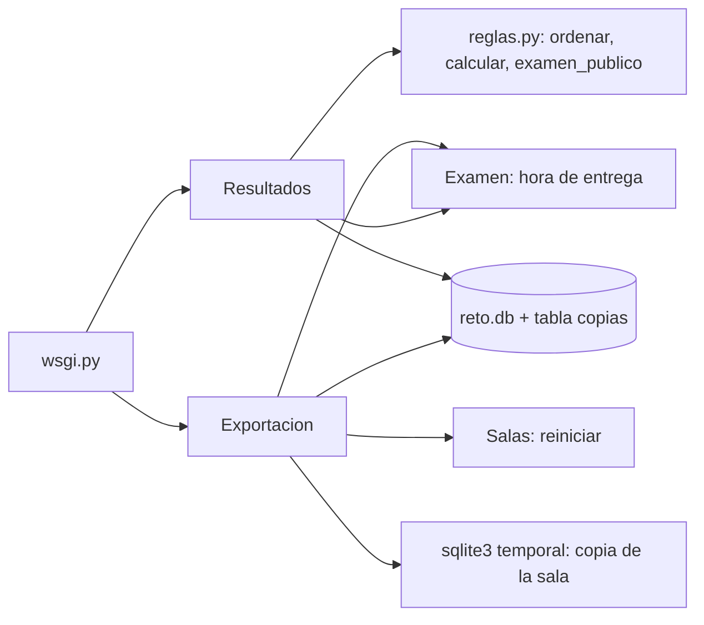

# Componentes lógicos — U14

Diseño no funcional de U14. Las decisiones son las del ADR de U11 (`../../u11-github-pages-corte/decisions.md`); los requisitos en `../nfr-requirements/`.

Texto alternativo: Resultados y Exportacion piden a Examen aplicar la entrega antes de leer; Resultados
usa las reglas de clasificación y experimento; Exportacion arma la copia en un SQLite temporal, la guarda
en `copias` y, al reiniciar, pide a Salas vaciar la sala en la misma transacción.

| Sección de `servicio.py` | Componente | Qué agrega U14 |
|---|---|---|
| `Resultados` | Resultados | tablero por sala, revisión en resultados, resumen con ranking y experimento |
| `Exportacion` | Exportacion | CSV de hoy, paquete, copia de sala, reiniciar, copias, borrado con copias |
| `web/` | PanelDocente, Tablero | lista de copias, paquete, mensajes del tablero |
| `4_Codigo_y_datos/DICCIONARIO_DATOS_RETO.md` | — | diccionario de datos (FR9.3) |
