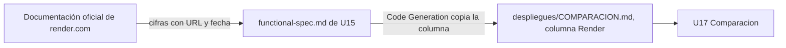

# Componentes lógicos — U15

Diseño no funcional de U15 (solo documentación sobre Render). No hay código: el único componente del
dominio que toca es **Comparacion** (`components.md`, domain-design/), y solo su entrada de datos.

Texto alternativo: las cifras se leen de la documentación oficial, se dejan en la especificación de U15
con URL y fecha, Code Generation las copia a la columna Render de la tabla, y U17 las usa para el
veredicto.

| Archivo | Componente |
|---|---|
| `despliegues/COMPARACION.md` (columna Render) | Comparacion (entrada) |
| `despliegues/render/LEEME.md` | Sin cambios de código; Code Generation actualiza el «Estado» a «no se despliega: de pago (FR12.2a)» y enlaza la columna |
