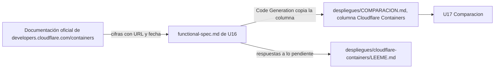

# Componentes lógicos — U16

Diseño no funcional de U16 (solo documentación sobre Cloudflare Containers). No hay código: el único
componente del dominio que toca es **Comparacion** (`components.md`, domain-design/), y solo su entrada.

Texto alternativo: las cifras se leen de la documentación oficial, se dejan en la especificación de U16
con URL y fecha, Code Generation las copia a la columna de la tabla y al LEEME de la opción, y U17 las usa
para el veredicto.

| Archivo | Componente |
|---|---|
| `despliegues/COMPARACION.md` (columna Cloudflare Containers) | Comparacion (entrada) |
| `despliegues/cloudflare-containers/LEEME.md` | Sin código; Code Generation responde lo «Pendiente de decidir» y cambia el «Estado» |
