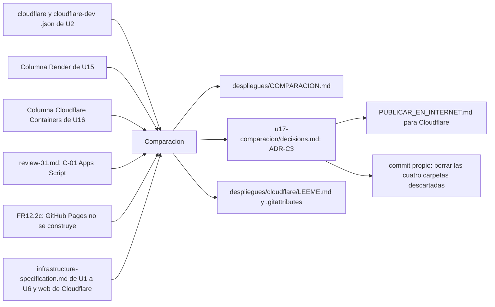

# Componentes lógicos — U17

> **Revisión 2026-10-27 (una sola sala).** Entradas y salidas para una sola candidata construida: dos mediciones de Cloudflare (ADR-C5), GitHub Pages «no se construye» (FR12.2c) y el `LEEME.md` de Cloudflare como salida nueva (ADR-C6).

Diseño no funcional de U17. No hay código: el componente del dominio es **Comparacion** (`components.md`,
domain-design/), que recibe mediciones y cifras y produce la tabla, el ADR y la guía.

Texto alternativo: Comparacion toma las dos mediciones de Cloudflare de U2, las columnas documentadas de
U15 y U16, el hallazgo C-01 de Apps Script, la decisión FR12.2c para GitHub Pages y las piezas y refrescos
de Cloudflare; produce la tabla, el ADR final y el `LEEME.md` de Cloudflare para una sala y Windows. Del
ADR aprobado salen la guía para Cloudflare y el borrado de las cuatro carpetas descartadas.

| Archivo | Componente | Etapa que lo escribe |
|---|---|---|
| `despliegues/COMPARACION.md` | Comparacion (salida) | Code Generation de U17 |
| `construction/u17-comparacion/decisions.md` | Comparacion (elección, ADR-C3) | esta etapa en «Proposed»; Code Generation lo completa con las cifras; el humano lo acepta |
| `despliegues/cloudflare/LEEME.md` y `.gitattributes` | Comparacion (pasos para una sala y Windows, ADR-C6) | Code Generation de U17, antes de la guía |
| `PUBLICAR_EN_INTERNET.md` | Comparacion (guía) | Code Generation de U17, tras la aprobación |
| `despliegues/{apps-script,render,cloudflare-containers,github-pages}/` | — | commit de borrado tras la aprobación |
