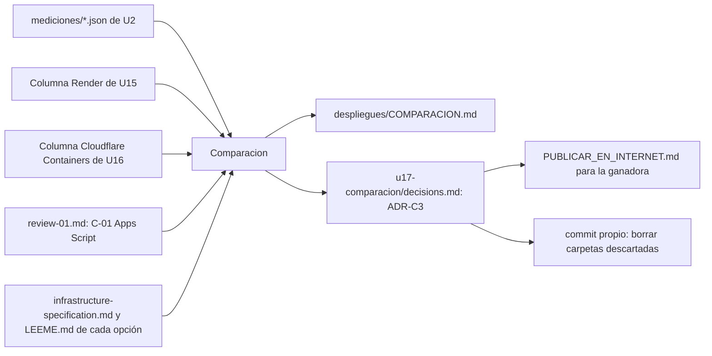

# Componentes lógicos — U17

Diseño no funcional de U17. No hay código: el componente del dominio es **Comparacion** (`components.md`,
domain-design/), que recibe mediciones y cifras y produce la tabla, el ADR y la guía.

Texto alternativo: Comparacion toma las mediciones de U2, las columnas documentadas de U15 y U16, el
hallazgo C-01 de Apps Script y las piezas y pasos de cada opción; produce la tabla, el ADR final, y de ese
ADR aprobado salen la guía para la ganadora y el borrado de las carpetas descartadas.

| Archivo | Componente | Etapa que lo escribe |
|---|---|---|
| `despliegues/COMPARACION.md` | Comparacion (salida) | Code Generation de U17 |
| `construction/u17-comparacion/decisions.md` | Comparacion (elección, ADR-C3) | esta etapa en «Proposed»; Code Generation lo completa con las cifras; el humano lo acepta |
| `PUBLICAR_EN_INTERNET.md` | Comparacion (guía) | Code Generation de U17, tras la aprobación |
| `despliegues/<perdedoras>/` | — | commit de borrado tras la aprobación |
