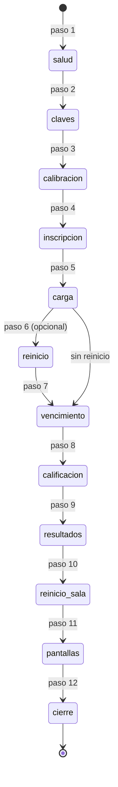

# Especificación funcional — U2 `u2-prueba-comun`

Qué hace la prueba común completa, paso a paso. Los datos están en `entities.md` y las reglas en
`rules.md`. Sale de `unit-of-work.md` (U2), `requirements.md` (FR12.3, FR12.5, FR6.3, FR11.7, NFR1–NFR12),
`contract-summary.md` (C2, C3), `bolt-plan.md` (B2) y de `2_Aplicacion_Reto/pruebas/simulacro.py`, cuyas
comprobaciones se replican por HTTP. Amplía la prueba mínima de U1 (`despliegues/prueba_comun/src/prueba.py`,
9 pasos) sin quitarle nada. Este alcance no tiene historias de usuario (`stories.md`).

## Qué demuestra

Una sola prueba, en Python sin paquetes, que recibe una URL y una clave y termina en «TODO BIEN» o con la
lista de lo que falló, y escribe el JSON de mediciones que U17 pone en `despliegues/COMPARACION.md`. Contra
la versión local, la parte base da «TODO BIEN» y la parte de fugas falla hasta U3; contra cada opción de la
nube, todo tiene que dar «TODO BIEN».

## Cómo se corre

```bash
python3 despliegues/prueba_comun/src/prueba.py --url <dirección> --clave <clave> --modo nube --opcion cloudflare
python3 despliegues/prueba_comun/src/prueba.py --url http://localhost:8790 --clave <clave> --modo local --opcion local
```

| Argumento | Para qué | Por defecto |
|---|---|---|
| `--url`, `--clave` | Dirección y clave (`PRUEBA_URL`, `PRUEBA_CLAVE`) | obligatorios (BR1.1) |
| `--modo` | `nube` o `local` | `nube` |
| `--opcion` | Nombre de la opción en el JSON (C3) | obligatorio |
| `--duracion-min` | Duración de cada sala del reto | 10 (BR4.2) |
| `--reinicio` | `ninguno`, `manual` o `comando` | `ninguno` (BR7.2) |
| `--comando-reinicio` | Comando que reinicia el servicio | — |
| `--frio` | Mide la primera petición como arranque en frío | apagado (BR7.3) |
| `--participantes`, `--salas` | Tamaño de la carga | 40 y 10 (BR6.1) |
| `--semilla` | Semilla del guion | 7 (BR3.1) |
| `--salida` | Ruta del JSON | `mediciones/<opcion>_<fecha>.json` (BR8.1) |
| `--referencia` | JSON de la corrida local para comparar fracciones | — (BR8.2) |

Una corrida completa dura unos 15 minutos: la espera del vencimiento es real (C-09).

## Flujos

### F1. Salud y arranque en frío (paso 1)

1. `GET /api/publico`: en la nube responde solo `{"ok": true}`; en local 200 (como en U1).
2. Con `--frio`, el tiempo de esa primera petición es `arranque_frio_ms` y se exige ≤ 30.000 ms (BR7.3).

### F2. Claves (paso 2)

Igual que en U1: clave mala 403, clave de sala inexistente 403, `?clave=` 403, la del semillero crea una
sala y entra con rol «semillero», la de la sala entra con rol «sala». En local la clave docente entra y
la sala sale de `/api/publico`. Se agrega: sin cabecera, `/api/admin/estado` da 403 (BR6.3).

### F3. Calibración: la clave por texto (paso 3)

1. Nube: crear la sala «calibración» con su colegio provisional (nombre único por corrida) y abrirla.
   Local: usar la única sala y abrirla (BR2.1).
2. Inscribir 40 calibradores (nombres «Calibrador <n> <sufijo>»), hacerlos comenzar y leer su
   `/api/estado`: de cada pregunta se calcula su huella (BR2.2). Aquí se revisa también BR5.1 (ningún
   secreto en `misiones`) y, en la nube, BR5.3 sobre los calibradores.
3. Elegir representantes hasta cubrir todas las parejas (pregunta, huella); cada representante responde
   todo con respuestas válidas cualesquiera y entrega (BR2.3). Los demás calibradores no responden.
4. La sala pasa a «cerrado»: `GET /api/publico?sala=` no trae `verdad` ni `multitud_acierta`
   (fuga_verdad_cerrado, BR5.2). Los representantes ya respondieron «¿lo compartirías?» y «¿es verdad?».
5. La sala pasa a «resultados»: `experimento.por_publicacion[]` trae `verdad` y `multitud_acierta`
   (experimento_completo_resultados) y `revision` de cada representante arma la ClavePorTexto.
6. Local: «Reiniciar» con `confirmar: BORRAR` deja la sala en inscripción (BR4.6 se verifica aquí y en
   F10). Nube: la sala de calibración se deja en resultados.

### F4. Salas del reto e inscripción (paso 4)

1. Nube: crear 10 salas con tamaños 10, 7, 6, 5, 4, 3, 2, 1, 1 y 1, cada una con su colegio provisional, y
   configurar `duracion_min` (BR6.1, BR4.2). Local: configurar `duracion_min` en la única sala.
2. Comprobaciones de inscripción de la parte base (tabla de abajo): sala incorrecta, grado 8, 40
   inscritos con códigos únicos, repetido, entrar con el código, comenzar antes de abrir, panel sin clave.
3. Abrir todas las salas y leer `abierto_en` de cada una.

### F5. Respuestas bajo carga (paso 5)

1. 40 hilos, uno por participante, y 10 hilos de tablero (BR7.1). Cada participante comienza, pide
   `/api/estado` (ids opacos y orden: BR5.3; grupo A/B con el resumen: BR4.5) y responde su guion
   (BR3.1, BR3.2), midiendo `responder + estado`.
2. Casos del papel: el perfecto intenta «¿es verdad?» antes de «¿lo compartirías?» (400) y responde una
   pregunta dos veces (400); el vencido_sin_respuestas no responde; los vencido_al_final guardan su última
   pregunta para F7; el que llega tarde se inscribe después de abrir y no comienza.
3. Reloj global: `inicio_k` igual a `abierto_en` (BR4.4); cambiar `reloj_global` con la sala abierta da
   400.
4. Todos menos los vencidos y el que llega tarde entregan con `/api/finalizar`.
5. Nube: conteos por sala (BR6.2).

### F6. Reinicio a mitad de la prueba (paso 6)

Solo con `--reinicio manual|comando`: se guarda el resumen de cada sala, se reinicia el servicio, se
espera la salud y se compara (BR7.2). El reloj siguió corriendo durante la caída (FR3.3): la espera de F7
se calcula con `abierto_en`, no con la hora del reinicio.

### F7. Vencimiento (paso 7)

1. En `abierto_en + duración − 15 s`, los vencido_al_final envían su última pregunta (BR4.3).
2. Espera hasta `abierto_en + duración + 2 s`. Durante la espera los tableros sondean cada 10 s.
3. Después: el vencido_sin_respuestas está «finalizado» con `tiempo_usado` igual a la duración; responder
   da 400; el que llega tarde no puede comenzar (400) y se elimina con `/api/admin/participante`
   usando el id del resumen (BR4.2, BR4.5).

### F8. Calificación (paso 8)

Con `/api/admin/resumen` de cada sala: perfecto 1.000, cero 0, bono en (0, 20], bono de los vencidos
(BR4.3), puntos de cada participante iguales a `puntos_esperados` (BR3.3) y fracciones del parcial
estrictamente entre 0 y 1 en los tipos con crédito parcial.

### F9. Cierre, resultados y exportaciones (paso 9)

1. Nube: cerrar primero la sala más grande; las demás siguen abiertas con su `abierto_en` (salas_reloj,
   BR6.2). Luego cerrar todas; fuga_verdad_cerrado en cada sala (BR5.2).
2. Publicar resultados en todas: puestos 1..n sin repetir por sala, ordenados por total, clasificación
   recalculada igual a `puesto` (BR4.5), `revision` y `puesto` para un finalizado, experimento con n igual
   al tamaño (en salas de 1, `listo` es falso y n es 1), top 10 = min(10, n), ranking sin nombres de otra
   sala, CSV de resultados con n + 1 líneas, CSV de respuestas con más de n × 30 líneas y sin ids
   opacos (BR5.4), clave de otra sala en resumen y CSV → 403 (BR6.3).

### F10. Reinicio de la sala (paso 10)

`confirmar: "no"` da 400; `BORRAR` reinicia: conteo 0 y copia (BR4.6). En la nube se reinicia la sala más
grande; en local la única.

### F11. Pantallas (paso 11)

Igual que en U1: `/`, `/admin`, `/tablero` y estáticos con 200; el banco con 404 por cualquier ruta.

### F12. Cierre de la corrida (paso 12)

Se arma la Medicion, se valida, se escribe el JSON (BR8.1), se compara con `--referencia` si la hay
(BR8.2) y se imprime el resultado (BR1.2).

## Parte base: las comprobaciones de `simulacro.py` por HTTP

La corrida de `simulacro.py 40` del 2026-10-25 imprime 30 comprobaciones (`code-summary.md` de U1);
`code-quality-assessment.md` contaba 29. Se replican las 30. «Igual» significa la misma condición por la
misma ruta; donde hoy se lee SQLite o se mueve el reloj, la columna dice la equivalencia (BR4.1).

| # | Comprobación de `simulacro.py` | Id en la prueba común | Cómo se verifica por HTTP |
|---|---|---|---|
| 1 | rechaza un código de sala incorrecto | base_sala_incorrecta | Igual |
| 2 | rechaza grados distintos de 9, 10 y 11 | base_grado_invalido | Igual |
| 3 | códigos únicos para todos | base_codigos_unicos | Igual, sobre los 40 |
| 4 | no deja inscribir dos veces el mismo nombre, colegio y grado | base_repetido | Igual |
| 5 | entrar de nuevo con el código recupera la sesión | base_entrar | Igual |
| 6 | no se puede empezar antes de que el docente abra el reto | base_comenzar_antes | Igual |
| 7 | el panel docente exige la clave | base_panel_clave | Igual (sin cabecera, 403) |
| 8, 9 | grupo A/B: recordatorio visible solo para B | base_recordatorio_grupo | El grupo sale de `/api/admin/resumen`, no de la base (BR4.5) |
| 10 | «¿es verdad?» exige antes «¿lo compartirías?» | base_requiere | Igual |
| 11 | una pregunta no se puede responder dos veces | base_una_vez | Igual |
| 12 | el navegador nunca recibe respuestas ni explicaciones durante el reto | base_sin_respuestas | Igual, y además la lista de BR5.1 |
| 13 | reloj global: todos comparten la hora de inicio | base_reloj_global | `inicio_k` calculado con `/api/estado` igual a `abierto_en` (BR4.4) |
| 14 | reloj global: no se puede comenzar con el tiempo terminado | base_comenzar_vencido | Espera real en vez de mover `abierto_en` (BR4.2) |
| 15 | el tipo de reloj no se cambia con el reto abierto | base_reloj_fijo | Igual |
| 16 | al vencerse el intento se entrega solo | base_vence_solo | Espera real y `tiempo_usado` igual a la duración (BR4.2) |
| 17 | no se aceptan respuestas fuera de tiempo | base_fuera_de_tiempo | Igual, tras la espera |
| 18 | todo correcto = 1.000 | base_perfecto | Igual; la clave sale de la calibración (BR2.3) |
| 19 | todo incorrecto = 0 | base_cero | Igual |
| 20 | bono de tiempo entre 0 y 20 | base_bono_rango | Igual |
| 21 | quien responde al final no recibe bono | base_bono_final | Sin mover `inicio`: 0 para quien no respondió y cota de la fórmula para quien respondió en los últimos 15 s (BR4.3) |
| 22 | puestos 1..N sin repetir | base_puestos | Igual, por sala |
| 23 | ordenados por puntaje total | base_orden_total | Igual, y además la clasificación recalculada (BR4.5) |
| 24 | con resultados hay revisión y puesto | base_revision | Igual |
| 25 | el experimento usa a todos los participantes | base_experimento_n | Igual, por sala (en salas de 1, n = 1 y `listo` falso) |
| 26 | el tablero muestra el top 10 | base_top10 | Igual, min(10, n) |
| 27 | CSV de resultados con una fila por participante | base_csv_resultados | Igual |
| 28 | CSV con el detalle de cada respuesta | base_csv_respuestas | Igual |
| 29 | el reinicio exige escribir BORRAR | base_reiniciar_borrar | Igual |
| 30 | reiniciar deja copia y empieza de cero | base_reiniciar_copia | La copia por `/api/admin/copias` en la nube; en local se exige su nombre (BR4.6) |

## Parte nueva

| Id | Parte | Qué | Regla |
|---|---|---|---|
| fuga_verdad_cerrado, experimento_completo_resultados | fugas | FR6.1 | BR5.2 |
| fuga_ids_opacos, fuga_orden_banco | fugas | FR6.2 | BR5.3 |
| fuga_estado_<ruta>, fuga_publico_<estado> | fugas | Claves secretas sin clave docente (C-14) | BR5.1 |
| csv_ids_del_banco | fugas | FR6.2, FR9.2 | BR5.4 |
| salas_conteo, salas_ranking, salas_reloj, salas_csv | salas | FR11.7 | BR6.2 |
| claves_403 | salas | NFR9 | BR6.3 |
| clave_por_texto_completa, puntos_esperados, parcial_entre_0_y_1 | nfr | NFR11, FR2.1 | BR2.4, BR3.3 |
| nfr_p95_responder, nfr_p95_tablero | nfr | NFR2, NFR3 | BR7.1 |
| nfr_sobrevive_reinicio | nfr | NFR4 | BR7.2 |
| nfr_arranque_frio | nfr | NFR5 | BR7.3 |
| mismas_fracciones_que_local | nfr | NFR11, FR5.5 | BR8.2 |

## Módulos

Todo en `despliegues/prueba_comun/`, solo biblioteca estándar de Python 3.12 (Delivery Planning, Q6-A).

| Módulo | Qué tiene | Cómo se prueba |
|---|---|---|
| `src/prueba.py` | Argumentos, orquestación de los 12 pasos, impresión | Corrida bajo `trace` contra la versión local |
| `src/cliente.py` | `Cliente.pedir` (GET/POST, cabeceras, tope de tiempo, conteo de peticiones, latencias) y lectura tolerante de JSON (BR1.4) | `pruebas/test_cliente.py` con un servidor `http.server` de prueba |
| `src/guion.py` | Huellas, ClavePorTexto desde `revision`, respuestas por tipo y decisión, papeles, tamaños de sala y puntos esperados (BR2, BR3) | `pruebas/test_guion.py`, sin red, con preguntas inventadas |
| `src/carga.py` | Hilos de participantes y de tableros, percentiles, espera del vencimiento (BR7.1) | `pruebas/test_carga.py` con el servidor de prueba |
| `src/mediciones.py` | Armado y validación del JSON C3, comparación con la referencia (BR8) | `pruebas/test_mediciones.py` |

Las funciones de `guion.py` y `mediciones.py` son puras: reciben datos y devuelven datos, sin red ni
reloj, como las «calculadoras» de ADR-001.

## Estados



Texto alternativo: los pasos corren en orden; el reinicio del servicio (paso 6) es opcional; una
comprobación esencial que falla salta directo al cierre (BR1.3), que siempre escribe el JSON.

## Fuera de esta unidad

`casos_reglas.json` (C4) lo empieza U4. La tabla `COMPARACION.md` la llena U17 con el JSON. El paquete
`.zip` (C5) se comprueba cuando exista la ruta (U6); mientras tanto no hay comprobación del paquete.
