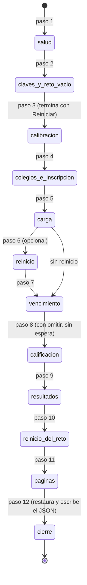
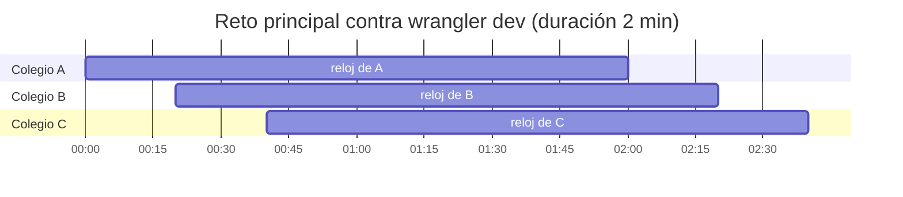

# Especificación funcional — U2 `u2-prueba-comun`

> **Revisión 2026-10-25 (una sola sala, solo Cloudflare).** Esta revisión deja la prueba para una sola
> sala con la clave docente (C2, ADR-010, ADR-011). Cambia lo siguiente:
>
> - Desaparecen la clave del semillero, crear salas, `?sala=` y las 10 salas.
> - La calibración se hace en el mismo reto y se borra con «Reiniciar» (F3).
> - El reto principal tiene 40 equipos de 3 colegios con relojes que arrancan a distinta hora (F4, F5).
> - El vencimiento se espera de verdad contra `wrangler dev` con `DURACION_MINIMA_MIN` (D9) y se omite
>   contra la URL pública (F7).
> - Entran las partes `relojes` y `claves` del C3 revisado y una comprobación `pantalla_*` por cada fila
>   de la tabla «Pantallas completas» de U6 (criterio del humano del 2026-10-26).
> - La prueba deja el reto como lo encontró (F12).
> - U2 crea `contrato_api.yaml`.
>
> Los flujos F1 a F12 conservan su número.

Qué hace la prueba común completa, paso a paso. Los datos están en `entities.md` y las reglas en
`rules.md`. Fuentes:

- `unit-of-work.md`: U2;
- `requirements.md`: FR12.3, FR12.5, FR6.3, FR11.7, FR2.5 y NFR1 a NFR12;
- `contract-summary.md`: C1, C2 y C3, y la sección «La prueba común con una sola sala»;
- `contract-design-questions.md`: D1 a D10;
- `bolt-plan.md`: B2;
- la sección «Prueba común» de U5 y la de U6;
- `2_Aplicacion_Reto/pruebas/simulacro.py`, cuyas comprobaciones se replican por HTTP.

Amplía la prueba mínima de U1 (`despliegues/prueba_comun/src/prueba.py`, 9 pasos), que U5 ya pasó a la
clave docente. Este alcance no tiene historias de usuario (`stories.md`).

## Qué demuestra

Es una sola prueba, en Python y sin paquetes. Recibe una URL y la clave docente. Termina en «TODO BIEN»
o con la lista de lo que falló, y escribe el JSON de mediciones que U17 pone en
`despliegues/COMPARACION.md`. Se espera esto:

- **Versión local:** la parte base da «TODO BIEN», las fugas fallan mientras U3 siga saltada y los
  relojes no aplican.
- **Cloudflare en `wrangler dev`:** todo da «TODO BIEN», incluido el vencimiento real de cada colegio.
- **URL de Workers:** todo da «TODO BIEN»; lo que necesita el vencimiento real queda en «no aplica»
  (D9, `bolt-plan.md`, B2).

## Cómo se corre

| Contra | Comando | Antes |
|---|---|---|
| Cloudflare en local | `python3 despliegues/prueba_comun/src/prueba.py --url http://localhost:8787 --clave "$PRUEBA_CLAVE" --modo nube --opcion cloudflare --duracion-min 2 --reinicio comando --comando-reinicio "<reiniciar wrangler dev>" --salida despliegues/prueba_comun/mediciones/cloudflare-dev_<fecha>.json` | `.dev.vars` con `CLAVE_DOCENTE` (12 o más caracteres) y `DURACION_MINIMA_MIN=1`; `npx wrangler dev` |
| URL de Workers | `python3 despliegues/prueba_comun/src/prueba.py --url https://<nombre>.workers.dev --clave "$PRUEBA_CLAVE" --modo nube --opcion cloudflare --vencimiento omitir --frio --reinicio manual` | Sin reto en curso, el reto vacío (BR1.5) y 15 minutos sin tocar el servicio para `--frio`; el reinicio manual es un `npx wrangler@4.148.0 deploy` cuando la prueba lo pide |
| Versión local | `python3 despliegues/prueba_comun/src/prueba.py --url http://localhost:8790 --clave "$PRUEBA_CLAVE" --modo local --opcion local` | `python3 servidor.py --puerto 8790 --clave <clave de ensayo> --db <carpeta temporal>/reto.db` desde `2_Aplicacion_Reto/`, para no tocar `datos/reto.db` |

Las dos corridas de Cloudflare escriben archivos distintos, y U17 sabe qué NFR sale de cada una (ADR-C5
de U17). La clave se pasa por la variable `PRUEBA_CLAVE` para que no quede en el historial del terminal. Nunca se
escribe una clave real en un archivo versionado.

| Argumento | Para qué | Por defecto |
|---|---|---|
| `--url`, `--clave` | Dirección y clave docente (`PRUEBA_URL`, `PRUEBA_CLAVE`) | obligatorios (BR1.1) |
| `--modo` | `nube` (Cloudflare) o `local` | `nube` |
| `--opcion` | Nombre de la opción en el JSON: `cloudflare` o `local` (C3) | obligatorio |
| `--duracion-min` | Duración de la calibración y del reto principal; el servidor decide el mínimo | 10 (BR4.2) |
| `--vencimiento` | `esperar` el fin real de cada reloj u `omitir` | `esperar` (BR4.2) |
| `--reinicio` | `ninguno`, `manual` o `comando` | `ninguno` (BR7.2) |
| `--comando-reinicio` | Comando que reinicia el servicio | — |
| `--frio` | Mide la primera petición como arranque en frío | apagado (BR7.3) |
| `--participantes` | Tamaño de la carga, repartido en 3 colegios | 40 (BR6.1) |
| `--semilla` | Semilla del guion | 7 (BR3.1) |
| `--salida` | Ruta del JSON | `mediciones/<opcion>_<fecha>.json` (BR8.1) |
| `--referencia` | JSON de la corrida local para comparar fracciones y CSV | — (BR8.2) |

Duración aproximada de cada corrida:

- contra `wrangler dev`, unos 8 minutos: dos esperas de 2 minutos más la carga;
- contra la URL de Workers, unos 5 minutos, porque no espera el vencimiento;
- contra la versión local, unos 15 minutos, porque espera 10 minutos reales (C-09).

## Flujos

### F1. Salud y arranque en frío (paso 1)

1. `GET /api/publico`. En la nube responde el tablero sin parámetros (`claves_publico_sin_sala`,
   BR6.3); en local responde 200.
2. Con `--frio`, el tiempo de esa primera petición es `arranque_frio_ms` y se exige ≤ 30.000 ms (BR7.3).

### F2. Claves y reto vacío (paso 2)

1. Sin cabecera: `/api/admin/estado` da 403 (`base_panel_clave`). Con una clave inventada da 403
   (`claves_incorrecta`).
2. Solo en la nube:
   - la clave con `?clave=` además de la cabecera da 403 (`claves_url`);
   - con las mayúsculas cambiadas da 403 (`claves_mayusculas`);
   - con espacios en los extremos da 200 (`claves_espacios`);
   - `POST /api/admin/login` responde solo `ok` (`claves_login`, `pantalla_login`);
   - `POST /api/admin/salas/crear` da 404 (`claves_rutas_quitadas`).
3. `GET /api/admin/resumen` (`pantalla_resumen` en inscripción). Si el reto no está vacío, la prueba
   termina con código 2 sin tocar nada (BR1.5).
4. Se guarda la ConfiguracionInicial: duración, modo sorpresa, retro, nombres de los colegios y copias
   existentes (`GET /api/admin/copias`).

### F3. Calibración: la clave por texto (paso 3)

1. Se fija `duracion_min` (`pantalla_config`). En la nube se agrega el colegio «Colegio Calibración
   <sufijo>» (`pantalla_colegios_admin`); en local ese nombre va como texto.
2. Se inscriben 40 calibradores («Calibrador <n> <sufijo>»), con `pantalla_colegios` y
   `pantalla_registro`. Se abre el reto (`pantalla_estado_reto`); en la nube el colegio de calibración
   arranca solo porque tiene equipos.
3. Cada calibrador comienza y lee su `/api/estado`, y de cada pregunta se calcula la huella (BR2.2). Aquí
   se revisan BR5.1 (ningún secreto en `misiones`, `fuga_revision_antes`) y BR5.3.
4. Se eligen representantes hasta cubrir todas las parejas (pregunta, huella). Cada representante
   responde todo con respuestas válidas cualesquiera y entrega (BR2.3); los demás calibradores no
   responden.
5. Se cierra el reto. `GET /api/publico` solo trae `n` y `listo` del experimento (`fuga_verdad_cerrado`,
   BR5.2).
6. Se publica. `experimento.por_publicacion[]` trae `verdad` y `multitud_acierta`
   (`experimento_completo_resultados`), y la `revision` de cada representante arma la ClavePorTexto.
7. «Reiniciar» con `confirmar: BORRAR`. El reto vuelve a inscripción y su copia va a `copias_creadas`
   (BR2.1). Si falla, la corrida se detiene (BR1.3).

### F4. Colegios e inscripción del reto principal (paso 4)

1. Se fija `duracion_min` (BR4.2). En la nube se agregan los colegios A, B, C y uno de sobra, «Colegio
   Prueba D <sufijo>», en una sola llamada `agregar` con `nombres` (BR6.1).
2. En la nube corren los errores de la lista (`colegios_errores`, BR6.4):
   - un nombre de 2 letras;
   - un repetido con otras mayúsculas junto a uno nuevo;
   - arrancar A antes de abrir;
   - quitar D, que no tiene equipos y desaparece de `/api/colegios`.
3. Comprobaciones de inscripción de la parte base (tabla de abajo): sala incorrecta, grado 8, códigos
   únicos, repetido, entrar con el código (`pantalla_entrar`), comenzar antes de abrir
   (`pantalla_estado_espera`) y panel sin clave.
   - **Nube:** se inscriben solo los equipos de A. Quitar A con equipos da 400 (`colegios_errores`).
   - **Local:** se inscriben los 40, con su colegio como texto.
4. Con `GET /api/publico` en inscripción: `pantalla_publico_inscripcion`.
5. Se abre el reto y se lee `abierto_en`.
   - **Nube:** se inscriben los equipos de B y C (siguen sin arrancar), salvo el que llega tarde.
   - **Las dos:** el que llega tarde se inscribe después de abrir y no comienza.
6. **Nube:** a 20 s de `abierto_en`, «Arrancar reloj» de B; a 40 s, el de C. Arrancar B dos veces da 400
   (`colegios_errores`), y antes del arranque de C un equipo de C prueba a comenzar
   (`relojes_espera_colegio`). Después se comprueban `relojes_arranques` y `relojes_conteo`.

### F5. Respuestas bajo carga (paso 5)

1. Hay un hilo por participante, un hilo de tablero cada 2 s y un hilo de panel cada 3 s (BR7.1). Cada
   participante comienza cuando su colegio arrancó (`pantalla_comenzar`) y pide `/api/estado`
   (`pantalla_estado_curso`). Ahí se revisan los ids opacos y el orden (BR5.3) y el grupo A/B con el
   resumen (BR4.5). Después responde su guion (BR3.1, BR3.2; `pantalla_responder`) y se mide
   `responder + estado`. Cada salida de la pestaña del guion envía `/api/evento` (`pantalla_evento`).
2. Casos de cada papel:
   - el perfecto intenta «¿es verdad?» antes de «¿lo compartirías?» (400) y responde una pregunta dos
     veces (400);
   - el primer participante normal que recibe cada tipo manda antes una respuesta inválida
     (`tipos_respuesta`, BR4.8);
   - el vencido_sin_respuestas, el vencido_colegio y el no_inicia no responden;
   - los vencido_al_final guardan su última pregunta para F7.
3. Relojes:
   - `base_reloj_global` y `relojes_inicio_por_colegio` (BR4.4);
   - mandar `reloj_global` a `/api/admin/config` da 400 «El reloj es por colegio y ya no se configura.»
     en la nube, o «no se cambia con el reto abierto» en local (`base_reloj_fijo`);
   - `relojes_bono_desde_arranque` con un participante de B y uno de C (BR6.2).
4. Panel y tablero:
   - modo sorpresa encendido y apagado (`sorpresa_oculta_juntos`, BR5.5);
   - `pantalla_publico_curso` con `colegios[]` y su reloj;
   - «anular» y «reactivar» a un participante normal, y «entregar» al entregado_docente
     (`acciones_docente`, `pantalla_participante`, BR4.9).
5. Entregan con `/api/finalizar` (`pantalla_finalizar`) todos menos los vencidos, el no_inicia y el que
   llega tarde.

### F6. Reinicio a mitad de la prueba (paso 6)

Solo corre con `--reinicio manual|comando`. Se guarda el resumen, se reinicia el servicio, se espera a que
responda la salud y se compara (BR7.2). Los relojes siguieron corriendo durante la caída (FR3.3), así que
las esperas de F7 se calculan con los arranques, no con la hora del reinicio.

### F7. Vencimiento (paso 7)

Solo con `--vencimiento esperar`. Con `omitir`, sus comprobaciones van a `no_aplica` (BR4.2) y se pasa a
F8.

1. En `arranque_A + duración − 15 s`, los vencido_al_final envían su última pregunta (BR4.3).
2. En `arranque_A + duración + 2 s`:
   - el vencido_sin_respuestas de A está «finalizado» con `tiempo_usado` igual a la duración y motivo
     `tiempo`;
   - responder da 400 (`base_fuera_de_tiempo`);
   - el que llega tarde no puede comenzar (400);
   - en la nube, el vencido_colegio de C sigue en curso (`relojes_vence_por_colegio`, primera mitad).
3. En `arranque_C + duración + 2 s`, el vencido_colegio está «finalizado» con `tiempo_usado` igual a la
   duración (segunda mitad). En local hay una sola espera.
4. Durante las esperas, el tablero sondea cada 10 s. El que llega tarde se elimina con
   `/api/admin/participante` usando el id del resumen (`acciones_docente`, BR4.5).

### F8. Calificación (paso 8)

Con `/api/admin/resumen`:

- el perfecto saca 1.000 y el cero, 0;
- el bono está en (0, 20];
- se revisa el bono de los vencidos (BR4.3);
- los puntos de cada participante son iguales a `puntos_esperados` (BR3.3);
- las fracciones del parcial están estrictamente entre 0 y 1 en los tipos con crédito parcial.

### F9. Cierre, resultados y exportaciones (paso 9)

1. Se cierra el reto:
   - nadie queda en curso y el no_inicia queda en «No inició» (`cierre_no_inicio`, BR4.9);
   - `fuga_verdad_cerrado` (BR5.2) y `pantalla_publico_cerrado`.
2. Se publican los resultados. En el reto:
   - puestos de 1 a n sin repetir, ordenados por total, respetando el orden de U4 (BR4.5);
   - top 10.
3. En el estudiante y el tablero:
   - un finalizado tiene `revision`, `puesto`, `puesto_grado` y `nota` en su `/api/estado`
     (`base_revision`, `pantalla_estado_final`);
   - el experimento tiene su n;
   - el tablero cumple `resultados_por_grado`, `resultados_nota` y `pantalla_publico_resultados`
     (BR4.10).
4. Exportaciones:
   - CSV de resultados con n + 1 líneas (`pantalla_csv_resultados`);
   - CSV de respuestas sin ids opacos (BR5.4, `pantalla_csv_respuestas`);
   - se guardan sus encabezados para BR8.2.
5. **Nube:** `GET /api/admin/paquete.zip` (`pantalla_paquete`) se descomprime con `zipfile` de la
   biblioteca estándar. Trae los seis archivos de C5, `participantes.csv` tiene una fila por participante
   y ninguna columna se llama `token`, `semilla` ni `codigo` (`paquete_completo`).

### F10. Reinicio del reto (paso 10)

`confirmar: "no"` da 400 (`base_reiniciar_borrar`). Con `BORRAR` se reinicia: conteo 0, estado en
inscripción y copia (`base_reiniciar_copia`, `pantalla_reiniciar`, BR4.6). En la nube, la copia se lista
(`pantalla_copias`), se descarga (`pantalla_copia`) y se borra (`pantalla_copia_borrar`).

### F11. Páginas y estáticos (paso 11)

Igual que en U1: `/`, `/admin`, `/tablero` y los estáticos responden 200, y el banco da 404 por cualquier
ruta.

### F12. Cierre de la corrida (paso 12)

1. Se restaura el reto (BR1.6, `reto_restaurado`): configuración, colegios del docente y borrado de las
   copias de la prueba que queden. Esto corre también tras una esencial que falló.
2. Se arma la Medicion, se valida y se escribe el JSON (BR8.1). Si hay `--referencia`, se compara con ella
   (BR8.2). Al final se imprime el resultado (BR1.2).

## Parte base: las comprobaciones de `simulacro.py` por HTTP

La corrida de `simulacro.py 40` del 2026-10-25 imprime 30 comprobaciones (`code-summary.md` de U1);
`code-quality-assessment.md` contaba 29. Se replican las 30.

- **«Igual»:** la misma condición por la misma ruta.
- **Equivalencia:** donde hoy se lee SQLite o se mueve el reloj, la columna dice cómo se comprueba
  (BR4.1).
- **«Sin vencimiento real»:** la comprobación va a `no_aplica` con `--vencimiento omitir`.

| # | Comprobación de `simulacro.py` | Id en la prueba común | Cómo se verifica por HTTP |
|---|---|---|---|
| 1 | rechaza un código de sala incorrecto | base_sala_incorrecta | Igual |
| 2 | rechaza grados distintos de 9, 10 y 11 | base_grado_invalido | Igual |
| 3 | códigos únicos para todos | base_codigos_unicos | Igual, sobre los 40 de los 3 colegios |
| 4 | no deja inscribir dos veces el mismo nombre, colegio y grado | base_repetido | Igual; en la nube, mismo `id_colegio` |
| 5 | entrar de nuevo con el código recupera la sesión | base_entrar | Igual |
| 6 | no se puede empezar antes de que el docente abra el reto | base_comenzar_antes | Igual |
| 7 | el panel docente exige la clave | base_panel_clave | Igual (sin cabecera, 403) |
| 8, 9 | grupo A/B: recordatorio visible solo para B | base_recordatorio_grupo | El grupo sale de `/api/admin/resumen`, no de la base (BR4.5) |
| 10 | «¿es verdad?» exige antes «¿lo compartirías?» | base_requiere | Igual |
| 11 | una pregunta no se puede responder dos veces | base_una_vez | Igual |
| 12 | el navegador nunca recibe respuestas ni explicaciones durante el reto | base_sin_respuestas | Igual, y además la lista de BR5.1 |
| 13 | reloj global: todos comparten la hora de inicio | base_reloj_global | En la nube, todos los de A empiezan en `abierto_en`; los de B y C, en el arranque de su colegio (BR4.4) |
| 14 | reloj global: no se puede comenzar con el tiempo terminado | base_comenzar_vencido | Espera real en vez de mover `abierto_en` (BR4.2); sin vencimiento real |
| 15 | el tipo de reloj no se cambia con el reto abierto | base_reloj_fijo | Local: igual. Nube: `reloj_global` da 400 en cualquier estado (D1) |
| 16 | al vencerse el intento se entrega solo | base_vence_solo | Espera real y `tiempo_usado` igual a la duración (BR4.2); sin vencimiento real |
| 17 | no se aceptan respuestas fuera de tiempo | base_fuera_de_tiempo | Igual, tras la espera; sin vencimiento real |
| 18 | todo correcto = 1.000 | base_perfecto | Igual; la clave sale de la calibración (BR2.3) |
| 19 | todo incorrecto = 0 | base_cero | Igual |
| 20 | bono de tiempo entre 0 y 20 | base_bono_rango | Igual |
| 21 | quien responde al final no recibe bono | base_bono_final | Sin mover `inicio`: 0 para quien no respondió y la cota de la fórmula para quien respondió en los últimos 15 s (BR4.3); la segunda mitad, sin vencimiento real |
| 22 | puestos 1..N sin repetir | base_puestos | Igual, en el reto entero |
| 23 | ordenados por puntaje total | base_orden_total | Igual, y además el orden de U4 (BR4.5) |
| 24 | con resultados hay revisión y puesto | base_revision | Igual, y además `puesto_grado` y `nota` en la nube |
| 25 | el experimento usa a todos los participantes | base_experimento_n | n igual al número de participantes que, según el guion, respondieron las dos preguntas del Exp. 01 |
| 26 | el tablero muestra el top 10 | base_top10 | Igual, min(10, n) |
| 27 | CSV de resultados con una fila por participante | base_csv_resultados | Igual, con los que quedan tras eliminar al que llega tarde |
| 28 | CSV con el detalle de cada respuesta | base_csv_respuestas | Igual |
| 29 | el reinicio exige escribir BORRAR | base_reiniciar_borrar | Igual |
| 30 | reiniciar deja copia y empieza de cero | base_reiniciar_copia | En la nube, la copia por `/api/admin/copias`; en local se exige su nombre (BR4.6) |

Además, en la parte base:

| Id | Qué | Regla | En local |
|---|---|---|---|
| `pantalla_*` (27 ids, uno o varios por cada fila de «Pantallas completas» de U6) | Cada llamada de `web/js/*.js` y `tablero.html` responde con las claves que usa la pantalla | BR4.7 | No aplican las 6 rutas que la versión local no tiene |
| tipos_respuesta | Los 10 tipos con una aceptada y una rechazada | BR4.8 | Aplica |
| acciones_docente, cierre_no_inicio | Las cuatro acciones del panel y el cierre | BR4.9 | Aplica |
| resultados_por_grado, resultados_nota | Podio, por grado y nota | BR4.10 | `resultados_por_grado` no aplica |
| paquete_completo | El `.zip` con los seis archivos de C5 | BR4.7 (fila 17 de U6) | No aplica |
| reto_restaurado | El reto queda como estaba | BR1.6 | Aplica (solo la configuración) |

Los 27 ids `pantalla_*` son estos:

- **estudiante:** `pantalla_colegios`, `pantalla_registro`, `pantalla_entrar`, `pantalla_estado_espera`,
  `pantalla_estado_curso`, `pantalla_estado_final`, `pantalla_comenzar`, `pantalla_responder`,
  `pantalla_finalizar` y `pantalla_evento`;
- **panel:** `pantalla_login`, `pantalla_resumen`, `pantalla_estado_reto`, `pantalla_config`,
  `pantalla_participante`, `pantalla_colegios_admin`, `pantalla_csv_resultados`,
  `pantalla_csv_respuestas`, `pantalla_paquete`, `pantalla_reiniciar`, `pantalla_copias`,
  `pantalla_copia` y `pantalla_copia_borrar`;
- **tablero:** `pantalla_publico_inscripcion`, `pantalla_publico_curso`, `pantalla_publico_cerrado` y
  `pantalla_publico_resultados`.

## Parte nueva

| Id | Parte | Qué | Regla |
|---|---|---|---|
| fuga_verdad_cerrado, experimento_completo_resultados | fugas | FR6.1, D5 | BR5.2 |
| fuga_ids_opacos, fuga_orden_banco | fugas | FR6.2 | BR5.3 |
| fuga_estado_<estado>, fuga_publico_<estado>, fuga_colegios, fuga_revision_antes | fugas | Claves secretas sin clave docente (C-14) | BR5.1 |
| csv_ids_del_banco | fugas | FR6.2, FR9.2 | BR5.4 |
| sorpresa_oculta_juntos | fugas | D4 | BR5.5 |
| relojes_arranques, relojes_espera_colegio, relojes_inicio_por_colegio, relojes_bono_desde_arranque, relojes_vence_por_colegio, relojes_conteo | relojes | FR11.7, FR2.6 | BR6.2 |
| colegios_errores | relojes | FR11.5, D3 | BR6.4 |
| claves_incorrecta, claves_url, claves_mayusculas, claves_espacios, claves_login, claves_rutas_quitadas, claves_publico_sin_sala | claves | NFR9, ADR-010, D6 | BR6.3 |
| clave_por_texto_completa, puntos_esperados, parcial_entre_0_y_1 | nfr | NFR11, FR2.1 | BR2.4, BR3.3 |
| nfr_p95_responder, nfr_p95_tablero | nfr | NFR2, NFR3 | BR7.1 |
| nfr_sobrevive_reinicio | nfr | NFR4 | BR7.2 |
| nfr_arranque_frio | nfr | NFR5 | BR7.3 |
| mismas_fracciones_que_local, mismos_csv_que_local | nfr | NFR11, FR5.5, FR4.3 | BR8.2 |

Lo que no aplica en cada caso:

- **Local:** la parte `relojes` entera y las comprobaciones de `claves` salvo `claves_incorrecta`.
- **URL de Workers (`--vencimiento omitir`):** `relojes_vence_por_colegio` y las 4 comprobaciones base
  marcadas «sin vencimiento real».

Todas van a `nfr.no_aplica` con su motivo. U17 las muestra en la comparación.

## Módulos

Todo vive en `despliegues/prueba_comun/` y usa solo la biblioteca estándar de Python 3.12 (Delivery
Planning, Q6-A). No hace falta ningún paquete nuevo.

| Módulo | Qué tiene | Cómo se prueba |
|---|---|---|
| `src/prueba.py` | Argumentos, orquestación de los 12 pasos, restauración e impresión | Corrida bajo `trace` contra la versión local y contra `wrangler dev` |
| `src/cliente.py` | `Cliente.pedir` (GET/POST, cabeceras, tope de tiempo, conteo de peticiones, latencias), lectura tolerante de JSON (BR1.4) y descarga de archivos | `pruebas/test_cliente.py` con un servidor `http.server` de prueba |
| `src/guion.py` | Huellas, ClavePorTexto desde `revision`, respuestas por tipo y decisión (también la inválida de BR4.8), papeles, reparto en colegios y puntos esperados (BR2, BR3, BR6.1) | `pruebas/test_guion.py`, sin red, con preguntas inventadas |
| `src/carga.py` | Hilos de participantes, de tablero y de panel, percentiles, arranques de B y C a su hora y esperas del vencimiento (BR6.1, BR7.1) | `pruebas/test_carga.py` con el servidor de prueba |
| `src/pantallas.py` | La tabla de los 27 ids `pantalla_*` con su ruta, estado y claves exigidas, y la función que revisa un cuerpo contra ella (BR4.7) | `pruebas/test_pantallas.py`, sin red |
| `src/mediciones.py` | Armado y validación del JSON C3, `no_aplica` y comparación con la referencia (BR8) | `pruebas/test_mediciones.py` |
| `contrato_api.yaml` | Contenido inicial del contrato, tal cual (BR8.3) | `pruebas/test_contrato.py`: cada ruta de `cliente.py` está en el archivo |

Las funciones de `guion.py`, `pantallas.py` y `mediciones.py` son puras: reciben datos y devuelven
datos, sin red ni reloj, como las «calculadoras» de ADR-001. Las pruebas usan `unittest` y se corren
nombrando cada archivo.

## Estados

Texto alternativo: los pasos corren en orden y el reinicio del servicio (paso 6) es opcional. Con
`--vencimiento omitir`, el paso 7 no espera y sus comprobaciones van a «no aplica». Un reto con datos en
el paso 2 termina la corrida sin tocar nada. Una comprobación esencial que falla salta directo al cierre
(BR1.3), que siempre restaura el reto y escribe el JSON.

Texto alternativo: A arranca al abrir (segundo 0), B a los 20 s y C a los 40 s; cada reloj dura
2 minutos y vence por su cuenta. A vence en el segundo 120, B en el 140 y C en el 160.

## Fuera de esta unidad

- `casos_reglas.json` (C4) lo empieza U4.
- La tabla `COMPARACION.md` la llena U17 con el JSON.
- La prueba no mide los 90 minutos completos de NFR1: mide la carga de 40 equipos y deja la duración real
  a la estimación de consumo de U17 (NFR6).
- La versión local no se cambia para pasar las fugas ni las claves (FR12.1); U3 sigue saltada.
