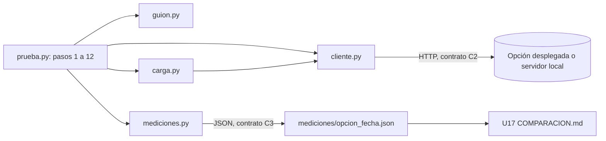

# Componentes lógicos — U2

Diseño no funcional de U2. La prueba común no es una versión del reto: no tiene componentes de
`components.md`. Es el dueño de los contratos C1, C2 y C3 (`contract-summary.md`, «Reglas de dueño y de
cambio») y consume la API de cada opción como lo hace el navegador.

Texto alternativo: `prueba.py` orquesta los pasos y usa el cliente HTTP, el guion (puro), la carga
(hilos) y las mediciones (puro). El cliente habla con la opción por el contrato C2 y las mediciones
escriben el JSON del contrato C3 que U17 lee.

| Módulo | Responsabilidad | Puro | Requisitos |
|---|---|---|---|
| `src/prueba.py` | Argumentos, orden de pasos, comprobaciones, impresión, cierre | No | U2-O1, U2-O4, U2-R4 |
| `src/cliente.py` | `Cliente`: GET/POST con cabeceras, tope de 20 s, conteo y latencia por petición, lectura tolerante de JSON | No | U2-S1, U2-R3, U2-E2 |
| `src/guion.py` | Huellas, clave por texto, respuestas por tipo y decisión, papeles, plan de salas, puntos esperados, detección de opacos y de órdenes | Sí | U2-R1, U2-S3, U2-S7, U2-P4 |
| `src/carga.py` | Pool de hilos de participantes y tableros, percentiles, espera con reloj del servidor | No (hilos y reloj) | U2-P1, U2-P2, U2-E4, U2-R7 |
| `src/mediciones.py` | Armar, validar, escribir y comparar el JSON C3 | Sí (salvo `escribir`) | U2-O2, U2-O3, U2-S4 |
| `pruebas/servidor_falso.py` | `http.server` mínimo para las pruebas de `cliente.py` y `carga.py` | No | U2-M1 |

Separación: `guion.py` y `mediciones.py` reciben datos y devuelven datos; nada en ellos abre red, reloj
ni archivos. Es la misma forma de las «calculadoras» de ADR-001, aplicada a la prueba para que sus reglas
tengan pruebas `unittest` sin servidor.
