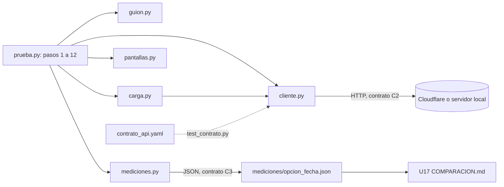

# Componentes lógicos — U2

> **Revisión 2026-10-27 (una sola sala).** Entran `pantallas.py` (los 27 ids `pantalla_*`, BR4.7) y
> `contrato_api.yaml` (BR8.3); `guion.py` reparte en 3 colegios en vez de armar un plan de salas (BR6.1).

Diseño no funcional de U2. La prueba común no es una versión del reto: no tiene componentes de
`components.md`. Es el dueño de los contratos C1, C2 y C3 (`contract-summary.md`, «Reglas de dueño y de
cambio») y consume la API de cada opción como lo hace el navegador.

Texto alternativo: `prueba.py` orquesta los pasos y usa el cliente HTTP, el guion (puro), la carga
(hilos), la tabla de pantallas (pura) y las mediciones (puro). El cliente habla con la opción por el
contrato C2, las mediciones escriben el JSON del contrato C3 que U17 lee, y una prueba comprueba que cada
ruta del cliente está en `contrato_api.yaml`.

| Módulo | Responsabilidad | Puro | Requisitos |
|---|---|---|---|
| `src/prueba.py` | Argumentos, orden de pasos, comprobaciones, impresión, restauración y cierre | No | U2-O1, U2-O4, U2-R4, U2-R8 |
| `src/cliente.py` | `Cliente`: GET/POST con cabeceras, tope de 20 s, conteo y latencia por petición, lectura tolerante de JSON, descarga de archivos | No | U2-S1, U2-R3, U2-E2 |
| `src/guion.py` | Huellas, clave por texto, respuestas por tipo y decisión (también la inválida), papeles, reparto en 3 colegios, puntos esperados, detección de opacos, de órdenes y de claves secretas | Sí | U2-R1, U2-S3, U2-S7, U2-P4, U2-E1 |
| `src/carga.py` | Hilos de participantes, de tablero y de panel, percentiles, arranques de B y C a su hora y espera con reloj del servidor | No (hilos y reloj) | U2-P1, U2-P2, U2-E4, U2-R7 |
| `src/pantallas.py` | Tabla de los 27 ids `pantalla_*` (ruta, estado, claves exigidas) y `revisar(id, codigo, cuerpo)` | Sí | U2-O1 |
| `src/mediciones.py` | Armar, validar, escribir y comparar el JSON C3; `no_aplica` | Sí (salvo `escribir` y `leer_referencia`) | U2-O2, U2-O3, U2-S4 |
| `contrato_api.yaml` | Contrato C1/C2, copiado tal cual | — | U2-M1 (`test_contrato.py`) |
| `pruebas/servidor_falso.py` | `http.server` mínimo para las pruebas de `cliente.py` y `carga.py` | No | U2-M1 |

Separación: `guion.py`, `pantallas.py` y `mediciones.py` reciben datos y devuelven datos; nada en ellos
abre red, reloj ni archivos (salvo las dos funciones de archivo de `mediciones.py`). Es la misma forma de
las «calculadoras» de ADR-001, aplicada a la prueba para que sus reglas tengan pruebas `unittest` sin
servidor.
