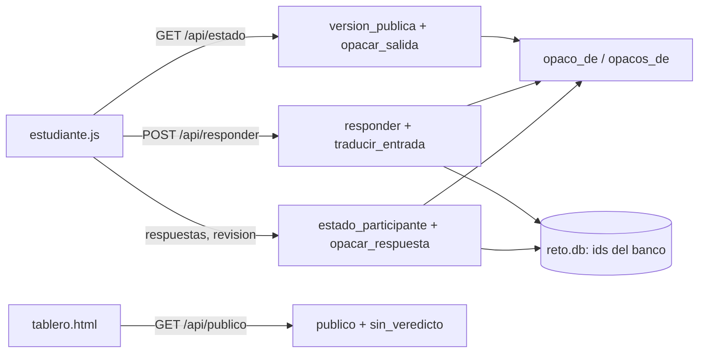

# Componentes lógicos — U3

Diseño no funcional de U3. La versión local sigue siendo un monolito de un archivo (`servidor.py`,
`code-structure.md`); U3 no lo parte (FR12.1). La tabla dice qué sección del archivo toca cada bloque de
`components.md`, solo para los cambios de esta unidad.

Texto alternativo: el navegador del estudiante recibe el examen, las respuestas guardadas y la revisión
con ids opacos calculados por `opaco_de`; al responder, `traducir_entrada` vuelve a ids del banco antes
de guardar; el tablero recibe en «cerrado» solo `n` y `listo` del experimento.

| Bloque de `components.md` | Dónde vive en `servidor.py` | Cambio de U3 |
|---|---|---|
| Banco (examen por participante, ids opacos, traducción) | sección «examen por participante»: `version_publica`, `examen_publico`; nuevas `opaco_de`, `opacos_de`, `opacar_salida`, `opacar_respuesta`, `traducir_entrada` | Nuevas funciones puras y una línea al final de `version_publica` |
| Examen (responder) | sección «acciones»: `responder` | Una línea: traducir antes de validar |
| Resultados (vista del participante y tablero) | sección «vistas»: `estado_participante`, `publico`; nueva `sin_veredicto` | Dos líneas en `estado_participante`, una en `publico` |
| Persistencia, Exportacion, Clasificacion, Experimento, ApiHttp, Arranque | el resto del archivo | Sin cambios |
| AppEstudiante, PanelDocente, Tablero | `web/` | Sin cambios |

Las seis funciones nuevas son «calculadoras» (ADR-001): reciben datos y devuelven datos, sin base, red ni
reloj, y por eso se prueban con `unittest` sin servidor (ADR-L3).
