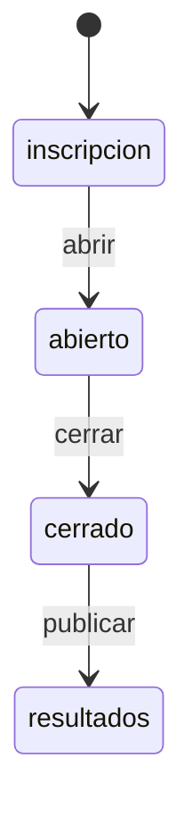
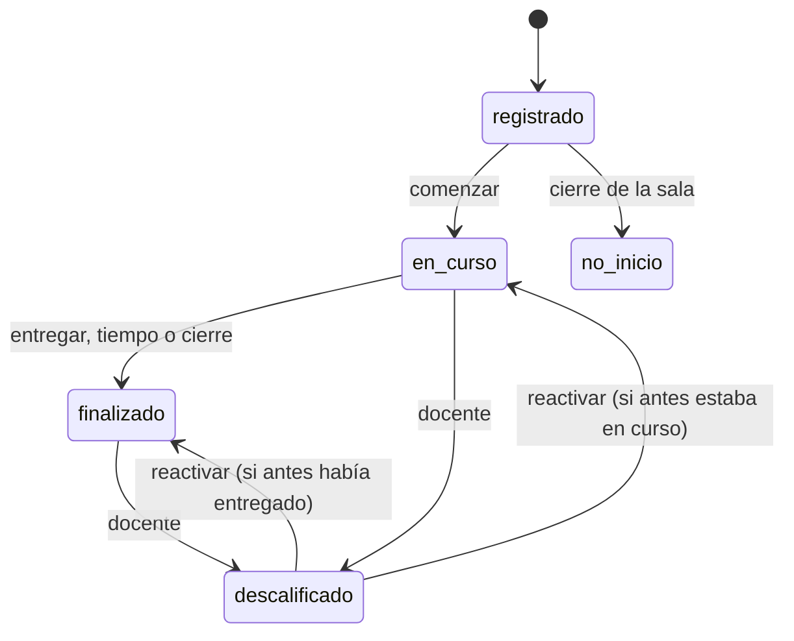

# Especificación funcional — U4 `u4-cloudflare-reglas`

Qué entrega U4: las seis «calculadoras» de ADR-001 en JavaScript, con la forma del contrato C4, sus
pruebas y la tabla de casos compartida. Reemplaza la versión mínima de Banco y Calificacion que trajo U1
(`unit-of-work.md`, «U4, U8, U12»). Los datos están en `entities.md`, las reglas en `rules.md` y las
decisiones en `../decisions.md` (ADR-W6 a ADR-W9). Este alcance no tiene historias de usuario.

## Qué demuestra la unidad

Que con los mismos datos y la misma hora, la opción Cloudflare da los mismos puntos, el mismo bono, el
mismo orden y el mismo experimento que `servidor.py` (NFR11, FR5.5), y que eso se comprueba sin servidor
ni base (FR7.1, FR10.5), con una tabla de casos que no escribió nadie a mano (C4).

## Archivos

| Archivo | Componente de `components.md` | Funciones (nombres de C4) |
|---|---|---|
| `src/reglas/banco.js` | Banco | `validar_banco`, `huella_banco`, `examen_publico`, `armar_misiones`, `aplicar_bloqueos`, `resolver`, `visible_para`, `opaco_de`, `opacos_de`, `traducir_opaco`, **`traducir_respuesta`**, **`respuesta_opaca`**, **`revision_publica`** |
| `src/reglas/calificacion.js` | Calificacion | `validar_respuesta`, **`a_numero`**, `fraccion`, `bono`, `cerrar_intento` |
| `src/reglas/clasificacion.js` | Clasificacion | **`ordenar`**, **`nota`**, **`puesto_de`** |
| `src/reglas/ciclo_de_sala.js` | CicloDeSala | `transicion_permitida`, `hora_de_entrega`, **`estado_tras_cierre`**, **`admite_inscripciones`** |
| `src/reglas/limpieza_entrada.js` | LimpiezaEntrada | **`normalizar_texto`** (antes `limpiar`), `normalizar_codigo`, `normalizar_nombre`, **`normalizar_integrantes`**, **`validar_inscripcion`** |
| `src/reglas/experimento.js` | Experimento | **`calcular`**, **`experimento_publico`** |
| `src/reglas/comun.js` | (apoyo) | `sha256_hex`, `iguales_en_tiempo_constante`, `redondear`, `ALFABETO`, `ESTADOS_SALA`, `PUNTOS_TOTALES` |
| `src/reglas.js` | fachada | `export * from` cada archivo; `limpiar` se conserva como alias de `normalizar_texto` para que `reto.js` de U1 no cambie |

En negrita lo nuevo. Todo lo de U1 conserva nombre y firma; sus 23 pruebas siguen pasando.

## Flujos

### F1. Traducir y calificar una respuesta de cualquier tipo (BR1.1, BR2.1, BR2.3)

1. `reto.js` resuelve la pregunta con `resolver(semilla, pregunta)`.
2. `traducir_respuesta(semilla, cuerpo, respuesta_opaca)` devuelve la respuesta con ids del banco, o
   `null` si algún id opaco no corresponde.
3. `validar_respuesta(cuerpo, traducida)` devuelve `{valor}` normalizado o `{error: "formato"}`.
4. `fraccion(cuerpo, valor)` da el crédito; `puntos = fraccion × cuerpo.puntos` (la multiplicación la hace
   `reto.js`, como hoy `responder()`).
5. Para devolver la respuesta guardada al navegador, `respuesta_opaca(semilla, cuerpo, valor)` hace el
   camino inverso. En U1 esto solo cubría `opcion`.

### F2. Cerrar un intento (BR2.4, BR4.2)

`hora_de_entrega(ahora, inicio, duracion, cierre)` dice si se entrega y por qué; `cerrar_intento` da los
números. U5 escribe la fila; U4 solo calcula. Sin cambios frente a U1 salvo que `cierre` ya no es
siempre `null`.

### F3. Ordenar una sala (BR3.1 a BR3.3)

`ordenar(finalizados)` recibe las filas de participantes finalizados **de una sola sala**, con `colegio`
ya resuelto al nombre definitivo (lo hace quien consulta, U5/U6), y devuelve las filas clasificadas.
`puesto_de(id, finalizados)` y `nota(puntos)` se apoyan en ella.

### F4. Cerrar la sala (BR4.1, BR4.3)

`transicion_permitida("abierto", "cerrado")` es verdadera; para cada participante,
`estado_tras_cierre(estado)` dice a qué pasa, y `hora_de_entrega(ahora, inicio, duracion, ahora)` da la
entrega con motivo `cierre` a los que estaban en curso. U5 escribe.

### F5. Limpiar y validar una inscripción (BR5.1 a BR5.4)

`normalizar_texto` sobre nombre, colegio (id, 80) y grado; `normalizar_integrantes` sobre integrantes;
`validar_inscripcion(campos, ids_de_colegios_de_la_sala)` devuelve los errores. El nombre repetido lo
revisa U5 contra la base.

### F6. Experimento de una sala (BR6.1, BR6.2)

`calcular(banco, filas)` da el objeto completo para el panel; `experimento_publico(experimento, estado)`
lo reduce para `/api/publico` mientras la sala no esté en `resultados`.

### F7. Revisión en resultados (BR1.2)

`revision_publica(banco, semilla, grupo)` da `{<pregunta_id>: {respuesta, explicacion}}` con ids opacos,
para que `estudiante.js` marque la opción correcta con los mismos ids que ya ve (C-02). U6 la llama.

### F8. Generar y copiar la tabla de casos (BR7.1)

1. `python3 despliegues/prueba_comun/herramientas/generar_casos.py` escribe
   `despliegues/prueba_comun/casos_reglas.json` (ADR-W7). Se corre a mano cuando cambia el generador o el
   banco de prueba, y el JSON se versiona.
2. `bash despliegues/cloudflare/herramientas/copiar.sh` copia la tabla a
   `despliegues/cloudflare/pruebas/casos_reglas.json`.
3. `node --test despliegues/cloudflare/pruebas/casos_reglas.test.js` corre cada caso; `verificar.sh`
   comprueba antes que la copia esté al día.

## Forma de la tabla de casos (C4, ADR-W7)

```json
[
  {"regla": "Calificacion", "funcion": "fraccion", "fuente": "servidor.py",
   "entrada": {"pregunta": {"id": "p_multiple", "tipo": "multiple", "puntos": 15, "respuesta": ["a", "c"], "opciones": [{"id": "a"}, {"id": "b"}, {"id": "c"}]},
               "respuesta": ["a", "b"]},
   "salida_esperada": 0},
  {"regla": "Experimento", "funcion": "calcular", "fuente": "servidor.py", "tolerancia": 1e-9,
   "entrada": {"banco": "banco_prueba", "filas": []},
   "salida_esperada": {"n": 0, "listo": false}}
]
```

- `entrada.banco: "banco_prueba"` es una referencia a `banco_prueba.json`, que la prueba carga una vez;
  así la tabla no repite el banco en cada caso.
- Mínimo de casos por función, que el generador produce y la prueba cuenta: `validar_respuesta` 3 por
  tipo (1 válido, 2 inválidos); `fraccion` 3 por tipo con puntos (acierto, parcial, cero);
  `a_numero` 8; `bono` y `cerrar_intento` 4 (última respuesta antes del fin, sin respuestas, vencido,
  cierre); `ordenar` 5 (empate en total, empate en total y puntos, empate hasta `fin`, empate hasta `id`,
  lista vacía); `nota` 3; `transicion_permitida` 7; `hora_de_entrega` 5; `estado_tras_cierre` 5;
  `normalizar_texto` 6; `normalizar_integrantes` 4; `validar_inscripcion` 4; `calcular` 4 (n < 2, solo
  grupo A, los dos grupos, con un descalificado); `experimento_publico` 2.
- Los casos de Experimento usan el Expediente 01 **inventado** del banco de prueba: sus veredictos no son
  los del banco real.

## Estados

U4 no cambia los diagramas de estado de U1; completa las transiciones que U1 dejó para U5:



Texto alternativo: las únicas tres transiciones permitidas son abrir, cerrar y publicar, en ese orden;
cualquier otra es rechazada (BR4.1). Volver a «inscripción» solo ocurre con «Reiniciar» (U6), que no es
una transición de estado sino un borrado con copia.



Texto alternativo: el participante nace «registrado»; comienza o, si la sala cierra sin que empiece,
pasa a «no inició»; en curso termina por entrega, tiempo o cierre; el docente puede anular en curso o
tras entregar, y reactivar devuelve al estado anterior. `estado_tras_cierre` cubre las flechas de
cierre; las del docente las escribe U5 con la regla de hoy (`accion_participante()` de `servidor.py`).

## Reglas (vista derivada de `rules.md`)

| Flujo | Reglas |
|---|---|
| F1 responder | BR1.1, BR1.3, BR2.1, BR2.2, BR2.3 |
| F2 cerrar intento | BR2.4, BR4.2 |
| F3 ordenar | BR3.1, BR3.2, BR3.3 |
| F4 cerrar sala | BR4.1, BR4.3 |
| F5 inscripción | BR4.4, BR5.1, BR5.2, BR5.3, BR5.4 |
| F6 experimento | BR6.1, BR6.2 |
| F7 revisión | BR1.2 |
| F8 tabla de casos | BR7.1, BR7.2 |

## Pantallas

Ninguna: U4 no toca `web/`. Los ids opacos de los otros tipos ya los acepta `estudiante.js` porque usa los
ids que recibe en `misiones` (C-02).

## Fuera de la unidad

Escribir en la base, las rutas nuevas, el panel y el tablero (U5 y U6). La parte de la prueba común que
usa estas reglas por HTTP (todos los tipos de pregunta, FR12.3) es de U2.
