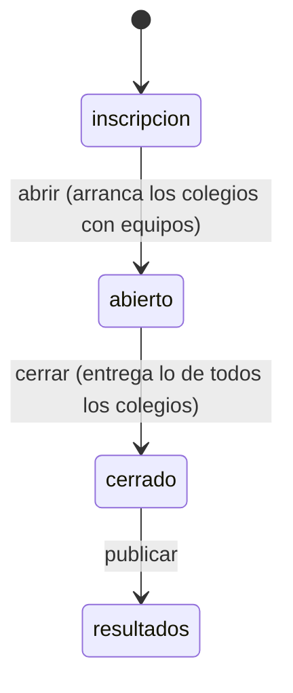
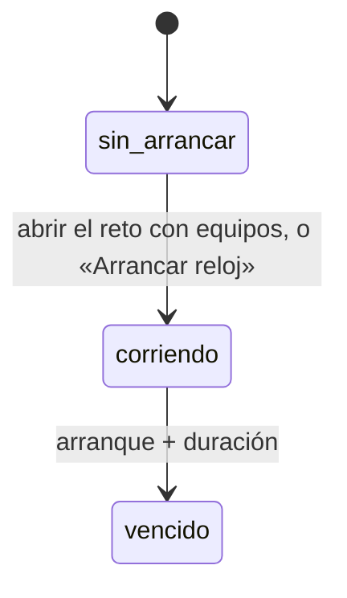
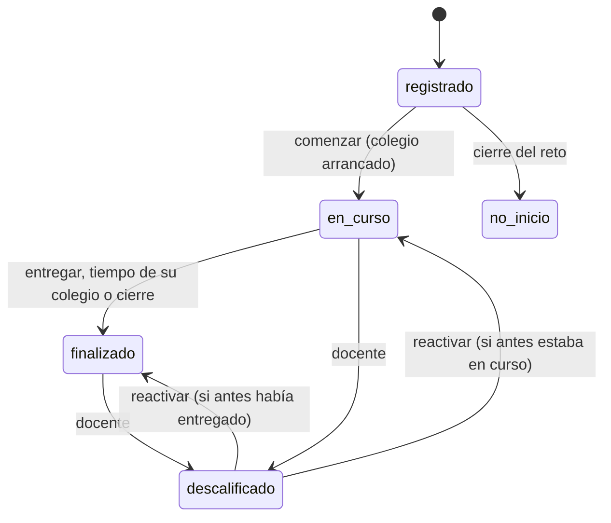

# Especificación funcional — U4 `u4-cloudflare-reglas`

> **Revisión 2026-10-25 (una sola sala, solo Cloudflare).** Las reglas son de un solo reto con varios
> colegios y un reloj por colegio (FR3.1, FR11, ADR-011, contrato C4 revisado). Cambian: el archivo
> `ciclo_de_sala.js` pasa a `ciclo_del_reto.js` con `puede_arrancar_colegio`, `puede_comenzar`,
> `estado_reloj` y `colegios_al_abrir`; Clasificacion gana `por_grado` y ordena con tiempos relativos al
> arranque (F3); LimpiezaEntrada gana `preparar_colegios` (F9); `comun.js` gana `redondear` como Python
> (ADR-W8); la tabla de casos suma fuentes y el caso obligatorio de dos colegios. Se conservan F1 a F8.

Qué entrega U4: las seis «calculadoras» de ADR-001 en JavaScript, con la forma del contrato C4, sus
pruebas y la tabla de casos compartida. Reemplaza la versión mínima de Banco y Calificacion que trajo U1
(`unit-of-work.md`, «U4»). Los datos están en `entities.md`, las reglas en `rules.md` y las decisiones en
`../decisions.md` (ADR-W6 a ADR-W9). Este alcance no tiene historias de usuario.

## Qué demuestra la unidad

Que con los mismos datos y la misma hora, la opción Cloudflare da los mismos puntos, el mismo bono, el
mismo orden y el mismo experimento que `servidor.py` (NFR11, FR5.5); que con colegios arrancados a horas
distintas el bono y los desempates se miden desde el arranque de cada colegio (FR2.6); y que eso se
comprueba sin servidor ni base (FR7.1, FR10.5), con una tabla de casos que no escribió nadie a mano (C4).

## Archivos

| Archivo | Componente de `components.md` | Funciones (nombres de C4) |
|---|---|---|
| `src/reglas/banco.js` | Banco | `validar_banco`, `huella_banco`, `examen_publico`, `armar_misiones`, `aplicar_bloqueos`, `resolver`, `visible_para`, `opaco_de`, `opacos_de`, `traducir_opaco`, **`traducir_respuesta`**, **`respuesta_opaca`**, **`revision_publica`** |
| `src/reglas/calificacion.js` | Calificacion | `validar_respuesta`, **`a_numero`**, `fraccion`, `bono`, `cerrar_intento` |
| `src/reglas/clasificacion.js` | Clasificacion | **`ordenar`**, **`por_grado`**, **`nota`**, **`puesto_de`** |
| `src/reglas/ciclo_del_reto.js` | CicloDelReto | `transicion_permitida`, `hora_de_entrega`, **`estado_tras_cierre`**, **`admite_inscripciones`**, **`puede_arrancar_colegio`**, **`puede_comenzar`**, **`estado_reloj`**, **`colegios_al_abrir`** |
| `src/reglas/limpieza_entrada.js` | LimpiezaEntrada | **`normalizar_texto`** (antes `limpiar`), `normalizar_codigo`, **`normalizar_nombre_colegio`** (antes `normalizar_nombre`), **`normalizar_integrantes`**, **`validar_inscripcion`**, **`preparar_colegios`** |
| `src/reglas/experimento.js` | Experimento | **`calcular`**, **`experimento_publico`** |
| `src/reglas/comun.js` | (apoyo) | `sha256_hex`, `iguales_en_tiempo_constante`, **`redondear`**, `ALFABETO`, `ESTADOS_RETO`, `PUNTOS_TOTALES`, `BONO_MAX`, `GRADOS` |
| `src/reglas.js` | fachada | `export * from` cada archivo; `limpiar` y `normalizar_nombre` se conservan como alias para que `reto.js` de U1 no cambie hasta U5 |

En negrita lo nuevo. Todo lo de U1 conserva nombre y firma; sus pruebas siguen pasando. `normalizar_codigo`
sigue: lo usan el código de sala que escriben los estudiantes y el código personal de `/api/entrar`.

## Firmas (contrato C4, con los nombres de entrada)

| Función | Entrada | Salida |
|---|---|---|
| `cerrar_intento` | `{ahora, inicio, duracion, ultima, puntos}`; `inicio` = arranque del colegio | ResultadoDeCierre |
| `ordenar` | lista de ParticipanteParaOrden | lista de FilaClasificada con `puesto` |
| `por_grado` | salida de `ordenar` | `{lista, por_grado: {"9", "10", "11"}}` con `puesto_grado` |
| `nota` | `puntos` | número de 1,0 a 5,0 con 2 decimales |
| `puesto_de` | `id`, lista de ParticipanteParaOrden | `{puesto, puesto_grado, nota}` o `null` |
| `transicion_permitida` | `estado_actual`, `estado_nuevo` | booleano |
| `puede_arrancar_colegio` | `estado_reto`, `arranque` | `{ok}` o `{ok: false, mensaje}` |
| `puede_comenzar` | `estado_reto`, `estado_participante`, `arranque`, `duracion`, `ahora` | ResultadoDeComenzar |
| `hora_de_entrega` | `ahora`, `inicio`, `duracion`, `cierre` | Entrega o `null` |
| `estado_reloj` | `arranque`, `duracion`, `ahora` | EstadoReloj |
| `colegios_al_abrir` | `[{id_colegio, arranque, equipos}]` | lista de `id_colegio` |
| `preparar_colegios` | `{nombres o nombre, existentes}` | `{nombres: [{nombre, nombre_normalizado}]}` o `{error, existente?}` |
| `experimento_publico` | `experimento`, `estado` | objeto completo, `{n, listo}` o `null` |
| `redondear` | `x`, `d` | número, igual que `round(x, d)` de Python |

`duracion` va siempre en segundos (`duracion_min × 60`, lo calcula `reto.js`).

## Flujos

### F1. Traducir y calificar una respuesta de cualquier tipo (BR1.1, BR2.1, BR2.3)

1. `reto.js` resuelve la pregunta con `resolver(semilla, pregunta)`.
2. `traducir_respuesta(semilla, cuerpo, respuesta_opaca)` devuelve la respuesta con ids del banco, o
   `null` si algún id opaco no corresponde.
3. `validar_respuesta(cuerpo, traducida)` devuelve `{valor}` normalizado o `{error: "formato"}`.
4. `fraccion(cuerpo, valor)` da el crédito; `puntos = fraccion × cuerpo.puntos` (la multiplicación la hace
   `reto.js`, como hoy `responder()`).
5. Para devolver la respuesta guardada al navegador, `respuesta_opaca(semilla, cuerpo, valor)` hace el
   camino inverso. En U1 esto solo cubría `opcion`.

### F2. Cerrar un intento (BR2.4, BR4.2)

`hora_de_entrega(ahora, inicio, duracion, cierre)` dice si se entrega y por qué; `cerrar_intento` da los
números. `inicio` es el arranque del colegio del participante, así cada colegio vence a su hora y el bono
se mide desde su arranque. U5 escribe la fila; U4 solo calcula. `cierre` es `cerrado_en` del reto o `null`.

### F3. Ordenar el reto (BR3.1 a BR3.4)

1. `ordenar(finalizados)` recibe los participantes finalizados **de todos los colegios**, con `colegio` ya
   resuelto al nombre de la lista (lo hace quien consulta, U5 o U6), y los ordena por total ↓, puntos ↓,
   `tiempo_respuestas` ↑, `tiempo_usado` ↑ e `id` ↑.
2. `por_grado(ordenadas)` agrega `puesto_grado` a cada fila y separa las listas de 9.°, 10.° y 11.°.
3. El podio general son los `puesto` 1, 2 y 3; el de un grado, los `puesto_grado` 1, 2 y 3 (FR2.5).
4. `puesto_de(id, finalizados)` y `nota(puntos)` se apoyan en ellas.

Con un solo colegio, o con todos arrancados a la misma hora, `tiempo_usado` ↑ da el mismo orden que `fin` ↑
de `servidor.py`, porque todos restan el mismo `inicio` (FR11.7, BR7.3).

### F4. Cerrar el reto (BR4.1, BR4.3)

`transicion_permitida("abierto", "cerrado")` es verdadera; para cada participante,
`estado_tras_cierre(estado)` dice a qué pasa, y `cerrar_intento` con `ahora` igual a la hora del cierre da
la entrega con motivo `cierre` a los que estaban en curso, de todos los colegios. U5 escribe.

### F5. Limpiar y validar una inscripción (BR4.4, BR5.1 a BR5.3)

`normalizar_texto` sobre nombre, colegio (id, 80) y grado; `normalizar_integrantes` sobre integrantes;
`validar_inscripcion(campos, ids_colegios)` devuelve los errores, con `ids_colegios` = los `id_colegio` de la
lista del docente. El nombre repetido (nombre, `id_colegio` y grado) lo revisa U5 contra la base.

### F6. Experimento del reto (BR6.1, BR6.2)

`calcular(banco, filas)` da el objeto completo para el panel; `experimento_publico(experimento, estado)`
lo reduce para `/api/publico`: nada en «inscripción» y «abierto», `{n, listo}` en «cerrado», completo en
«resultados».

### F7. Revisión en resultados (BR1.2)

`revision_publica(banco, semilla, grupo)` da `{<pregunta_id>: {respuesta, explicacion}}` con ids opacos,
para que `estudiante.js` marque la opción correcta con los mismos ids que ya ve (C-02). U5 la llama en
`/api/estado` solo en «resultados» y con el participante finalizado.

### F8. Generar y copiar la tabla de casos (BR7.1, BR7.3)

1. `python3 despliegues/prueba_comun/herramientas/generar_casos.py` escribe
   `despliegues/prueba_comun/casos_reglas.json` (ADR-W7). Se corre a mano cuando cambia el generador o el
   banco de prueba, y el JSON se versiona. Se detiene si el caso B de BR7.3 no coincide con
   `clasificacion()` de `servidor.py`.
2. `bash despliegues/cloudflare/herramientas/copiar.sh` copia la tabla a
   `despliegues/cloudflare/pruebas/casos_reglas.json`.
3. `node --test despliegues/cloudflare/pruebas/casos_reglas.test.js` corre cada caso; `verificar.sh`
   comprueba antes que la copia esté al día.

### F9. Relojes por colegio (BR4.5 a BR4.8, BR5.5)

1. **Cargar la lista.** `preparar_colegios({nombres, existentes})` limpia lo que pegó el docente; U5 guarda
   los nombres si no hay error.
2. **Abrir el reto.** `transicion_permitida("inscripcion", "abierto")` y `colegios_al_abrir(colegios)` dan
   los colegios que U5 arranca con `arranque = ahora`.
3. **Arrancar uno.** `puede_arrancar_colegio(estado_reto, arranque)` decide si U5 guarda `arranque = ahora`.
4. **Comenzar.** `puede_comenzar(...)` decide si el equipo pasa a «en curso» con `inicio = arranque`.
5. **Mostrar.** `estado_reloj(arranque, duracion, ahora)` da lo que ven el panel, el tablero y el
   estudiante (`colegio_restante_seg`).

## Forma de la tabla de casos (C4, ADR-W7)

```json
[
  {"regla": "Calificacion", "funcion": "fraccion", "fuente": "servidor.py",
   "entrada": {"pregunta": {"id": "p_multiple", "tipo": "multiple", "puntos": 15, "respuesta": ["a", "c"], "opciones": [{"id": "a"}, {"id": "b"}, {"id": "c"}]},
               "respuesta": ["a", "b"]},
   "salida_esperada": 0},
  {"regla": "CicloDelReto", "funcion": "estado_reloj", "fuente": "referencia ADR-011",
   "entrada": {"arranque": null, "duracion": 5400, "ahora": 1000},
   "salida_esperada": {"estado": "sin_arrancar", "restante_seg": null}},
  {"regla": "Experimento", "funcion": "calcular", "fuente": "servidor.py", "tolerancia": 1e-9,
   "entrada": {"banco": "banco_prueba", "filas": []},
   "salida_esperada": {"n": 0, "listo": false}}
]
```

Los valores de este bloque son ilustrativos de la forma; los del archivo los escribe el generador.

- `entrada.banco: "banco_prueba"` es una referencia a `banco_prueba.json`, que la prueba carga una vez;
  así la tabla no repite el banco en cada caso.
- Las horas de los casos son números fabricados (por ejemplo, arranque en 1.000 s), nunca horas de un reto
  real.
- Mínimo de casos por función, que el generador produce y la prueba cuenta:

| Función | Casos | Cuáles |
|---|---|---|
| `validar_respuesta` | 3 por tipo | 1 válido, 2 inválidos |
| `fraccion` | 3 por tipo con puntos | acierto, parcial, cero |
| `a_numero` | 8 | coma, punto, miles, entero, sin dígitos y combinaciones |
| `bono`, `cerrar_intento` | 5 | última respuesta antes del fin, sin respuestas, vencido, cierre, colegio arrancado tarde |
| `ordenar` | 7 | empate en total, en total y puntos, hasta `tiempo_usado`, hasta `id`, lista vacía, y los casos A y B de dos colegios (BR7.3) |
| `por_grado` | 3 | los tres grados, un grado vacío, un solo participante |
| `nota` | 4 | 0, 1.000, intermedio y un empate exacto (31,25 puntos) |
| `redondear` | 7 | un empate exacto por cada número de decimales usado (1, 2, 3, 4, 9) y dos sin empate |
| `transicion_permitida` | 7 | las 3 permitidas y 4 prohibidas |
| `hora_de_entrega` | 5 | sigue, vence, cierre antes, cierre después del vencimiento, cierre nulo |
| `estado_tras_cierre` | 5 | un estado de participante cada uno |
| `puede_arrancar_colegio` | 3 | arranca, reto no abierto, ya arrancó |
| `puede_comenzar` | 5 | comienza, sin cambio, reto no abierto, colegio sin arrancar, tiempo terminado |
| `estado_reloj` | 4 | sin arrancar, corriendo, justo al vencer, vencido |
| `colegios_al_abrir` | 3 | todos con equipos, uno sin equipos, uno ya arrancado |
| `normalizar_texto` | 6 | NFC, ancho cero, control, espacios, largo, vacío |
| `normalizar_integrantes` | 4 | vacío, uno, varios, comas sobrantes |
| `validar_inscripcion` | 4 | válido, nombre corto, grado, colegio fuera de la lista |
| `preparar_colegios` | 6 | lista válida, línea vacía, nombre corto, repetido con la lista, repetido dentro del texto, solo `nombre` |
| `calcular` | 4 | n < 2, solo grupo A, los dos grupos, con un descalificado |
| `experimento_publico` | 3 | abierto, cerrado, resultados |

- Los casos de Experimento usan el Expediente 01 **inventado** del banco de prueba: sus veredictos no son
  los del banco real.

## Estados



Texto alternativo: las únicas tres transiciones permitidas son abrir, cerrar y publicar, en ese orden;
cualquier otra es rechazada (BR4.1). Volver a «inscripción» solo ocurre con «Reiniciar» (U6), que no es
una transición de estado sino un borrado con copia.



Texto alternativo: el reloj de cada colegio nace sin arrancar, corre desde que se abre el reto (si el
colegio ya tiene equipos) o desde «Arrancar reloj», y vence a los `duracion_min` minutos. No vuelve atrás
(BR4.5, BR4.7). «Reiniciar» borra los colegios (U6).



Texto alternativo: el participante nace «registrado»; comienza solo cuando su colegio arrancó o, si el
reto cierra sin que empiece, pasa a «no inició»; en curso termina por entrega, por el tiempo de su colegio o
por el cierre; el docente puede anular en curso o tras entregar, y reactivar devuelve al estado anterior.
`estado_tras_cierre` cubre las flechas de cierre; las del docente las escribe U5 con la regla de hoy
(`accion_participante()` de `servidor.py`).

## Reglas (vista derivada de `rules.md`)

| Flujo | Reglas |
|---|---|
| F1 responder | BR1.1, BR1.3, BR2.1, BR2.2, BR2.3 |
| F2 cerrar intento | BR2.4, BR2.5, BR4.2 |
| F3 ordenar | BR2.5, BR3.1, BR3.2, BR3.3, BR3.4 |
| F4 cerrar el reto | BR4.1, BR4.3 |
| F5 inscripción | BR4.4, BR5.1, BR5.2, BR5.3 |
| F6 experimento | BR6.1, BR6.2 |
| F7 revisión | BR1.2 |
| F8 tabla de casos | BR7.1, BR7.2, BR7.3 |
| F9 relojes por colegio | BR4.5, BR4.6, BR4.7, BR4.8, BR5.4, BR5.5 |

## Pantallas

Ninguna: U4 no toca `web/`. Los ids opacos de los otros tipos ya los acepta `estudiante.js` porque usa los
ids que recibe en `misiones` (C-02).

## Fuera de la unidad

Escribir en la base, las rutas, el panel y el tablero (U5 y U6). La parte de la prueba común que usa estas
reglas por HTTP (todos los tipos de pregunta y los relojes por colegio, FR12.3, FR11.7) es de U2.
