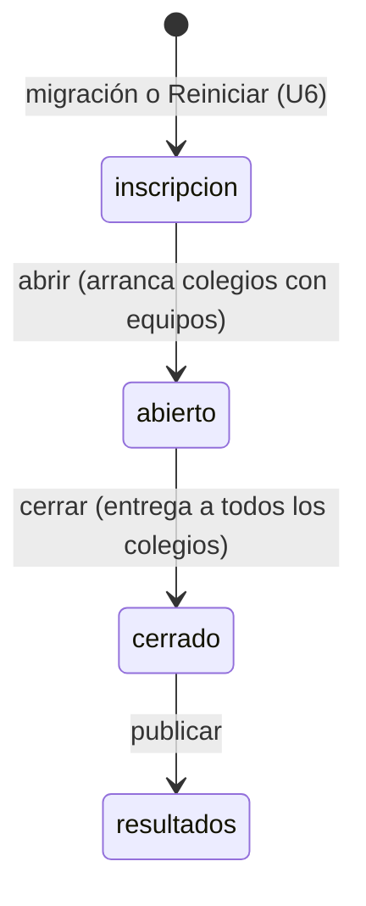
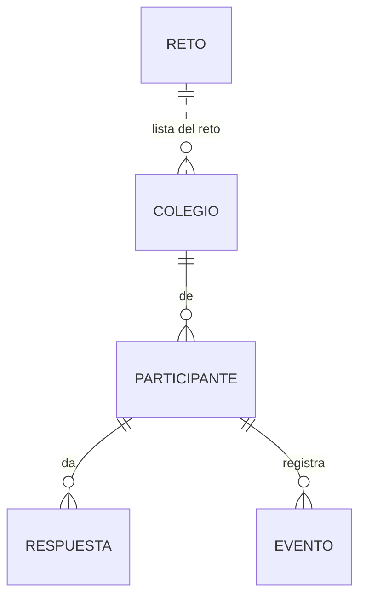

# Especificación funcional — U5 `u5-cloudflare-salas` (reto, colegios y relojes)

> **Revisión 2026-10-25 (una sola sala, solo Cloudflare).** Se reescribe para una sola sala, un solo
> docente con una sola clave (`CLAVE_DOCENTE`) y un reloj por colegio (ADR-009 a ADR-011, contrato
> revisado). Desaparecen el panel del semillero, las claves de sala, el catálogo, los colegios
> provisionales y `?sala=`. Entran la migración desde el corte (ADR-W19), la lista de colegios con
> «Arrancar reloj», el aviso de espera del estudiante y el criterio del humano del 2026-10-26: «que ya
> todos los paneles funcionen, el dash, el de admin y el de los estudiantes». Los flujos F1 y F2 cambian
> de contenido; F3 a F5 se conservan; F6 a F8 son nuevos.

Qué hace la opción Cloudflare Workers al cerrar U5: un reto completo, de punta a punta, con el panel del
docente y la pantalla del estudiante. Los datos están en `entities.md`, las reglas en `rules.md`, las
decisiones en `../decisions.md` (ADR-W10 a ADR-W12, ADR-W19 y ADR-W20). Sale de `unit-of-work.md`
(«U5»), `requirements.md`, `components.md`, `contract-summary.md` y `servidor.py`. Sin historias de usuario.

## Qué demuestra la unidad

Con la clave docente se entra al panel, se carga la lista de colegios, se abre el reto (arrancan los
colegios que ya tienen equipos) y se arranca a mano un colegio que llegó tarde; cada colegio vence a sus
`duracion_min` minutos desde su arranque; los equipos responden las 42 preguntas, el docente actúa sobre
ellos, cierra y publica. El estudiante no nota más cambio que el aviso de espera (FR11.3).

## Flujos

### F1. Arranque del servicio (BR1.6, BR8.1)

1. El objeto revisa `CLAVE_DOCENTE`: si falta o tiene menos de 12 caracteres, no atiende (500 en toda
   ruta, también en `GET /api/publico`, así falla la prueba de humo).
2. Corre las migraciones pendientes (ADR-W10). Sobre el corte desplegado: versión 1 (ya estaba), versión
   2 (aparta `v1_*` y crea el reto vacío). Sobre un objeto nuevo: 1 y 2 seguidas.
3. Antes de cada petición aplica la entrega de lo vencido (BR6.3).

### F2. Panel del docente (BR1.3 a BR1.5, BR2.2, BR2.3, BR6.2, BR7.1)

1. `POST /api/admin/login` con la clave en `X-Clave-Admin` responde `{ok: true}`; sin `rol` ni `sala`.
2. `GET /api/admin/resumen` cada 3 s arma el panel de hoy, más la tarjeta de colegios (F6).
3. Configuración con `POST /api/admin/config`: código de sala, evento, duración (solo en «inscripción»),
   modo sorpresa y retroalimentación. El interruptor «Reloj global» desaparece.
4. Abrir, cerrar y publicar con `POST /api/admin/estado`; abrir arranca los colegios con equipos; al cerrar
   se entrega a todos los colegios y quien nunca empezó queda «No inició».
5. Acciones sobre participantes con `POST /api/admin/participante` (Entregar, Anular, Reactivar,
   Eliminar).

### F3. Inscripción completa (BR5.1)

Como U1 F4, con el código de sala del reto, el colegio elegido de `GET /api/colegios` (se llena al abrir
el formulario, sin esperar el código), la limpieza de FR10.2, los integrantes de FR10.4 y la validación de
FR10.1 hechas por las calculadoras de U4.

### F4. Responder cualquier tipo (BR6.1)

Como U1 F8, con `traducir_respuesta`, `validar_respuesta` y `fraccion` de U4 para los 10 tipos. La
respuesta guardada sale al navegador con `respuesta_opaca`.

### F5. Entrega por tiempo y por cierre (BR6.3, BR2.3)

Antes de cada petición, `hora_de_entrega` con el `inicio` de cada equipo (el arranque de su colegio) y
`cerrado_en` del reto. Al cerrar, `cerrado_en` queda fijo; un intento que no alcanzó a cerrarse en la
transacción del cierre (no debería ocurrir) se entrega con la misma hora exacta.

### F6. Lista de colegios y relojes (BR4.2 a BR4.5)

1. En «inscripción», el docente pega la lista (un nombre por línea) en «Agregar colegios»:
   `POST /api/admin/colegios` con `accion: "agregar"` y `nombres`. Si un nombre ya existe, nada se agrega
   y el panel muestra «Ese colegio ya existe.» con el nombre que choca.
2. «Quitar» (`accion: "quitar"`) solo en colegios sin equipos.
3. Al abrir el reto, los colegios con equipos arrancan solos. Cada fila muestra el estado del reloj
   («Sin arrancar», minutos que quedan, «Vencido»).
4. Un colegio que llega tarde: el docente lo agrega si falta (con el reto abierto) y pulsa «Arrancar
   reloj». El panel pide confirmación dos veces («¿Arrancar el reloj de <colegio>? Tendrá <n> minutos desde
   ahora.» y «No se puede deshacer.»); luego `accion: "arrancar"`.

### F7. Lo que ve el estudiante de su reloj (BR6.4, BR6.5)

1. Con el reto en «abierto» y su colegio sin arrancar, la sala de espera muestra «Tu colegio todavía no ha
   empezado. Espera la señal del docente.» y «Comenzar» queda deshabilitado; si lo pulsa igual, el servidor
   responde ese mensaje con 400.
2. Cuando `participante.colegio_arranque` tiene valor, «Comenzar» se habilita y la pantalla muestra
   `colegio_restante_seg` como minutos que quedan.
3. Su tiempo corre desde el arranque del colegio, aunque pulse «Comenzar» después (FR3.1).

### F8. Migración desde el corte (BR8.1, ADR-W19)

1. Copiar en local el estado del corte: `wrangler dev` con el código de U1 y la prueba común mínima de U1
   (crea una sala, un colegio y un participante).
2. Cambiar al código de U5 sobre la misma carpeta de estado local y arrancar `wrangler dev`.
3. Comprobar: `PRAGMA user_version` = 2; existen `v1_salas` y `v1_participantes` con las filas de antes;
   `reto` tiene una fila en «inscripción»; `colegios` y `participantes` están vacías; el panel entra con la
   clave docente.

## Rutas

La tabla completa al cerrar U5 (BR1.1). Coincide con la del contrato (`contract-summary.md`, «Tabla de
rutas»); las de U6 se nombran para que se vea qué falta.

| Método | Ruta | Nivel | Flujo | Unidad | Cambio frente al corte |
|---|---|---|---|---|---|
| GET | `/api/publico` | público | F2, tablero | U5 (sin `ranking`, `por_grado` ni `experimento`) y U6 | Sin `?sala=`; tablero completo y salud; `colegios[]` |
| GET | `/api/colegios` | público | F3 | U5 | Sin `?sala=` |
| POST | `/api/registro` | público | F3 | U5 | Código del reto; colegio de la lista |
| POST | `/api/entrar` | público | F3 | U5 | — |
| GET | `/api/estado` | token | F4, F7 | U5 (U6 agrega lo de resultados) | `colegio_arranque`, `colegio_restante_seg` |
| POST | `/api/comenzar` | token | F7 | U5 | Exige colegio arrancado |
| POST | `/api/responder` | token | F4 | U5 | 10 tipos |
| POST | `/api/finalizar`, `/api/evento` | token | F4 | U5 | — |
| POST | `/api/admin/login` | clave | F2 | U5 | Solo `ok` |
| GET | `/api/admin/resumen` | clave | F2 | U5 | **nueva** en Cloudflare |
| POST | `/api/admin/estado` | clave | F2 | U5 | Tres transiciones con sus efectos |
| POST | `/api/admin/config` | clave | F2 | U5 | **nueva** en Cloudflare |
| GET | `/api/admin/colegios` | clave | F6 | U5 | **nueva** |
| POST | `/api/admin/colegios` | clave | F6 | U5 | `agregar`, `quitar`, `arrancar` |
| POST | `/api/admin/participante` | clave | F2 | U5 | **nueva** en Cloudflare |
| GET | `/api/admin/resultados.csv`, `/api/admin/respuestas.csv`, `/api/admin/paquete.zip`, `/api/admin/copias`, `/api/admin/copia` | clave | — | U6 | 404 hasta U6 |
| POST | `/api/admin/reiniciar`, `/api/admin/copia/borrar` | clave | — | U6 | 404 hasta U6 |

Se quitan del corte: `POST /api/admin/salas/crear` y los niveles `semillero` y `sala` (404 desde U5).

## Estados

Texto alternativo: el reto sigue las tres transiciones del panel; abrir arranca a la vez el reloj de cada
colegio que ya tiene equipos; cerrar entrega lo pendiente de todos. «Reiniciar» (U6) devuelve el reto a
«inscripción» sin ser una transición.

El reloj de cada colegio y el estado del participante son los de U4 (`functional-spec.md` de U4,
«Estados»), escritos en la base por `reto.js`.

## Modelo de datos (vista derivada de `entities.md`)

Texto alternativo: un solo reto (fila única, sin clave foránea porque hay uno) con su lista de colegios;
cada participante es de un colegio y tiene sus respuestas y eventos.

## Reglas (vista derivada de `rules.md`)

| Paso | Reglas |
|---|---|
| Toda ruta | BR1.1, BR1.3, BR1.4, BR1.5, BR6.3 |
| F1 arranque | BR1.6, BR8.1 |
| F2 docente | BR2.2, BR2.3, BR6.2, BR7.1 |
| F3 inscripción | BR5.1 |
| F2 eliminar | BR5.2 |
| F4 responder | BR6.1 |
| F6 colegios | BR4.2, BR4.3, BR4.4, BR4.5 |
| F7 estudiante | BR6.4, BR6.5 |
| Tablero | BR7.2 |
| Pantallas | BR9.1 |
| Política | BR2.5 |

## Pantallas

Cambios en la copia de `web/`, todos en `herramientas/cambios_web.patch` (que se rehace) y listados en
`contract-summary.md` («Cambios que exige el navegador»). Los que no son de U5 los hace U6.

| Archivo | Cambio | Motivo |
|---|---|---|
| `static/js/admin.js` | El login no pasa la clave a mayúsculas; el aviso de dónde está la clave dice «La clave docente la guarda el semillero en Cloudflare» en vez de nombrar la ventana negra y `datos/clave_docente.txt` | ADR-010, D6 |
| `static/js/admin.js` | Desaparece el interruptor «Reloj global» y sus textos | ADR-011, D1 |
| `static/js/admin.js` | Tarjeta «Colegios»: lista con el estado del reloj de cada uno, «Agregar colegios» (caja de texto, un nombre por línea), «Quitar» y «Arrancar reloj» con confirmación doble | FR11.5, ADR-009, ADR-011 |
| `static/js/admin.js` | Columna «Puesto en el grado» en la tabla de participantes (el filtro por grado ya existe) | FR2.5 |
| `static/js/estudiante.js` | La lista «Colegio» se llena con `GET /api/colegios` al abrir el formulario, sin `?sala=` | FR10.3 |
| `static/js/estudiante.js` | Sala de espera: aviso «Tu colegio todavía no ha empezado. Espera la señal del docente.» y «Comenzar» habilitado solo con `colegio_arranque`; los textos de reglas describen el reloj por colegio en vez de leer `reloj_global` | FR3.1, FR11.3 |
| `tablero.html` | Deja de leer `?sala=` de su URL y de pasarla a `/api/publico`; muestra el reloj de cada colegio con `colegios[]` | FR11.4 |

El panel conserva la forma IIFE con `h()` y `textContent` (`team.md`, «Code Style»).

## Prueba común (lo que U5 exige de U2)

Contra `wrangler dev`: 403 con clave ausente, incorrecta y con `?clave=`; 404 en las rutas quitadas; una
respuesta de cada uno de los 10 tipos aceptada y una rechazada; cerrar entrega a todos y deja «No inició»
a quien no empezó; las cuatro acciones del docente; colegios con los errores de BR4.2 a BR4.4; un colegio
arrancado tarde que vence a su hora. U2 es la dueña de la prueba; U5 cambia la prueba común mínima a la
clave docente en el mismo push (`bolt-plan.md`, B9).

## Hecho cuando

- La prueba común mínima, ya con la clave docente, da «TODO BIEN» contra `wrangler dev`.
- F8 comprobado sobre una copia local del estado del corte.
- Cada fila de U5 de la tabla «Pantallas completas» de U6 pasa (BR9.1): el panel entra y se dibuja
  completo, el estudiante se inscribe, espera, comienza, responde y entrega, y el tablero muestra los
  relojes.
- `node --test` de cada archivo de pruebas, el simulacro local en «TODO BIEN» y el 80 % de cobertura del
  código nuevo (`bolt-plan.md`, «Reglas para todos los Bolts»).

## Fuera de la unidad

Clasificación y experimento en el tablero, resultados al participante, CSV, paquete, copias y reiniciar
(U6, ADR-W11).
