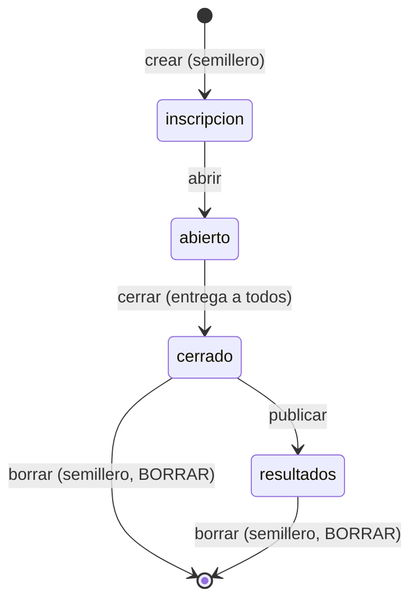
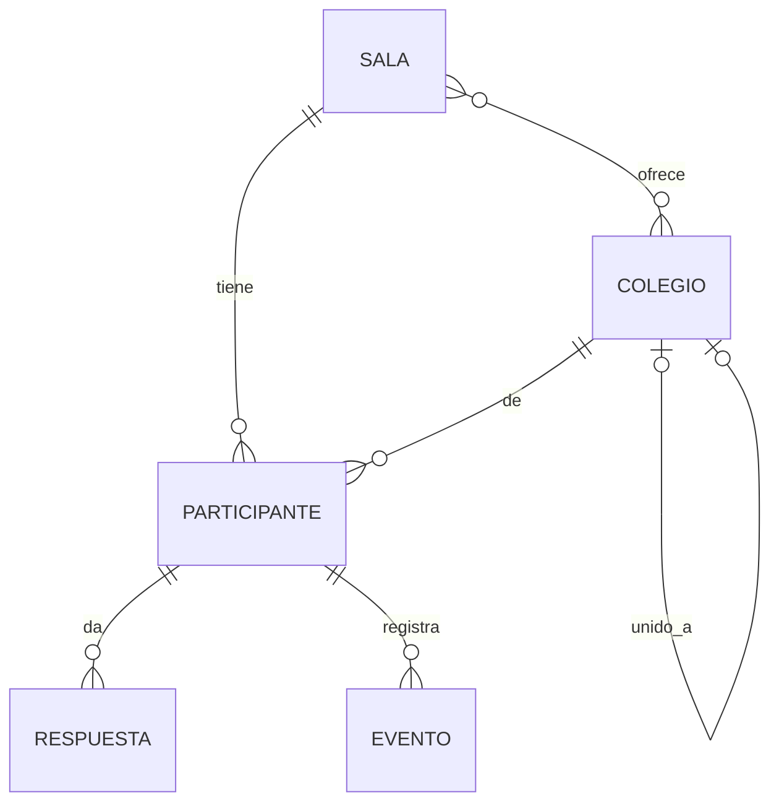

# Especificación funcional — U5 `u5-cloudflare-salas`

Qué hace la opción Cloudflare Workers al cerrar U5: un reto completo por sala, de punta a punta, con el
panel del docente y del semillero. Los datos están en `entities.md`, las reglas en `rules.md`, las
decisiones en `../decisions.md` (ADR-W10 a ADR-W13). Sale de `unit-of-work.md` («U5, U9, U13»),
`requirements.md`, `components.md`, `contract-summary.md` y `servidor.py`. Sin historias de usuario.

## Qué demuestra la unidad

Con la clave del semillero se crean varias salas y se entrega a cada docente su clave; cada docente elige
colegios, abre su sala, ve a sus participantes responder las 42 preguntas, actúa sobre ellos, cierra y
publica; dos salas a la vez no se mezclan (FR11.7). El panel entra con `rol` y el estudiante no nota
ningún cambio (FR11.3).

## Flujos

### F1. Panel del semillero (BR2.1, BR1.2, BR2.4, BR3.1, BR3.2)

1. `POST /api/admin/login` responde `{ok, rol: "semillero"}`; `admin.js` muestra la vista del semillero.
2. `GET /api/admin/salas` lista las salas. «Crear sala» usa `POST /api/admin/salas/crear` (U1) y muestra
   la clave una vez. «Nueva clave» usa `POST /api/admin/salas/clave?sala=`.
3. «Borrar la sala» pide escribir BORRAR y usa `POST /api/admin/salas/borrar?sala=` (solo con la sala
   cerrada o en resultados).
4. «Catálogo»: `GET /api/admin/catalogo` y `POST /api/admin/catalogo` con `agregar`, `corregir`,
   `confirmar` y `unir`.
5. Con `?sala=` el semillero también puede abrir el panel de cualquier sala (F2).

### F2. Panel del docente (BR7.1, BR2.2, BR2.3, BR4.1)

1. `POST /api/admin/login` responde `{ok, rol: "sala", sala}`.
2. `GET /api/admin/resumen` cada 3 s arma el panel de hoy. El «Código de sala» se muestra sin poder
   editarse (R-12).
3. Sección nueva «Colegios de la sala»: lista los elegidos (`GET /api/admin/colegios`), permite elegir
   del catálogo y quitar solo en «inscripción», y agregar uno provisional en cualquier estado.
4. Configuración con `POST /api/admin/config`, como hoy menos el código.
5. Abrir, cerrar y publicar con `POST /api/admin/estado`; al cerrar se entrega a todos y quien nunca
   empezó queda «No inició».
6. Acciones sobre participantes con `POST /api/admin/participante` (Entregar, Anular, Reactivar,
   Eliminar).

### F3. Inscripción completa (BR5.1)

Como U1 F4, con la limpieza de FR10.2, los integrantes de FR10.4 y la validación de FR10.1 hechas por
las calculadoras de U4.

### F4. Responder cualquier tipo (BR6.1)

Como U1 F8, con `traducir_respuesta`, `validar_respuesta` y `fraccion` de U4 para los 10 tipos. La
respuesta guardada sale al navegador con `respuesta_opaca`.

### F5. Entrega por cierre (BR6.3, BR2.3)

Al cerrar la sala, `cerrada` queda fija; desde entonces `vencer_tiempos` usa esa hora como `cierre`, así
un intento que no alcanzó a cerrarse en la transacción del cierre (no debería ocurrir) se entrega con la
misma hora exacta.

## Rutas de U5

La tabla completa de rutas (BR1.1). Las de U1 siguen igual; lo nuevo o cambiado está marcado.

| Método | Ruta | Nivel | Flujo | Cambio |
|---|---|---|---|---|
| GET | `/api/publico`, `/api/colegios` | público | U1 | — |
| POST | `/api/registro`, `/api/entrar` | público | F3, U1 | registro completo |
| GET | `/api/estado` | token | U1 | respuestas opacas de todos los tipos |
| POST | `/api/comenzar`, `/api/responder`, `/api/finalizar`, `/api/evento` | token | F4, U1 | responder completo |
| POST | `/api/admin/login` | clave | F1, F2 | — |
| GET | `/api/admin/resumen` | sala | F2 | **nueva** |
| POST | `/api/admin/estado` | sala | F2 | transiciones completas |
| POST | `/api/admin/config` | sala | F2 | **nueva** |
| POST | `/api/admin/participante` | sala | F2 | **nueva** |
| GET, POST | `/api/admin/colegios` | sala | F2 | GET nueva; POST con `elegir` y `quitar` |
| GET | `/api/admin/catalogo` | clave | F1, F2 | **nueva** |
| POST | `/api/admin/catalogo` | semillero | F1 | **nueva** |
| GET | `/api/admin/salas` | semillero | F1 | **nueva** |
| POST | `/api/admin/salas/crear` | semillero | F1 | — |
| POST | `/api/admin/salas/clave` | semillero | F1 | **nueva** |
| POST | `/api/admin/salas/borrar` | semillero | F1 | **nueva** |

Quedan para U6: `GET /api/admin/resultados.csv`, `respuestas.csv`, `paquete.zip`, `copias`, `copia` y
`POST /api/admin/reiniciar` (ADR-W11).

## Estados

Texto alternativo: la sala sigue las tres transiciones del panel; el semillero puede borrarla solo
desde «cerrado» o «resultados». «Reiniciar» (U6) devuelve la sala a «inscripción» sin ser una transición.

El estado del participante es el de U4 (`functional-spec.md` de U4, «Estados»), ahora escrito en la
base por `reto.js`.

## Modelo de datos (vista derivada de `entities.md`)

Texto alternativo: igual que U1 más la relación de un colegio provisional unido a uno definitivo, de
un solo salto.

## Reglas (vista derivada de `rules.md`)

| Paso | Reglas |
|---|---|
| Toda ruta | BR1.1, BR1.3, BR6.3 |
| F1 semillero | BR1.2, BR2.1, BR2.4, BR3.1, BR3.2 |
| F2 docente | BR2.2, BR2.3, BR4.1, BR6.2, BR7.1 |
| F3 inscripción | BR5.1 |
| F2 eliminar | BR5.2 |
| F4 responder | BR6.1 |
| Arranque | BR8.1 |
| Política | BR2.5 |

## Pantallas

Cambios en la copia de `web/`, todos en `herramientas/cambios_web.patch` (que crece) y listados en
`contract-summary.md` («Cambios que exige el navegador»):

| Archivo | Cambio | Motivo |
|---|---|---|
| `static/js/admin.js` | El campo «Código de sala» se muestra como texto fijo, sin «Guardar» | R-12 |
| `static/js/admin.js` | `login` guarda `rol` y `sala`; con `rol: "semillero"` dibuja la vista del semillero: salas, crear (muestra la clave una vez con la advertencia de guardarla), nueva clave, borrar con BORRAR, catálogo | FR11.5, ADR-002, ADR-003 |
| `static/js/admin.js` | Tarjeta «Colegios de la sala»: elegidos, elegir del catálogo, quitar, provisional | FR10.3 |
| `static/js/admin.js` | El texto del login ya no dice «ventana negra… `datos/clave_docente.txt`»: dice «La clave te la entrega el semillero» | FR11.5 (la frase describe la versión local) |
| `static/js/admin.js` | El enlace del tablero lleva `?sala=<código>` | FR11.4 |

El estudiante no ve ningún cambio más (FR11.3). El panel conserva la forma IIFE con `h()` y `textContent`
(`team.md`, «Code Style»).

## Prueba común (lo que U5 exige de U2)

Contra Workers, además de lo de U1: dos salas a la vez que no se mezclan (clasificación, relojes,
respuestas; FR11.7); 403 con clave de otra sala en cada ruta de sala; una respuesta de cada uno de los
10 tipos aceptada y una rechazada; cerrar entrega a todos y deja «No inició» a quien no empezó; las
cuatro acciones del docente; catálogo y colegios con los errores de BR3.2 y BR4.1. U2 es la dueña de la
prueba; U5 agrega estas comprobaciones en el mismo push si U2 ya existe.

## Fuera de la unidad

Resultados al participante, tablero completo, CSV, paquete, copias y reiniciar (U6, ADR-W11).
