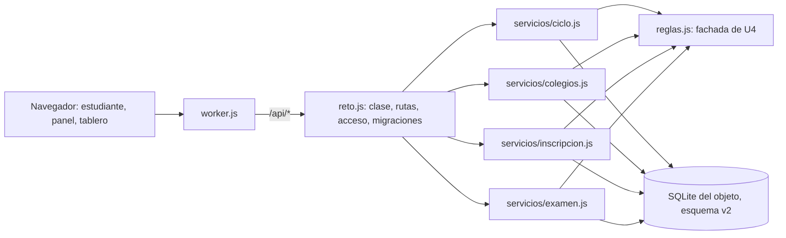

# Componentes lógicos — U5

> **Revisión 2026-10-27 (una sola sala).** Un solo reto, una sola clave docente (`CLAVE_DOCENTE`) y un
> reloj por colegio (ADR-009 a ADR-011, ADR-W19, ADR-W20). Se quitan las salas, la clave del semillero,
> las claves de sala y el catálogo; los servicios `salas.js` y `catalogo.js` pasan a `ciclo.js` y
> `colegios.js`.

Diseño no funcional de U5. Las decisiones están en `../decisions.md` (ADR-W10 a ADR-W12, ADR-W19 y ADR-W20); los requisitos en `../nfr-requirements/`.

Texto alternativo: el Worker sigue pasando la API al único objeto; `reto.js` conserva la clase, la tabla
de rutas, el acceso con la clave docente y las migraciones, y delega en cuatro módulos de servicio que
usan las calculadoras de U4 y la base SQLite en su versión 2.

| Archivo | Componentes de `components.md` |
|---|---|
| `src/reto.js` | ApiHttp (tabla de rutas), Acceso (clave docente), Arranque (migraciones), Persistencia (esquema) |
| `src/servicios/ciclo.js` | Reto y CicloDelReto: `login`, `config`, `estado` del docente, `resumen` (ADR-W11) y `publico` sin clasificación ni experimento |
| `src/servicios/colegios.js` | Colegios: lista del panel, `agregar`, `quitar`, `arrancar` y la lista pública de `GET /api/colegios` |
| `src/servicios/inscripcion.js` | Inscripcion: `registro`, `entrar` y «Eliminar» |
| `src/servicios/examen.js` | Examen: `estado` del estudiante, `comenzar`, `responder`, `finalizar`, `evento`, acciones del docente y entrega por tiempo y por cierre |
| `src/reglas.js` y `src/reglas/` | las seis calculadoras (U4) |
| `web/static/js/admin.js`, `web/static/js/estudiante.js`, `web/tablero.html` (parche) | PanelDocente con la tarjeta «Colegios»; aviso de espera; relojes del tablero |

Los módulos de `servicios/` exportan funciones `nombre(reto, contexto)`; `reto.js` las registra en la
tabla de rutas. No hay capa de base aparte (FR7.3, ADR-W3): cada servicio escribe su SQL.
