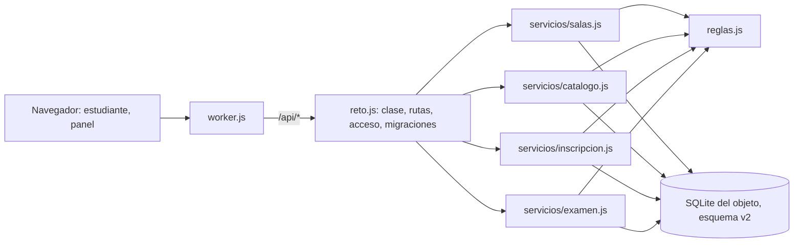

# Componentes lógicos — U5

Diseño no funcional de U5. Las decisiones están en `../decisions.md` (ADR-W10 a ADR-W13); los requisitos en `../nfr-requirements/`.

Texto alternativo: el Worker sigue pasando la API al único objeto; `reto.js` conserva la clase, la tabla
de rutas, el acceso y ahora las migraciones, y delega en cuatro módulos de servicio que usan las
calculadoras de U4 y la base SQLite en su versión 2.

| Archivo | Componentes de `components.md` |
|---|---|
| `src/reto.js` | ApiHttp (tabla de rutas), Acceso, Arranque (migraciones), Persistencia (esquema) |
| `src/servicios/salas.js` | Salas (listar, configurar, cambiar estado, regenerar clave, borrar) |
| `src/servicios/catalogo.js` | CatalogoColegios (catálogo y colegios de la sala) |
| `src/servicios/inscripcion.js` | Inscripcion (registro, entrar, eliminar) |
| `src/servicios/examen.js` | Examen (comenzar, responder, entregar, eventos, acciones del docente, entrega por cierre) y el resumen del panel (ADR-W11) |
| `src/reglas/` | las seis calculadoras (U4) |
| `web/static/js/admin.js` (parche) | PanelDocente con rol de sala y de semillero |

Los módulos de `servicios/` exportan funciones `nombre(reto, contexto)`; `reto.js` las registra en la
tabla de rutas. No hay capa de base aparte (FR7.3, ADR-W3): cada servicio escribe su SQL.
