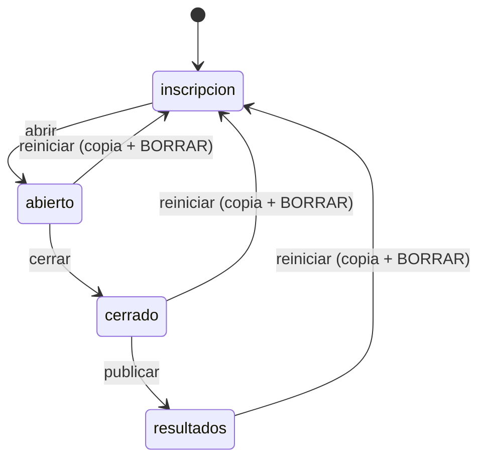
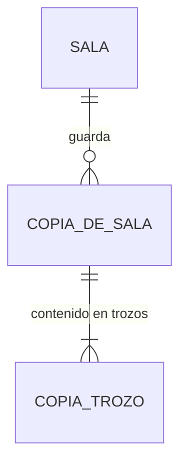

# Especificación funcional — U6 `u6-cloudflare-resultados`

Qué hace la opción Cloudflare Workers al cerrar U6: todo lo que sale **después** del reto (ADR-W11 de
U5): el resultado de cada estudiante, el tablero completo, los dos CSV de hoy, el paquete del
semillero, la copia de «Reiniciar» y su descarga, y el borrado completo al cerrar. Datos en
`entities.md`, reglas en `rules.md`, decisiones en `../decisions.md` (ADR-W14 a ADR-W18). Sale de
`unit-of-work.md` («U6, U10, U14»), `requirements.md`, `components.md`, `contract-summary.md` (C1, C5)
y `servidor.py`. Sin historias de usuario.

## Qué demuestra la unidad

Un reto completo en la nube termina igual que hoy: el docente publica, el tablero muestra el podio y las
tres diapositivas del experimento, cada estudiante ve su puesto, su nota y la revisión, el docente
descarga los CSV de siempre y el paquete del semillero, reinicia con copia y, al final, el semillero borra
la sala y no queda nada de ella en la nube (NFR10.1). Con esto la opción pasa la prueba común completa
(U2).

## Flujos

### F1. Resultados para el estudiante (BR1.1)

`GET /api/estado` con la sala en «resultados» y el participante finalizado agrega `puesto`, `nota` y
`revision`; `estudiante.js` ya los muestra. Los ids de `revision` son los mismos opacos de `misiones`.

### F2. Tablero completo (BR2.1, BR2.2)

`GET /api/publico?sala=` agrega `ranking` y `experimento` con las reglas de hoy, salvo que en «cerrado»
el experimento viene reducido (ADR-W9). El tablero muestra en «cerrado» lo mismo que hoy, porque allí no
usa el experimento.

### F3. CSV de hoy (BR3.1 a BR3.3)

`GET /api/admin/resultados.csv` y `GET /api/admin/respuestas.csv` devuelven los mismos bytes que la
versión local para los mismos datos (ADR-W16). El panel los descarga como hoy; con `rol: "semillero"`,
`admin.js` agrega `?sala=`.

### F4. Paquete del semillero (BR4.1 a BR4.5)

1. El panel tiene el botón «⬇ Paquete del semillero (.zip)» junto a los dos CSV.
2. `GET /api/admin/paquete.zip` arma los cuatro CSV, la copia y `metadatos.json` y los empaqueta
   (ADR-W15). No guarda nada.
3. La guía de cierre (U17, FR8.2) dice guardarlo en el Drive del semillero, en la carpeta del año, sin
   cambiarle el nombre (FR9.4).

### F5. Reiniciar con copia (BR5.1 a BR5.3)

1. «Reiniciar todo el reto» pide BORRAR, como hoy.
2. `POST /api/admin/reiniciar` guarda la copia y vacía la sala en una sola operación; responde
   `{ok, copia: <id_copia>}`.
3. `admin.js` muestra «Sala reiniciada. La copia quedó en la lista de copias; descárgala desde ahí.» (C-08).

### F6. Copias (BR6.1, BR6.2)

El panel muestra «Copias de esta sala» con `GET /api/admin/copias` y un botón de descarga por copia
(`GET /api/admin/copia?id=`). «Borrar la sala» (U5) borra también las copias.

### F7. Diccionario de datos (BR8.1)

`4_Codigo_y_datos/DICCIONARIO_DATOS_RETO.md` describe el paquete: nombre confirmado el que proponía
FR9.3. Lo escribe esta unidad; una prueba unitaria lo mantiene alineado con `csv.js`.

## Rutas de U6

| Método | Ruta | Nivel | Flujo | Cambio |
|---|---|---|---|---|
| GET | `/api/estado` | token | F1 | agrega `puesto`, `nota`, `revision` |
| GET | `/api/publico?sala=` | público | F2 | agrega `ranking`, `experimento` |
| GET | `/api/admin/resultados.csv` | sala | F3 | **nueva** |
| GET | `/api/admin/respuestas.csv` | sala | F3 | **nueva** |
| GET | `/api/admin/paquete.zip` | sala | F4 | **nueva** |
| POST | `/api/admin/reiniciar` | sala | F5 | **nueva** |
| GET | `/api/admin/copias` | sala | F6 | **nueva** |
| GET | `/api/admin/copia?id=` | sala | F6 | **nueva** |
| POST | `/api/admin/salas/borrar` | semillero | F6 | borra también copias |

Con esto quedan implementadas las 16 rutas de hoy (5 GET y 11 POST, `api-documentation.md`) y todas las
nuevas del contrato C1.

## Estados

«Reiniciar» no es una transición de CicloDeSala: es un borrado con copia que deja la sala en
«inscripción» desde cualquier estado, como hoy.

Texto alternativo: a las tres transiciones del panel se suma «Reiniciar», que desde cualquier estado
vuelve a «inscripción» tras guardar una copia; no pasa por `transicion_permitida`.

## Modelo de datos (vista derivada de `entities.md`)

Texto alternativo: cada sala puede tener varias copias; el contenido de cada copia se guarda en uno o
más trozos de 512 KiB. Es la migración 3 del esquema (ADR-W10).

## Reglas (vista derivada de `rules.md`)

| Flujo | Reglas |
|---|---|
| F1 | BR1.1 |
| F2 | BR2.1, BR2.2 |
| F3 | BR3.1, BR3.2, BR3.3 |
| F4 | BR3.3, BR4.1, BR4.2, BR4.3, BR4.4, BR4.5, BR5.1, BR7.1 |
| F5 | BR5.1, BR5.2, BR5.3 |
| F6 | BR3.3, BR6.1, BR6.2 |
| F7 | BR8.1 |

## Pantallas

Cambios en `static/js/admin.js`, agregados a `cambios_web.patch` y listados en el contrato:

| Cambio | Motivo |
|---|---|
| Botón «⬇ Paquete del semillero (.zip)» junto a los CSV | FR9.1 |
| Tarjeta «Copias de esta sala» con un botón de descarga por copia | R-17 |
| Texto tras reiniciar: «Sala reiniciada. La copia quedó en la lista de copias; descárgala desde ahí.» y la nota de la zona de peligro ya no habla de la «carpeta datos/» | C-08 |
| Las descargas (`fetch` con `X-Clave-Admin`) agregan `?sala=` cuando el rol es semillero | FR11.5 |

`tablero.html` y `estudiante.js` no cambian: ya leen `ranking`, `experimento`, `puesto`, `nota` y
`revision`.

## Prueba común (lo que U6 exige de U2)

Contra Workers: `fuga_verdad_cerrado` (nada del experimento salvo `n` y `listo` en «cerrado»);
`fuga_revision_antes` (sin `revision` antes de resultados); en resultados `puesto`, `nota` y `revision`
con ids opacos; `resultados.csv` y `respuestas.csv` iguales a los de la versión local con las mismas
respuestas (se corre el mismo guion contra las dos y se comparan); el paquete se descomprime, trae los
seis archivos, `participantes.csv` tiene una fila por participante y ninguna columna secreta; reiniciar
devuelve `copia` y la lista la muestra; borrar la sala deja 404 en `/api/publico?sala=` y en
`/api/admin/copias`.

## Fuera de la unidad

La guía de cierre (`PUBLICAR_EN_INTERNET.md`, FR8.2) y la organización en el Drive (FR9.4) son de U17;
U6 deja los pasos en `despliegues/cloudflare/LEEME.md`.
