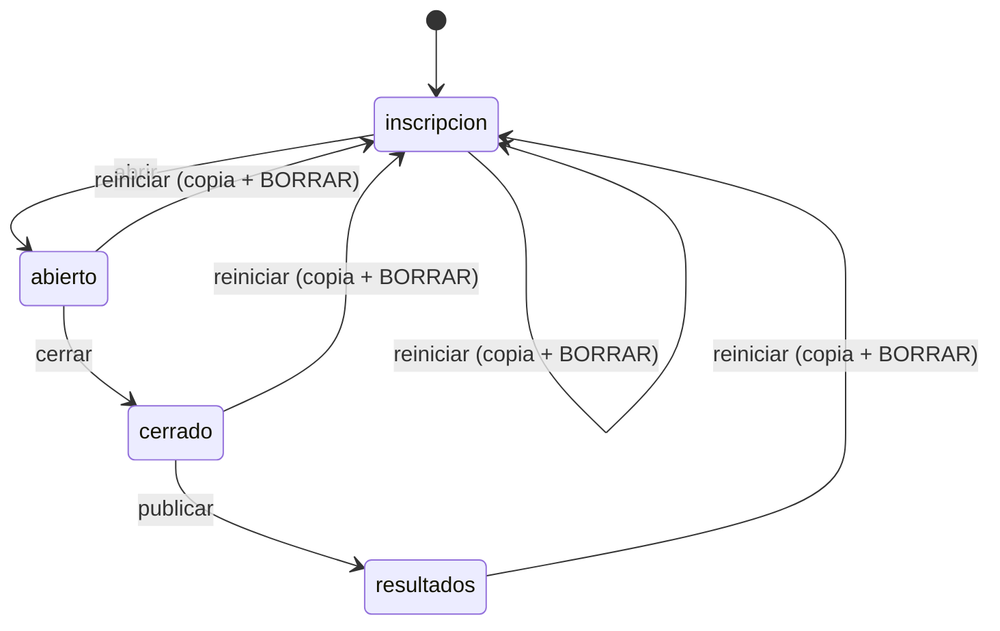
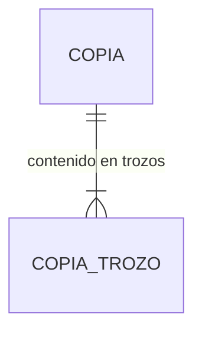

# Especificación funcional — U6 `u6-cloudflare-resultados`

> **Revisión 2026-10-25 (una sola sala, solo Cloudflare).** Todo pasa a ser del único reto, con la clave
> docente y sin `?sala=` (ADR-009 a ADR-011, contrato revisado). Cambian F1 (`puesto_grado`), F2 (podio
> general y por grado con nota), F3 (sin `?sala=`), F5 (Reiniciar borra también los colegios) y F6 (borrar
> una copia en vez de borrar una sala). Nuevos: F8 (migración 3) y F9 (pantallas completas). **Criterio de
> cierre del humano (2026-10-26):** «que ya todos los paneles funcionen, el dash, el de admin y el de los
> estudiantes» (ADR-W21, BR10.1 a BR10.3, tablas «Pantallas completas» y «Recorrido de las pantallas»).

Qué hace la opción Cloudflare Workers al cerrar U6: todo lo que sale **después** del reto (ADR-W11 de
U5): el resultado de cada estudiante, el tablero completo, los dos CSV de hoy, el paquete del semillero,
la copia de «Reiniciar» y su descarga, el borrado de copias y la comprobación de que las tres pantallas
funcionan completas. Datos en `entities.md`, reglas en `rules.md`, decisiones en `../decisions.md`
(ADR-W14 a ADR-W18 y ADR-W21). Sale de `unit-of-work.md` («U6»), `requirements.md`, `components.md`,
`contract-summary.md` (C1, C5) y `servidor.py`. Sin historias de usuario.

## Qué demuestra la unidad

Un reto completo en la nube termina igual que hoy: el docente publica, el tablero muestra el podio
general, la clasificación por grado con la nota y las diapositivas del experimento, cada estudiante ve su
puesto, su puesto en el grado, su nota y la revisión, el docente descarga los CSV de siempre y el paquete
del semillero, reinicia con copia y, al final, borra las copias y no queda nada del reto en la nube
(NFR10.1). El estudiante, el panel y el tablero funcionan con todas las acciones y vistas de la versión
local más lo nuevo de una sala. Con esto la opción pasa la prueba común completa (U2).

## Flujos

### F1. Resultados para el estudiante (BR1.1)

`GET /api/estado` con el reto en «resultados» y el participante finalizado agrega `puesto`,
`puesto_grado`, `nota` y `revision`; la copia de `estudiante.js` muestra además «Puesto en tu grado» en la
pantalla final. Los ids de `revision` son los mismos opacos de `misiones`.

### F2. Tablero completo (BR2.1, BR2.2)

`GET /api/publico` agrega `ranking`, `por_grado` y `experimento` con las reglas de hoy. La copia de
`tablero.html` agrega, después del podio general, una diapositiva por grado con su top y la nota de cada
fila; con modo sorpresa encendido, antes de «resultados» sigue mostrando «La clasificación se revela al
final». En «cerrado» el experimento viene reducido (ADR-W9) y el tablero muestra lo mismo que hoy.

### F3. CSV de hoy (BR3.1 a BR3.3)

`GET /api/admin/resultados.csv` y `GET /api/admin/respuestas.csv` devuelven los mismos bytes que la
versión local para los mismos datos (ADR-W16). El panel los descarga como hoy, con `fetch` y la cabecera.

### F4. Paquete del semillero (BR4.1 a BR4.5)

1. El panel tiene el botón «⬇ Paquete del semillero (.zip)» junto a los dos CSV.
2. `GET /api/admin/paquete.zip` arma los cuatro CSV, la copia y `metadatos.json` y los empaqueta
   (ADR-W15). No guarda nada.
3. La guía de cierre (U17, FR8.2) dice guardarlo en el Drive del semillero, en la carpeta del año, sin
   cambiarle el nombre (FR9.4).

### F5. Reiniciar con copia (BR5.1 a BR5.3)

1. «Reiniciar todo el reto» pide BORRAR, como hoy.
2. `POST /api/admin/reiniciar` guarda la copia y vacía el reto (participantes, respuestas, eventos y
   colegios) en una sola operación; responde `{ok, copia: <id_copia>}`. La configuración y las copias
   quedan.
3. La copia de `admin.js` muestra «Reto reiniciado. Copia de seguridad: <id_copia>. Está en la lista de
   copias.» y la nota de la zona de peligro ya no habla de la «carpeta datos/» (C-08).

### F6. Copias (BR6.1, BR6.2)

La tarjeta «Copias» del panel lista `GET /api/admin/copias` con «Descargar» (`GET /api/admin/copia?id=`) y
«Borrar» (`POST /api/admin/copia/borrar`, con confirmación) en cada fila.

### F7. Diccionario de datos (BR8.1)

`4_Codigo_y_datos/DICCIONARIO_DATOS_RETO.md` describe el paquete: nombre confirmado el que proponía
FR9.3. Lo escribe esta unidad; una prueba unitaria lo mantiene alineado con `csv.js`.

### F8. Migración 3 (BR9.1)

El primer arranque con el código de U6 crea `copias` y `copia_trozos`; si las tablas `v1_*` de U5 tienen
filas, las guarda como la copia `migracion_v1.sql` y las borra. La copia aparece en la tarjeta «Copias»;
el docente la descarga y la borra como cualquier otra.

### F9. Pantallas completas (BR10.1 a BR10.3)

1. `node --test despliegues/cloudflare/pruebas/pantallas.test.js` cruza las llamadas de la copia de `web/`
   con `RUTAS` (BR10.1).
2. La prueba común corre una comprobación `pantalla_*` por fila de la tabla de abajo (BR10.2).
3. Una persona hace el «Recorrido de las pantallas» en `wrangler dev` y lo anota (BR10.3).

## Pantallas completas

Cada llamada `fetch` o `api(...)` de la copia de `web/` (`static/js/estudiante.js`, `static/js/admin.js`,
`tablero.html`) después de U5 y U6. Las 16 rutas que llama la versión local (`2_Aplicacion_Reto/web/`)
siguen; las
marcadas **nueva** las agrega el contrato. La columna «Unidad» dice quién implementa la ruta; la columna
«Comprobación» es el id en la prueba común.

| # | Pantalla | Llamada | Para qué | Claves que lee la pantalla | Unidad | Comprobación |
|---|---|---|---|---|---|---|
| 1 | Estudiante | `GET /api/colegios` | Llenar la lista «Colegio» al abrir el formulario | `colegios[].id_colegio`, `nombre` | U5 | `pantalla_colegios` |
| 2 | Estudiante | `POST /api/registro` | Inscribirse | `token`, `codigo` | U5 | `pantalla_registro` |
| 3 | Estudiante | `POST /api/entrar` | Volver con el código | `token`, `codigo` | U5 | `pantalla_entrar` |
| 4 | Estudiante | `GET /api/estado` | Espera, misiones, reloj, final | `reto`, `participante` (con `colegio_arranque`, `colegio_restante_seg`), `misiones`, `respuestas`; en resultados `puesto`, `puesto_grado`, `nota`, `revision` | U5 y U6 | `pantalla_estado_espera`, `pantalla_estado_curso`, `pantalla_estado_final` |
| 5 | Estudiante | `POST /api/comenzar` | «Comenzar» | `ok` o `error` | U5 | `pantalla_comenzar` |
| 6 | Estudiante | `POST /api/responder` | Responder cada tipo | `ok`; con retro `puntos`, `max`, `fraccion` | U5 | `pantalla_responder` |
| 7 | Estudiante | `POST /api/finalizar` | «Entregar» | `ok` | U5 | `pantalla_finalizar` |
| 8 | Estudiante | `POST /api/evento` | Contar salidas de la pestaña | `ok` | U5 | `pantalla_evento` |
| 9 | Panel | `POST /api/admin/login` | Entrar con la clave | `ok` | U5 | `pantalla_login` |
| 10 | Panel | `GET /api/admin/resumen` | Dibujar y refrescar el panel cada 3 s (hoy falla en el corte) | `config`, `urls`, `banco`, `participantes[]` (con `puesto_grado`, `id_colegio`), `experimento`, `colegios[]`, `servidor_ahora` | U5 | `pantalla_resumen` |
| 11 | Panel | `POST /api/admin/estado` | Abrir, cerrar, publicar | `ok` | U5 | `pantalla_estado_reto` |
| 12 | Panel | `POST /api/admin/config` | Guardar un campo o un interruptor (dos llamadas en `admin.js`) | `ok` | U5 | `pantalla_config` |
| 13 | Panel | `POST /api/admin/participante` | Entregar, Anular, Reactivar, Eliminar | `ok` | U5 | `pantalla_participante` |
| 14 | Panel | `POST /api/admin/colegios` (**nueva**) | Agregar, Quitar, Arrancar reloj | `ok`, `agregados[]`, `arranque`, `existente` | U5 | `pantalla_colegios_admin` |
| 15 | Panel | `GET /api/admin/resultados.csv` | «⬇ Resultados (CSV)» | archivo | U6 | `pantalla_csv_resultados` |
| 16 | Panel | `GET /api/admin/respuestas.csv` | «⬇ Respuestas detalladas (CSV)» | archivo | U6 | `pantalla_csv_respuestas` |
| 17 | Panel | `GET /api/admin/paquete.zip` (**nueva**) | «⬇ Paquete del semillero (.zip)» | archivo | U6 | `pantalla_paquete` |
| 18 | Panel | `POST /api/admin/reiniciar` | «Reiniciar todo el reto» | `ok`, `copia` | U6 | `pantalla_reiniciar` |
| 19 | Panel | `GET /api/admin/copias` (**nueva**) | Tarjeta «Copias» | `copias[]` | U6 | `pantalla_copias` |
| 20 | Panel | `GET /api/admin/copia?id=` (**nueva**) | «Descargar» una copia | archivo | U6 | `pantalla_copia` |
| 21 | Panel | `POST /api/admin/copia/borrar` (**nueva**) | «Borrar» una copia | `ok` | U6 | `pantalla_copia_borrar` |
| 22 | Tablero | `GET /api/publico` | Sondear cada 2 s, sin `?sala=` | `estado`, `sala`, `urls`, `conteo`, `colegios[]`, `abierto_en`, `duracion_min`, `servidor_ahora`, `modo_sorpresa`; `ranking`, `por_grado`, `experimento` según el estado | U5 y U6 | `pantalla_publico_inscripcion`, `pantalla_publico_curso`, `pantalla_publico_cerrado`, `pantalla_publico_resultados` |

`GET /api/admin/colegios` no la llama ninguna pantalla (el panel usa `colegios[]` del resumen); la usa la
prueba común. Con ella son las 23 rutas del contrato.

## Recorrido de las pantallas

Se hace en `wrangler dev` con dos colegios y al menos tres equipos (dos de un colegio, uno de otro), con
la consola del navegador abierta. Cada línea se marca «sí» o «no» en `code-summary.md` de U6.

| Pantalla | Vistas y acciones que tienen que funcionar |
|---|---|
| Estudiante (`/`) | Formulario con la lista de colegios; inscripción y código mostrado; «Entrar con mi código»; sala de espera con «Tu colegio todavía no ha empezado. Espera la señal del docente.»; «Comenzar» al arrancar su colegio; mapa de misiones; una pregunta de cada uno de los 10 tipos con retroalimentación; reloj de su colegio; «Entregar»; pantalla final con puesto, puesto en el grado, nota y revisión en «resultados» |
| Panel (`/admin`) | Login con la clave tal cual (sin mayúsculas); pasos y botones Abrir, Cerrar y Publicar con confirmación; acceso (enlaces y código de sala); configuración (código, evento, duración, modo sorpresa, retroalimentación) sin «Reloj global»; tarjeta Colegios (agregar varios, repetido rechazado, quitar, arrancar con confirmación doble, estado del reloj); experimento; indicadores; tabla con filtro por grado, búsqueda, puesto en el grado y las cuatro acciones; los dos CSV; el paquete; la tarjeta Copias con Descargar y Borrar; Reiniciar con BORRAR |
| Tablero (`/tablero`) | Escena de inscripción con el código de sala y el conteo; en curso con el reloj de cada colegio y, con modo sorpresa apagado, la clasificación; cerrado; resultados con podio general, una diapositiva por grado con nota, clasificación completa y las diapositivas del experimento |

## Rutas de U6

| Método | Ruta | Nivel | Flujo | Cambio |
|---|---|---|---|---|
| GET | `/api/estado` | token | F1 | agrega `puesto`, `puesto_grado`, `nota`, `revision` |
| GET | `/api/publico` | público | F2 | agrega `ranking`, `por_grado`, `experimento` |
| GET | `/api/admin/resultados.csv` | clave | F3 | **nueva** en Cloudflare |
| GET | `/api/admin/respuestas.csv` | clave | F3 | **nueva** en Cloudflare |
| GET | `/api/admin/paquete.zip` | clave | F4 | **nueva** |
| POST | `/api/admin/reiniciar` | clave | F5 | **nueva** en Cloudflare; `copia` es `id_copia` |
| GET | `/api/admin/copias` | clave | F6 | **nueva** |
| GET | `/api/admin/copia?id=` | clave | F6 | **nueva** |
| POST | `/api/admin/copia/borrar` | clave | F6 | **nueva** |

Con esto quedan implementadas las 23 rutas del contrato C1: las 16 de hoy (5 GET y 11 POST,
`api-documentation.md`), `GET /api/colegios` y las 6 nuevas del panel.

## Estados

«Reiniciar» no es una transición de CicloDelReto: es un borrado con copia que deja el reto en
«inscripción» desde cualquier estado, como hoy.

Texto alternativo: a las tres transiciones del panel se suma «Reiniciar», que desde cualquier estado
vuelve a «inscripción» tras guardar una copia y borrar participantes, respuestas, eventos y colegios; no
pasa por `transicion_permitida`.

## Modelo de datos (vista derivada de `entities.md`)

Texto alternativo: el reto puede tener varias copias, sin clave foránea al reto porque hay uno solo; el
contenido de cada copia se guarda en uno o más trozos de 512 KiB. Es la migración 3 del esquema (ADR-W10).

## Reglas (vista derivada de `rules.md`)

| Flujo | Reglas |
|---|---|
| F1 | BR1.1 |
| F2 | BR2.1, BR2.2 |
| F3 | BR3.1, BR3.2, BR3.3 |
| F4 | BR3.3, BR4.1, BR4.2, BR4.3, BR4.4, BR4.5, BR5.1, BR7.1 |
| F5 | BR5.1, BR5.2, BR5.3 |
| F6 | BR3.3, BR6.1, BR6.2 |
| F7 | BR8.1 |
| F8 | BR9.1 |
| F9 | BR10.1, BR10.2, BR10.3 |

## Pantallas

Cambios en la copia de `web/`, agregados a `cambios_web.patch` y listados en el contrato («Cambios que
exige el navegador»). Los de U5 están en su `functional-spec.md`.

| Archivo | Cambio | Motivo |
|---|---|---|
| `static/js/admin.js` | Botón «⬇ Paquete del semillero (.zip)» junto a los CSV | FR9.1 |
| `static/js/admin.js` | Tarjeta «Copias» con «Descargar» y «Borrar» por copia | R-17, NFR10.1 |
| `static/js/admin.js` | Texto tras reiniciar con el `id_copia`; la nota de la zona de peligro ya no habla de la «carpeta datos/» | C-08, D7 |
| `tablero.html` | Diapositiva por grado con su top y la nota de cada fila, después del podio general | FR2.5, FR11.4 |
| `static/js/estudiante.js` | La pantalla final muestra «Puesto en tu grado» con `puesto_grado` | FR2.5 |

## Prueba común (lo que U6 exige de U2)

Contra Workers: `fuga_verdad_cerrado` (nada del experimento salvo `n` y `listo` en «cerrado»);
`fuga_revision_antes` (sin `revision` antes de resultados); en resultados `puesto`, `puesto_grado`, `nota`
y `revision` con ids opacos; `ranking` y `por_grado` ocultos juntos con modo sorpresa; `resultados.csv` y
`respuestas.csv` iguales a los de la versión local con las mismas respuestas (se corre el mismo guion
contra las dos y se comparan); el paquete se descomprime, trae los seis archivos, `participantes.csv`
tiene una fila por participante y ninguna columna secreta; reiniciar devuelve `copia`, la lista la muestra
y `copia/borrar` la quita; las comprobaciones `pantalla_*` de la tabla «Pantallas completas».

## Hecho cuando

- El tablero muestra el podio general y por grado, el panel tiene su resumen, salen los CSV y el paquete,
  y «Reiniciar» pide BORRAR y guarda la copia antes (`bolt-plan.md`, B11).
- `pantallas.test.js` pasa y cada fila de «Pantallas completas» tiene su comprobación en la prueba común
  (BR10.1, BR10.2).
- El «Recorrido de las pantallas» está anotado con todas las líneas en «sí» (BR10.3): **«que ya todos los
  paneles funcionen, el dash, el de admin y el de los estudiantes»** (humano, 2026-10-26).
- `node --test` de cada archivo de pruebas, el simulacro local en «TODO BIEN» y el 80 % de cobertura del
  código nuevo.

## Fuera de la unidad

La guía de cierre (`PUBLICAR_EN_INTERNET.md`, FR8.2) y la organización en el Drive (FR9.4) son de U17;
U6 deja los pasos en `despliegues/cloudflare/LEEME.md`.
