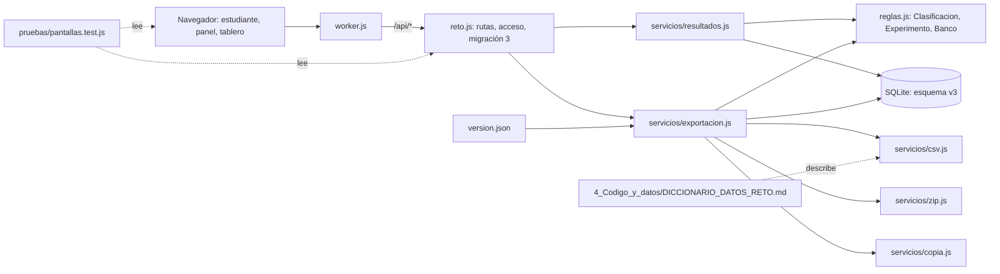

# Componentes lógicos — U6

> **Revisión 2026-10-27 (una sola sala).** Un solo reto, una sola clave docente (`CLAVE_DOCENTE`, solo
> por `X-Clave-Admin`) y reloj por colegio (ADR-009 a ADR-011). El tablero deja de ser «por sala»; se
> agregan `pruebas/pantallas.test.js` (ADR-W21) y los parches de `tablero.html` y `estudiante.js`.

Diseño no funcional de U6. Las decisiones están en `../decisions.md` (ADR-W14 a ADR-W18 y ADR-W21); los requisitos en `../nfr-requirements/`.

Texto alternativo: a los servicios de U5 se suman `resultados.js` (vista del participante y tablero) y
`exportacion.js` (CSV, paquete, copias, reiniciar y migración 3), que usa tres módulos de apoyo
(`csv.js`, `zip.js`, `copia.js`), las calculadoras de U4 y la base en su versión 3; `version.json` lo
genera `copiar.sh`, el diccionario de datos describe lo que `csv.js` produce y `pantallas.test.js` cruza
las rutas que llaman las pantallas con la tabla `RUTAS` de `reto.js`.

| Archivo | Componentes de `components.md` |
|---|---|
| `src/servicios/resultados.js` | Resultados (vista del participante en resultados, tablero del reto) |
| `src/servicios/exportacion.js` | Exportacion (CSV de hoy, paquete, copia, reiniciar, lista, descarga y borrado de copias, migración 3) |
| `src/servicios/csv.js`, `zip.js`, `copia.js` | apoyo de Exportacion (formatos, ADR-W14 a ADR-W16) |
| `src/reto.js` | migración 3 y las 7 rutas de U6 en `RUTAS` |
| `src/version.json` | Arranque (versión de la app, ADR-W17) |
| `web/static/js/admin.js` (parche) | PanelDocente: paquete, tarjeta «Copias», texto de reiniciar |
| `web/tablero.html` (parche) | Tablero: diapositiva por grado con nota |
| `web/static/js/estudiante.js` (parche) | Pantalla final: «Puesto en tu grado» |
| `pruebas/pantallas.test.js` | Comprobación de pantallas completas (BR10.1) |
| `4_Codigo_y_datos/DICCIONARIO_DATOS_RETO.md` | documento de FR9.3 |
