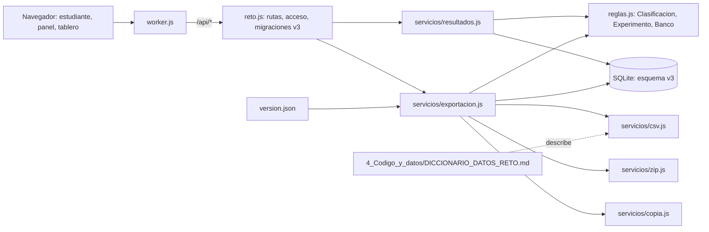

# Componentes lógicos — U6

Diseño no funcional de U6. Las decisiones están en `../decisions.md` (ADR-W14 a ADR-W18); los requisitos en `../nfr-requirements/`.

Texto alternativo: a los servicios de U5 se suman `resultados.js` (vista del participante y tablero) y
`exportacion.js` (CSV, paquete, copias, reiniciar), que usa tres módulos de apoyo (`csv.js`, `zip.js`,
`copia.js`), las calculadoras de U4 y la base en su versión 3; `version.json` lo genera `copiar.sh` y
el diccionario de datos describe lo que `csv.js` produce.

| Archivo | Componentes de `components.md` |
|---|---|
| `src/servicios/resultados.js` | Resultados (vista del participante en resultados, tablero por sala) |
| `src/servicios/exportacion.js` | Exportacion (CSV de hoy, paquete, copia, reiniciar, lista y descarga de copias) |
| `src/servicios/csv.js`, `zip.js`, `copia.js` | apoyo de Exportacion (formatos, ADR-W14 a ADR-W16) |
| `src/reto.js` | migración 3 y rutas nuevas en la tabla |
| `src/version.json` | Arranque (versión de la app, ADR-W17) |
| `web/static/js/admin.js` (parche) | PanelDocente: paquete, copias, texto de reiniciar |
| `4_Codigo_y_datos/DICCIONARIO_DATOS_RETO.md` | documento de FR9.3 |
