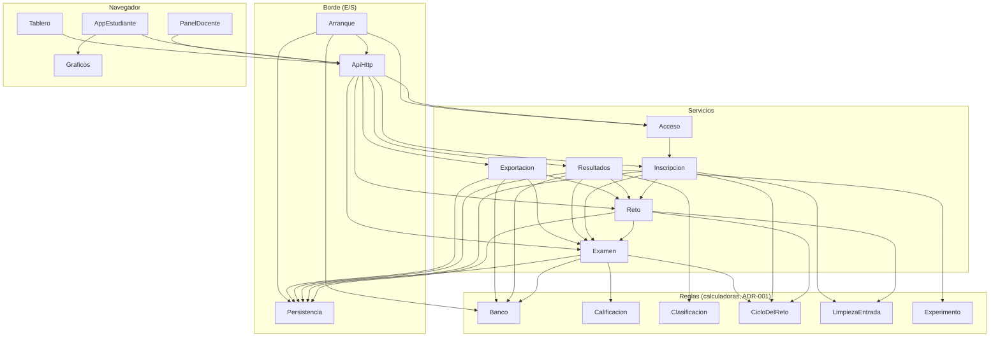

# Componentes del reto

Bloques lógicos del reto con **una sola sala**, varios colegios con su propio reloj, datos organizados y
entrada limpia. Salen de los requisitos revisados el 2026-10-25 (`../requirements-analysis/requirements.md`,
nota de revisión, FR2.5, FR2.6, FR3.1, FR10.3, FR11, NFR9), de las reglas de negocio que pegó el humano
(`../requirements-analysis/reglas-de-negocio-2026-10-25.md`, §1, §4.1 y §7), de los ADR de `decisions.md`
(ADR-001, 004, 006, 007 vigentes; ADR-009 a ADR-011 nuevos) y del código actual
(`aidlc/spaces/default/codekb/Reto_Desinformacion_Colegios/component-inventory.md` y `code-structure.md`,
«Mapa de secciones de `servidor.py`»).

**Valen para la versión de la nube que se construye: Cloudflare** (FR12.2c). Las demás opciones quedan
solo documentadas en la tabla de comparación. La versión local, `2_Aplicacion_Reto/`, no cambia
(FR12.1). Son bloques lógicos, no archivos: varios pueden vivir en un mismo módulo, y cómo se agrupan lo
deciden Units Generation y el ADR de la opción (FR12.2b). Aquí no se elige el lenguaje ni la forma del
almacén.

**Revisión del 2026-10-25.** La versión anterior de este documento estaba escrita para varias salas en
paralelo. El humano fijó que «esto lo controla un solo profesor en un solo panel. no con varios profesores
con varios paneles. es solo una sala.». Por eso desaparecen la búsqueda de sala por código o por prefijo de
clave, la clave del semillero, la clave por sala, el catálogo único del semillero, los colegios
«provisionales», «Borrar la sala», las copias por sala y el pendiente OQ8/R-20. Entran el reloj por
colegio, los tiempos relativos al arranque del colegio, el podio general con clasificación por grado y
nota, la lista de colegios cargada por el docente y una sola clave docente como secreto del hosting.

## Cómo leer este documento

1. **Diagrama** y **Resumen**: qué bloques hay y quién llama a quién (5 minutos).
2. **Dueño de cada dato**: quién escribe cada dato (ADR-007).
3. **Quién pide y con qué**, **El reloj de cada colegio** y **Por qué cada bloque va aparte**: las reglas
   que cruzan bloques.
4. El bloque `yaml` del final es la fuente para las etapas siguientes; no hace falta leerlo entero.

## Diagrama de componentes

Las flechas van de quien llama hacia quien es llamado. Las reglas no llaman a nadie.



Texto alternativo: cuatro capas. **Navegador**: AppEstudiante (usa Graficos), PanelDocente y Tablero
llaman a ApiHttp. **Borde**: ApiHttp despacha a los servicios; Persistencia es lo único que habla con el
almacén; Arranque lee la configuración y los secretos, le entrega la clave docente a Acceso, carga el
Banco, abre la Persistencia y levanta ApiHttp. **Servicios**: Reto, Acceso, Inscripcion, Examen,
Resultados y Exportacion. Reto es dueño del estado del reto, de su configuración y de la lista de colegios
con el arranque del reloj de cada uno. Examen es el único que escribe la entrega: Reto al cerrar, y
Resultados y Exportacion antes de leer, le piden a Examen que aplique la regla; Inscripcion le pide
borrar los eventos de un participante eliminado. Resultados y Exportacion leen el nombre de cada colegio
en Reto. **Reglas**: Banco, Calificacion, Clasificacion, CicloDelReto, LimpiezaEntrada y Experimento
reciben datos y la hora, y devuelven datos.

## Resumen

| Componente | Capa | Para qué | Depende de | Lo usan | Entidades |
|---|---|---|---|---|---|
| Banco | Reglas | Valida el banco y arma el examen de cada participante con ids opacos. | — | Examen, Resultados, Exportacion, Arranque | Mision, Pregunta |
| Calificacion | Reglas | Califica una respuesta con crédito parcial y calcula el bono. | — | Examen | — |
| Clasificacion | Reglas | Ordena a los participantes sin empates, con tiempos relativos al arranque de su colegio; podio, puestos por grado y nota. | — | Resultados | — |
| CicloDelReto | Reglas | Transiciones del reto, arranque de cada colegio y hora de entrega con su motivo. | — | Reto, Inscripcion, Examen | — |
| LimpiezaEntrada | Reglas | Normaliza y valida el texto que llega del navegador. | — | Reto, Inscripcion | — |
| Experimento | Reglas | Estadística del experimento A/B de toda la sala. | — | Resultados | — |
| Reto | Servicios | Estado, configuración, lista de colegios, arranque del reloj de cada colegio y reinicio del único reto. | CicloDelReto, LimpiezaEntrada, Examen, Persistencia | Inscripcion, Resultados, Exportacion, ApiHttp | Reto, Colegio |
| Acceso | Servicios | Decide quién puede hacer cada cosa: clave docente o token del participante. | Inscripcion | ApiHttp, Arranque | — |
| Inscripcion | Servicios | Inscribe, deja entrar y elimina participantes. | Reto, LimpiezaEntrada, CicloDelReto, Examen, Persistencia | Acceso, ApiHttp | Participante |
| Examen | Servicios | Comenzar, responder, entregar y las acciones del docente sobre el reto. | Banco, Calificacion, CicloDelReto, Persistencia | Reto, Inscripcion, Resultados, Exportacion, ApiHttp | Respuesta, Evento |
| Resultados | Servicios | Vista del participante, tablero (podio general y por grado) y resumen del panel. | Examen, Banco, Clasificacion, Experimento, Reto, Persistencia | ApiHttp | — |
| Exportacion | Servicios | CSV de hoy, paquete de datos y copia de «Reiniciar». | Examen, Reto, Banco, Persistencia | ApiHttp | Copia |
| ApiHttp | Borde (E/S) | Recibe las peticiones y las despacha con su nivel de acceso. | Acceso, Reto, Inscripcion, Examen, Resultados, Exportacion | Arranque, AppEstudiante, PanelDocente, Tablero | — |
| Persistencia | Borde (E/S) | Lee y escribe en el almacén de la opción. | — | Reto, Inscripcion, Examen, Resultados, Exportacion, Arranque | — |
| Arranque | Borde (E/S) | Arranca la versión con su configuración y sus secretos. | ApiHttp, Acceso, Banco, Persistencia | — | — |
| AppEstudiante | Navegador | Pantallas del estudiante (`estudiante.js`). | ApiHttp, Graficos | — | — |
| PanelDocente | Navegador | Panel del docente (`admin.js`). | ApiHttp | — | — |
| Tablero | Navegador | Pantalla para proyectar (`tablero.html`). | ApiHttp | — | — |
| Graficos | Navegador | Gráficos SVG del banco (`graficos.js`). | — | AppEstudiante | — |

## Dueño de cada dato

Cada dato tiene un solo dueño. Los tipos y valores permitidos van en Functional Design.

| Entidad | Componente dueño | Identificador | Atributos | Referencias |
|---|---|---|---|---|
| Mision | Banco | `id` | titulo, subtitulo, intro, preguntas, glosario, dossier (titulo, graficos, revelar_tras), lectura | — |
| Pregunta | Banco | `id` | tipo, puntos, enunciado, respuesta, explicacion, requiere, solo_grupo, variantes, tolerancia, opciones, items, partes, categorias, publicaciones, experimento, estilo, unidad, simulador, tabla, min, max, paso, grafico, entero | — |
| Reto | Reto | único (una sola fila) | codigo, estado, duracion_min, modo_sorpresa, retro, evento, abierto_en, cerrado_en | — |
| Colegio | Reto | `id_colegio` | nombre, nombre_normalizado, arranque, creado | — |
| Participante | Inscripcion (datos de la persona) y Examen (datos del reto) | `id` | codigo, token, nombre, id_colegio, grado, integrantes, n_integrantes, grupo, semilla, creado; estado, inicio, fin, motivo_fin, puntos, bono, total, tiempo_usado, tiempo_respuestas, salidas | Colegio |
| Respuesta | Examen | `participante_id + pregunta_id` | variante, respuesta, fraccion, puntos, max_puntos, momento | Participante, Pregunta |
| Evento | Examen | `id_evento` | tipo, momento | Participante |
| Copia | Exportacion | `id_copia` | creada, contenido | — |

Los nombres de Mision y Pregunta son los del banco (`banco_preguntas.json`: 10 misiones y 42 preguntas,
contadas por nombre de campo). El `id` de Participante crece con el orden de inscripción, porque es el
último desempate (R-15).

**Reto es una sola fila.** Hoy vive en la tabla `config` de `servidor.py` (`estado`, `sala`,
`duracion_min`, `modo_sorpresa`, `retro`, `evento`, `abierto_en`, `cerrado_en`). El código de sala lo
fija el docente, como hoy (FR11.1). La configuración `reloj_global` de hoy desaparece: la reemplaza el
reloj por colegio (ADR-011); qué devuelve la API en esa clave JSON, que `web/js/` sigue leyendo (FR4.1),
lo fija el contrato de la API.

**Colegio lleva su `arranque`** (ADR-011): la hora en que el docente arrancó su reloj, o vacío si no ha
arrancado. Es el único dato nuevo del reloj. El `id_colegio` lo genera el servidor y es estable durante el
reto; el paquete de FR9 lo lleva junto con el nombre en `colegios.csv`.

**Participante, una sola entidad con dos dueños (ADR-007).** Inscripcion escribe quién es la persona y
la crea; guarda `id_colegio`, no el texto del colegio (FR10.3). Examen escribe el estado (`registrado`,
`en_curso`, `finalizado`, `no_inicio`, `descalificado`) y lo que pasa en el reto. Las acciones del docente
se reparten igual:

| Acción | Dueño | Regla |
|---|---|---|
| Inscribir | Inscripcion | Crea el participante en `registrado` |
| `eliminar` | Inscripcion | Solo en `registrado` o `no_inicio`; le pide a Examen borrar sus eventos |
| `finalizar`, `descalificar`, `reactivar` | Examen | Cambian el estado con las reglas de hoy |
| Entregar por tiempo o por cierre | Examen | Regla de ADR-004, idempotente, por colegio |

**Evento** lleva su propio `id_evento`, porque dos eventos del mismo tipo en el mismo instante no se
distinguirían de otro modo y el paquete de FR9.2 necesita filas que se unan sin ambigüedad (R-08).

## Quién pide y con qué

Regla de Acceso y ApiHttp (ADR-010, FR7.2, NFR9):

| Quién pide | Nivel de acceso | Cómo se identifica |
|---|---|---|
| Tablero | Público | `GET /api/publico`, sin parámetros: hay una sola sala; es también el chequeo de salud del hosting |
| Estudiante al inscribirse | Público | El código de sala que escribe, comparado con `Reto.codigo` |
| Estudiante inscrito | Token | `Authorization: Bearer <token>`, como hoy |
| Estudiante que vuelve | Público | Su código personal de 5 caracteres |
| Docente | Clave docente | Cabecera `X-Clave-Admin`, comparada en tiempo constante con el secreto del hosting; nunca `?clave=` |

**Una sola clave (ADR-010).** No hay clave del semillero ni clave por sala. La clave vive como secreto del
hosting, Arranque la lee al arrancar y se niega a arrancar si tiene menos de 12 caracteres (NFR9), y se la
entrega a Acceso. No se guarda en la base ni en el paquete, y no se registra. Cambiarla es cambiar el
secreto y redesplegar, nunca con un reto en curso.

**Búsquedas de todo el servicio.** Con una sola sala no hay que separar nada por sala: toda consulta es
del único reto. Lo único que tiene que ser único es el código personal de cada participante.

## El reloj de cada colegio

Regla de CicloDelReto, Reto y Examen (ADR-004, ADR-011, FR3.1, FR2.6; reglas de negocio §4.1). El tiempo
lo mide siempre el servidor (NFR11):

- **La lista de colegios la carga el docente** en su panel, en `inscripcion` o `abierto`, antes o el mismo
  día del reto (FR10.3, ADR-009). Cada colegio nace sin `arranque`.
- **«Abrir el reto»** pasa el reto a `abierto`, fija `abierto_en` y pone `arranque = ahora` en cada colegio
  que ya tiene al menos un equipo inscrito. Es el caso ideal en que todos empiezan juntos.
- **«Arrancar reloj»** de un colegio, en el panel y con confirmación, pone `arranque = ahora` en ese
  colegio. Solo vale con el reto en `abierto` y el colegio sin arrancar; un arranque no se repite ni se
  deshace.
- **«Comenzar»** de un equipo exige que el reto esté `abierto` y que su colegio ya tenga `arranque`; si no,
  recibe «Tu colegio todavía no ha empezado. Espera la señal del docente.». Su `inicio` es el `arranque`
  de su colegio, aunque pulse «Comenzar» después, y si `ahora ≥ arranque + duración` recibe «El tiempo del
  reto ya terminó.», como hoy con el reloj global.
- **Hora de entrega** = la menor entre `ahora`, `inicio + duración` (que es `arranque del colegio +
  duración`, porque `inicio = arranque`) y `cerrado_en`; motivo `tiempo` o `cierre` según cuál llegó
  primero. Al vencer un colegio se entregan solo sus equipos; los de otro colegio siguen hasta su propio
  vencimiento.
- **«Cerrar el reto»** entrega lo pendiente de todos los colegios, hayan vencido o no, y pasa a
  `no_inicio` a quien nunca empezó.
- **El panel muestra el reloj de cada colegio**: sin arrancar, minutos que quedan o vencido (FR11.5).
- **Tiempos relativos al arranque del colegio (FR2.6).** `tiempo_respuestas` = última respuesta − `inicio`,
  con tope en la duración; `tiempo_usado` = `fin` − `inicio`. El bono ya se calcula con
  `tiempo_respuestas`. El desempate usa `tiempo_respuestas` ↑ y luego `tiempo_usado` ↑ en vez de la hora
  absoluta `fin` ↑ de hoy: así un colegio que arrancó 10 minutos tarde no pierde bono ni desempates. La
  inscripción más temprana (`id` ↑) sigue siendo absoluta, porque todos se inscriben antes de arrancar.
- **Sin regresión (FR11.7).** Con un solo colegio arrancado al abrir, todos los `inicio` son iguales, así
  que `tiempo_usado` ↑ ordena igual que `fin` ↑ y el reto se comporta como hoy con el reloj global.

## La entrega tiene un solo dueño

Regla de CicloDelReto y Examen (ADR-004, R-01, R-09):

- solo Examen la escribe, y la aplica **antes de cualquier operación sobre el reto** (ADR-004): comenzar,
  responder, registrar un evento, entregar y las acciones del docente. Reto al cerrar, y Resultados y
  Exportacion antes de leer, le piden a Examen aplicarla (R-13);
- vence por colegio: cada participante vence a `inicio + duración`, y `inicio` es el arranque de su
  colegio (FR3.1, FR3.2);
- es idempotente: un participante pasa de `en_curso` a `finalizado` una sola vez, dentro de una
  transacción. El mecanismo de la plataforma va en su ADR.

## Revisar y escribir sin cruzarse

Hoy un solo candado (`LOCK` en `servidor.py`) hace que las peticiones pasen de a una. Con una sola sala la
regla se conserva tal cual: cada operación de «revisar y luego escribir» corre sin cruzarse con otra del
servicio (R-10). El mecanismo (un Durable Object atiende de a una, una transacción) va en el ADR de la
opción (FR12.2b).

| Operación | Qué revisa antes de escribir |
|---|---|
| Responder (Examen) | Que siga `en_curso`, que la pregunta no esté respondida y que su `requiere` sí; luego suma puntos |
| Comenzar (Examen) | Que esté `registrado`, el reto `abierto` y su colegio arrancado y sin vencer |
| Entregar (Examen) | Que siga `en_curso` |
| Inscribir (Inscripcion) | Reto en `inscripcion` o `abierto`, código de sala, colegio en la lista, nombre repetido (mismo `id_colegio` y grado), grupo A/B alternado y código personal único |
| Registrar un evento (Examen) | Que siga `en_curso`; luego suma `salidas` |
| `finalizar`, `descalificar`, `reactivar` (Examen) | El estado actual del participante |
| `eliminar` (Inscripcion) | Que esté `registrado` o `no_inicio` |
| Cambiar el estado del reto (Reto) | La transición permitida; al cerrar, la entrega de los que siguen `en_curso` |
| Arrancar el reloj de un colegio (Reto) | Reto `abierto` y colegio sin `arranque` |
| Agregar o quitar un colegio (Reto) | Reto en `inscripcion` o `abierto`; nombre normalizado no repetido; quitar solo si no tiene equipos |
| Reiniciar (Exportacion y Reto) | Todo junto, como una sola operación: copiar y después borrar |

## Copias y «Reiniciar»

- **Qué lleva una copia (R-11).** El paquete `AAAA-MM-DD_<sala>_reto.zip` (FR9.1) y la copia de
  «Reiniciar» llevan todas las filas del reto: participantes, respuestas, eventos y colegios, más
  `metadatos.json`. No llevan las columnas `token`, `semilla` ni `codigo` personal, porque con ellas se
  podría entrar como otro participante (FR9.5). Los dos CSV de hoy (FR4.3) salen igual que hoy.
- **«Reiniciar» (R-17, FR11.6).** Exportacion arma la copia, la guarda como Copia y después le pide a
  Reto reiniciar, todo como una sola operación. Reiniciar borra participantes, respuestas, eventos y la
  lista de colegios, vacía `abierto_en` y `cerrado_en` y deja el reto en `inscripcion`; conserva la
  configuración (código de sala, evento, modo sorpresa, retroalimentación, duración) y **las copias**. El
  docente descarga cada copia desde el panel y la borra cuando ya la guardó en el lugar privado del
  semillero (NFR10.1, FR8.2). Borrar la lista de colegios al reiniciar es decisión del asistente: FR11.6
  dice «borra el reto entero» y `colegios.csv` ya queda en la copia.
- **Borrado en bloque.** Reiniciar y borrar una copia borran de una vez, sin pasar por cada dueño. Es la
  única excepción a la regla de dueños: lo borrado deja de existir para el reto.

## Cambios que el docente y el estudiante ven

Son parte de la revisión del 2026-10-25 (FR2.5, FR3.1, FR10.3, FR11) y se listan en el contrato de la API
(Contract Design). Quedan como excepciones aprobadas a «no cambiar la conducta visible» en lo que dice cada
requisito:

- en el panel, la lista de colegios: cargar o agregar, quitar uno sin equipos, el estado del reloj de cada
  uno y el botón «Arrancar reloj» con confirmación (FR11.5);
- en el panel, la descarga del paquete `.zip` (FR9.1) y la lista de copias de «Reiniciar», con un botón para
  descargar y otro para borrar cada una;
- en el panel desaparece el selector «reloj global / individual» de hoy, reemplazado por el reloj por
  colegio (ADR-011, decisión del asistente);
- en la pantalla del estudiante, el campo «Colegio» pasa a ser una lista (FR10.3) y aparece el aviso de
  espera mientras su colegio no ha arrancado (FR11.3);
- en el tablero, el podio general y la clasificación por grado (FR2.5, FR11.4).

## Pendiente para Contract Design

- Los campos nuevos del JSON: lista de colegios con `arranque` y estado del reloj en el resumen del panel,
  podio general y clasificación por grado en `/api/publico`, y qué devuelve la clave `reloj_global`.
- Cómo se carga la lista de colegios desde el panel (ADR-009 propone pegar un nombre por línea y agregar
  uno a uno).

## Dependencias externas

| Componente | Dependencia | Tipo | Para qué |
|---|---|---|---|
| Banco | `banco_preguntas.json` | other | banco generado por `construir_banco.py`; solo lectura, copiado a la opción con su huella propia |
| Persistencia | Almacén de la opción (Durable Object con SQLite en Cloudflare) | database | guardar el reto, los colegios, participantes, respuestas, eventos y copias de «Reiniciar» |
| Arranque | Secretos del hosting | other | clave docente y secreto de los ids opacos |
| AppEstudiante | `localStorage` | other | guardar el token del participante |
| PanelDocente | `sessionStorage` | other | guardar la clave durante la sesión |

## Por qué cada bloque va aparte

| Componente | Por qué va aparte |
|---|---|
| Banco, Calificacion, Clasificacion, CicloDelReto, LimpiezaEntrada, Experimento | Son las «calculadoras» de ADR-001: reciben datos y la hora y se prueban sin servidor ni base, con los casos de `despliegues/prueba_comun/casos_reglas.json` (FR7.1, FR10.5, NFR12) |
| Reto | Dueño del único estado del reto, de su configuración y de los colegios con su arranque; de él depende el reloj por colegio (FR3.1, FR11.1) |
| Acceso | Una sola puerta para la clave docente y los tokens; evita que una ruta olvide revisarla (FR7.2, FR9.5, NFR9) |
| Inscripcion | Escribe quién es cada participante; cambia con las reglas de entrada (ADR-007) |
| Examen | Escribe lo que pasa en el reto y es el único dueño de la entrega (ADR-004, ADR-007, FR2.4) |
| Resultados | Lo que ve cada pantalla; ahí se esconden las respuestas antes de «resultados» (FR6.1) y se arman el podio y la clasificación por grado (FR2.5) |
| Exportacion | Formato estable de los datos del semillero (FR9), que cambia por razones distintas a la API |
| ApiHttp | Traduce HTTP y JSON y declara el nivel de acceso de cada ruta (FR7.2) |
| Persistencia | Lo único que cambia entre almacenes. Si es un módulo aparte o va dentro de cada servicio lo decide el ADR de la opción (FR7.3) |
| Arranque | Configuración y secretos del hosting, separados de las rutas |
| AppEstudiante, PanelDocente, Tablero, Graficos | Se copian de `2_Aplicacion_Reto/web/` a la carpeta `web/` de la opción; solo cambian donde lo dicen FR2.5, FR10.3 y FR11 |

## Qué se decidió en cada ADR

- **ADR-001**: las reglas como «calculadoras»; lo demás va directo contra la base de la plataforma.
- **ADR-004**: el tiempo vence al consultar, por colegio; Examen es el único dueño de la entrega (R-01,
  R-09).
- **ADR-006**: ids opacos con HMAC de la semilla.
- **ADR-007**: un solo Participante con un dueño por cada grupo de datos (R-02).
- **ADR-009**: la lista de colegios la carga el docente en su panel; reemplaza a ADR-002.
- **ADR-010**: una sola clave docente como secreto del hosting, solo por `X-Clave-Admin`; reemplaza a
  ADR-003.
- **ADR-011**: una sola sala y un reloj por colegio arrancado por el docente, con tiempos de bono y
  desempate relativos al arranque del colegio; reemplaza a ADR-005.

**Simulacro (R-04).** `simulacro.py` no cambia y sigue corriendo solo contra la versión local, que tampoco
cambia (FR12.1). La versión de la nube se verifica con la prueba común (FR12.3), cuya parte base repite
las 29 comprobaciones sin debilitar ninguna y cuya parte nueva agrega el caso de dos colegios arrancados a
distinta hora (FR11.7).

## Catálogo (fuente para las etapas siguientes)

```yaml
components:
  - name: Banco
    summary: "Valida el banco y arma el examen de cada participante con ids opacos."
    behaviour: "Regla (ADR-001). Recibe el banco ya leído y lo rechaza si no suma 1.000 puntos, tiene ids repetidos o no tiene versión. Arma el examen de un participante a partir de su semilla: variante, orden de opciones e ids opacos con HMAC de la semilla, la pregunta y la opción (ADR-006, FR6.2), y traduce los opacos de vuelta a los ids del banco. Muestra a cada grupo solo sus preguntas (solo_grupo) y mantiene el dossier bloqueado hasta responder la pregunta de revelar_tras: la evidencia no sale del servidor antes. La vista pública nunca trae respuesta, explicación ni veredicto antes de resultados (FR6, NFR8). El banco nunca se sirve como archivo."
    responsibilities:
      - "validar el banco (1.000 puntos, ids únicos, versión)"
      - "examen por participante: variantes, orden e ids opacos"
      - "vista pública de cada pregunta sin respuestas"
      - "revelar claves y explicaciones solo en resultados"
      - "pregunta visible según el grupo (solo_grupo)"
      - "dossier bloqueado hasta revelar_tras"
    depends_on: []
    dependents:
      - component: Examen
        interaction: "examen del participante y traducción de ids opacos"
      - component: Resultados
        interaction: "vista pública y revelado en resultados"
      - component: Exportacion
        interaction: "huella del banco"
      - component: Arranque
        interaction: "validar el banco al arrancar"
    external_dependencies:
      - name: "banco_preguntas.json"
        kind: other
        purpose: "banco generado por construir_banco.py; solo lectura, copiado a la opción con su huella propia"
    entities:
      - name: Mision
        identifier: "id"
        attributes: [titulo, subtitulo, intro, preguntas, glosario, dossier, lectura]
      - name: Pregunta
        identifier: "id"
        attributes: [tipo, puntos, enunciado, respuesta, explicacion, requiere, solo_grupo, variantes, tolerancia, opciones, items, partes, categorias, publicaciones, experimento, estilo, unidad, simulador, tabla, min, max, paso, grafico, entero]
  - name: Calificacion
    summary: "Califica una respuesta con crédito parcial y calcula el bono."
    behaviour: "Regla (ADR-001). Valida la forma de la respuesta según el tipo de pregunta y sus campos (min, max, entero, tolerancia, items, partes…), calcula la fracción de crédito parcial de los 10 tipos y el bono 20 x (puntos/1.000) x (1 - tiempo_respuestas/duracion), con tiempo_respuestas medido desde el arranque del colegio del participante (FR2.2, FR2.6). Da exactamente los mismos puntos que hoy (FR2.1, NFR11). Recibe la pregunta, la respuesta y los tiempos; no lee base ni reloj."
    responsibilities:
      - "validar la forma de una respuesta por tipo"
      - "fracción de crédito parcial"
      - "bono de tiempo relativo al arranque del colegio"
    depends_on: []
    dependents:
      - component: Examen
        interaction: "calificar y calcular el bono"
    entities: []
  - name: Clasificacion
    summary: "Ordena a los participantes sin empates, con tiempos relativos al arranque de su colegio; podio, puestos por grado y nota."
    behaviour: "Regla (ADR-001) sobre los participantes finalizados de toda la sala: total desc y puntos desc (los dos redondeados a 9 decimales), tiempo_respuestas asc (segundos desde el arranque de su colegio hasta la última respuesta, con tope en la duración), tiempo_usado asc (segundos desde el arranque de su colegio hasta la entrega) e id asc, que crece con el orden de inscripción (FR2.3, FR2.6, NFR11). Dos participantes nunca comparten puesto. Con un solo colegio arrancado al abrir, tiempo_usado asc ordena igual que la hora de entrega asc de hoy (FR11.7). Calcula el puesto general, el podio (1.°, 2.° y 3.° entre todos los colegios), el puesto dentro de cada grado (9.°, 10.° y 11.°) con el mismo orden, el top 10 y la nota 1 + 4 x puntos/1.000 sin el bono (FR2.5)."
    responsibilities:
      - "orden total con los desempates de hoy, en tiempos relativos al arranque del colegio"
      - "puesto general y podio entre todos los colegios"
      - "puesto por grado"
      - "nota de 1,0 a 5,0"
    depends_on: []
    dependents:
      - component: Resultados
        interaction: "ranking general, por grado y podio"
    entities: []
  - name: CicloDelReto
    summary: "Transiciones del reto, arranque de cada colegio y hora de entrega con su motivo."
    behaviour: "Regla (ADR-001). Lista de transiciones del reto que ofrece el panel; rechaza las demás (FR7.4, FR1.1). Estados del participante (FR1.2). Decide si un colegio se puede arrancar (reto abierto y colegio sin arranque) y si un equipo puede comenzar (reto abierto, su colegio arrancado y sin vencer); el inicio del equipo es el arranque de su colegio (FR3.1, ADR-011). Con la hora como argumento calcula la hora de entrega: la menor entre ahora, inicio + duración y cerrado_en, con motivo tiempo o cierre, así que cada colegio vence por su cuenta; al cerrar, quien nunca empezó pasa a no_inicio (ADR-004, FR3). Calcula el estado del reloj de cada colegio para el panel: sin arrancar, segundos que quedan o vencido (FR11.5)."
    responsibilities:
      - "transiciones permitidas del reto"
      - "estados del participante"
      - "si un colegio se puede arrancar y si un equipo puede comenzar"
      - "hora de entrega y motivo, por colegio"
      - "estado del reloj de cada colegio"
      - "si el reto admite inscripciones"
    depends_on: []
    dependents:
      - component: Reto
        interaction: "validar cada cambio de estado y cada arranque de colegio"
      - component: Inscripcion
        interaction: "saber si el reto admite inscripciones"
      - component: Examen
        interaction: "si puede comenzar, hora de entrega y estado del participante"
    entities: []
  - name: LimpiezaEntrada
    summary: "Normaliza y valida el texto que llega del navegador."
    behaviour: "Regla (ADR-001): Unicode NFC, quitar caracteres de control e invisibles, juntar espacios, recortar al largo (60 el nombre, 200 los integrantes, 80 cada colegio); validar nombre (>= 3 letras), grado (9, 10, 11), colegio presente en la lista, integrantes separados por comas (FR10.1, FR10.2, FR10.4, FR10.5). Calcula el nombre normalizado de un colegio para rechazar duplicados en la lista (ADR-009). No cambia mayúsculas ni tildes de lo que se muestra."
    responsibilities:
      - "normalizar texto"
      - "validar campos de inscripción"
      - "normalizar integrantes y contarlos"
      - "nombre normalizado de colegio"
    depends_on: []
    dependents:
      - component: Reto
        interaction: "limpiar el nombre del evento y de cada colegio, y detectar colegios repetidos"
      - component: Inscripcion
        interaction: "limpiar y validar los campos"
    entities: []
  - name: Experimento
    summary: "Estadística del experimento A/B de toda la sala."
    behaviour: "Regla (ADR-001) sobre las respuestas de toda la sala, sin separar por colegio: proporciones por grupo y las tres diapositivas del experimento, igual que hoy (FR11.2). Excluye a los descalificados, como hoy."
    responsibilities:
      - "resumen del experimento por grupo A/B"
    depends_on: []
    dependents:
      - component: Resultados
        interaction: "diapositivas del experimento"
    entities: []
  - name: Reto
    summary: "Estado, configuración, lista de colegios, arranque del reloj de cada colegio y reinicio del único reto."
    behaviour: "Hay un solo reto, una sola fila (FR11.1). El docente, con la clave docente, fija el código de sala, el evento, el modo sorpresa, la retroalimentación y la duración, como hoy; carga la lista de colegios en inscripcion o abierto, agregando uno a uno o pegando un nombre por línea, con un id_colegio que genera el servidor; un nombre que normalizado ya existe se rechaza, y un colegio solo se quita si no tiene equipos (ADR-009, FR10.3). Cambia de estado con las transiciones de CicloDelReto (FR7.4). Abrir el reto fija abierto_en y arranca a la vez cada colegio que ya tiene equipos inscritos; Arrancar reloj arranca un colegio que llega tarde, con sus 90 minutos completos desde ese momento; un arranque no se repite ni se deshace (ADR-011, FR3.1). Al cerrar, pide a Examen entregar con la hora del cierre (ADR-004). Reiniciar borra en bloque participantes, respuestas, eventos y la lista de colegios, vacía abierto_en y cerrado_en, deja el reto en inscripcion y conserva la configuración y las copias (FR11.6, R-17)."
    responsibilities:
      - "configuración del reto y código de sala"
      - "lista de colegios: agregar, quitar sin equipos, rechazar repetidos"
      - "arrancar el reloj de cada colegio: al abrir, los que tienen equipos; después, uno a uno"
      - "cambio de estado con las transiciones permitidas"
      - "reiniciar el reto (conserva configuración y copias)"
    depends_on:
      - component: CicloDelReto
        interaction: "validar cada cambio de estado y cada arranque de colegio"
        style: sync
      - component: LimpiezaEntrada
        interaction: "limpiar el nombre del evento y de cada colegio, y detectar colegios repetidos"
        style: sync
      - component: Examen
        interaction: "entregar al cerrar el reto"
        style: sync
      - component: Persistencia
        interaction: "guardar y leer el reto y los colegios"
        style: sync
    dependents:
      - component: Inscripcion
        interaction: "código de sala, estado del reto y lista de colegios"
      - component: Resultados
        interaction: "estado y configuración del reto, colegios con su arranque"
      - component: Exportacion
        interaction: "metadatos del reto, colegios y reiniciar después de la copia"
      - component: ApiHttp
        interaction: "rutas del panel: estado, configuración, colegios y arranque"
    entities:
      - name: Reto
        identifier: "unico"
        attributes: [codigo, estado, duracion_min, modo_sorpresa, retro, evento, abierto_en, cerrado_en]
      - name: Colegio
        identifier: "id_colegio"
        attributes: [nombre, nombre_normalizado, arranque, creado]
  - name: Acceso
    summary: "Decide quién puede hacer cada cosa: clave docente o token del participante."
    behaviour: "Una sola clave, la del docente (NFR9, ADR-010): secreto del hosting que recibe de Arranque, llega solo por la cabecera X-Clave-Admin y se compara en tiempo constante; una clave ausente, incorrecta o pasada en la URL (?clave=) recibe 403 sin datos (FR9.5). Abre todas las rutas /api/admin/*. Resuelve el token del participante. Nunca registra una clave ni un token."
    responsibilities:
      - "verificar la clave docente en tiempo constante"
      - "rechazar la clave en la URL"
      - "resolver el token del participante"
    depends_on:
      - component: Inscripcion
        interaction: "resolver el token del participante"
        style: sync
    dependents:
      - component: ApiHttp
        interaction: "nivel de acceso de cada petición"
      - component: Arranque
        interaction: "entregar la clave docente leída del secreto"
    entities: []
  - name: Inscripcion
    summary: "Inscribe, deja entrar y elimina participantes."
    behaviour: "Inscribe con el código de sala del reto, limpiando y validando todo en el servidor (FR10). El colegio tiene que estar en la lista del reto y se guarda su id_colegio (FR10.3). Rechaza un nombre repetido con el mismo id_colegio y grado. Genera el código personal de 5 caracteres, único, el token y la semilla, y asigna el grupo A/B alternado (FR1.3). Solo inscribe con el reto en inscripcion o abierto. Revisar repetido, asignar grupo y código y guardar corre sin cruzarse con otra inscripción (R-10). Escribe solo los datos de la persona (ADR-007). Elimina a un participante solo en registrado o no_inicio y pide a Examen borrar sus eventos."
    responsibilities:
      - "inscribir participante con colegio de la lista"
      - "entrar con el código personal"
      - "grupo A/B alternado"
      - "control de nombre repetido por id_colegio y grado"
      - "eliminar participante"
    depends_on:
      - component: Reto
        interaction: "código de sala, estado del reto y lista de colegios"
        style: sync
      - component: LimpiezaEntrada
        interaction: "limpiar y validar los campos"
        style: sync
      - component: CicloDelReto
        interaction: "saber si el reto admite inscripciones"
        style: sync
      - component: Examen
        interaction: "borrar los eventos del participante eliminado"
        style: sync
      - component: Persistencia
        interaction: "guardar y borrar participantes"
        style: sync
    dependents:
      - component: Acceso
        interaction: "resolver el token del participante"
      - component: ApiHttp
        interaction: "registro, entrada y eliminar"
    entities:
      - name: Participante
        identifier: "id"
        attributes: [codigo, token, nombre, id_colegio, grado, integrantes, n_integrantes, grupo, semilla, creado, estado, inicio, fin, motivo_fin, puntos, bono, total, tiempo_usado, tiempo_respuestas, salidas]
        references:
          - entity: Colegio
            owned_by: Reto
            relationship: "cada participante es de un colegio de la lista del reto"
  - name: Examen
    summary: "Comenzar, responder, entregar y las acciones del docente sobre el reto."
    behaviour: "Escribe el estado y los datos del reto de Participante (ADR-007). Comienza solo si el reto está abierto y el colegio del participante ya arrancó; el inicio es el arranque de su colegio, y si ese reloj ya venció no deja comenzar (FR3.1, ADR-011). Acepta cada pregunta una sola vez y solo si su requiere ya fue respondida (FR2.4); traduce ids opacos con Banco, califica con Calificacion y guarda la respuesta. Es el único dueño de la entrega (ADR-004): aplica la hora de entrega de CicloDelReto antes de cualquier operación sobre el reto (comenzar, responder, evento, entregar y acciones del docente), al cerrar el reto y cuando Resultados o Exportacion se lo piden (R-13); vence por colegio, entregar es idempotente y va en una transacción (R-09). Calcula tiempo_usado y tiempo_respuestas desde el inicio del participante, es decir desde el arranque de su colegio (FR2.6). Comenzar, responder, registrar un evento, entregar, finalizar, descalificar y reactivar revisan y escriben sin cruzarse con otra operación (R-10). Recibe de quien lo llama la configuración del reto (duración, cierre) y el arranque del colegio del participante. Registra salidas de pestaña como eventos y borra los de un participante eliminado."
    responsibilities:
      - "comenzar con el arranque del colegio como inicio"
      - "responder una vez por pregunta, en el orden de requiere"
      - "entregar por pedido, tiempo del colegio o cierre, idempotente"
      - "tiempos del participante relativos al arranque de su colegio"
      - "finalizar, descalificar y reactivar"
      - "eventos de salida de pestaña"
    depends_on:
      - component: Banco
        interaction: "examen del participante y traducción de ids opacos"
        style: sync
      - component: Calificacion
        interaction: "calificar y calcular el bono"
        style: sync
      - component: CicloDelReto
        interaction: "si puede comenzar, hora de entrega y estado del participante"
        style: sync
      - component: Persistencia
        interaction: "guardar el reto, respuestas y eventos en una transacción"
        style: sync
    dependents:
      - component: Reto
        interaction: "entregar al cerrar el reto"
      - component: Inscripcion
        interaction: "borrar los eventos del participante eliminado"
      - component: Resultados
        interaction: "aplicar la entrega antes de leer"
      - component: Exportacion
        interaction: "aplicar la entrega antes de leer"
      - component: ApiHttp
        interaction: "comenzar, responder, entregar y acciones del docente"
    entities:
      - name: Respuesta
        identifier: "participante_id + pregunta_id"
        attributes: [variante, respuesta, fraccion, puntos, max_puntos, momento]
        references:
          - entity: Participante
            owned_by: Inscripcion
            relationship: "cada respuesta es de un participante"
          - entity: Pregunta
            owned_by: Banco
            relationship: "cada respuesta contesta una pregunta del banco"
      - name: Evento
        identifier: "id_evento"
        attributes: [tipo, momento]
        references:
          - entity: Participante
            owned_by: Inscripcion
            relationship: "cada evento es de un participante"
  - name: Resultados
    summary: "Vista del participante, tablero (podio general y por grado) y resumen del panel."
    behaviour: "Arma la vista del participante, la vista pública del tablero (GET /api/publico sin parámetros, que es también el chequeo de salud) y el resumen del panel, con la lista de colegios y el estado del reloj de cada uno (FR11.4, FR11.5). Antes de leer pide a Examen aplicar la entrega. Antes de resultados no entrega veredicto, clave ni multitud_acierta (FR6.1), y con modo sorpresa esconde la clasificación hasta publicar, como hoy. Usa Clasificacion para el ranking general, el podio entre todos los colegios, la clasificación por grado y la nota (FR2.5), Experimento para las diapositivas, Banco para revelar en resultados y Reto para el nombre de cada colegio, que la API sigue devolviendo en la clave colegio (FR4.1)."
    responsibilities:
      - "vista del participante, con el aviso de espera si su colegio no arrancó"
      - "vista pública del tablero: podio general y clasificación por grado"
      - "resumen del panel docente con el reloj de cada colegio"
    depends_on:
      - component: Examen
        interaction: "aplicar la entrega antes de leer"
        style: sync
      - component: Banco
        interaction: "vista pública y revelado en resultados"
        style: sync
      - component: Clasificacion
        interaction: "ranking general, por grado y podio"
        style: sync
      - component: Experimento
        interaction: "diapositivas del experimento"
        style: sync
      - component: Reto
        interaction: "estado y configuración del reto, colegios con su arranque"
        style: sync
      - component: Persistencia
        interaction: "leer participantes y respuestas"
        style: sync
    dependents:
      - component: ApiHttp
        interaction: "estado, público y resumen"
    entities: []
  - name: Exportacion
    summary: "CSV de hoy, paquete de datos y copia de «Reiniciar»."
    behaviour: "Antes de leer pide a Examen aplicar la entrega (FR3.2). Los dos CSV salen igual que hoy (FR4.3), con el nombre del colegio en la columna colegio. El paquete AAAA-MM-DD_<sala>_reto.zip trae participantes, respuestas, eventos y colegios en CSV UTF-8 con ISO 8601 y punto decimal, una copia de los datos que se puede volver a abrir y metadatos.json con la huella del banco y la versión (FR9.1, FR9.2). El paquete y la copia no llevan las columnas token, semilla ni codigo personal (FR9.5, R-11). Usa ids del banco y el id_colegio con su nombre. Para «Reiniciar» arma la misma copia, la guarda como Copia y después pide a Reto reiniciar, como una sola operación; reiniciar conserva las copias y el docente las descarga y las borra desde el panel (R-17, NFR10.1)."
    responsibilities:
      - "CSV de resultados y respuestas"
      - "paquete .zip del reto"
      - "copia de los datos, sin token, semilla ni codigo"
      - "copia de «Reiniciar», lista de copias para descargar y borrar cada una"
      - "metadatos del reto"
    depends_on:
      - component: Examen
        interaction: "aplicar la entrega antes de leer"
        style: sync
      - component: Reto
        interaction: "metadatos del reto, colegios y reiniciar después de la copia"
        style: sync
      - component: Banco
        interaction: "huella del banco"
        style: sync
      - component: Persistencia
        interaction: "leer todas las filas y guardar o borrar copias"
        style: sync
    dependents:
      - component: ApiHttp
        interaction: "CSV, paquete, reiniciar, descargar y borrar copias"
    entities:
      - name: Copia
        identifier: "id_copia"
        attributes: [creada, contenido]
  - name: ApiHttp
    summary: "Recibe las peticiones y las despacha con su nivel de acceso."
    behaviour: "Cada ruta declara su nivel de acceso (público, token o clave docente) y una ruta sin nivel no responde (FR7.2). Cómo se despacha lo decide el ADR de la opción. Mantiene las rutas y claves JSON que usa web/js/ (FR4.1); agrega las rutas de colegios, arranque de reloj, paquete y copias, que van al contrato de la API. GET /api/publico no lleva parámetros. Valida el cuerpo una vez. Ante un error inesperado responde 500 sin detalles y registra la traza."
    responsibilities:
      - "nivel de acceso de cada ruta"
      - "conversión JSON de entrada y salida"
      - "códigos de error"
      - "páginas y estáticos"
    depends_on:
      - component: Acceso
        interaction: "nivel de acceso de cada petición"
        style: sync
      - component: Reto
        interaction: "rutas del panel: estado, configuración, colegios y arranque"
        style: sync
      - component: Inscripcion
        interaction: "registro, entrada y eliminar"
        style: sync
      - component: Examen
        interaction: "comenzar, responder, entregar y acciones del docente"
        style: sync
      - component: Resultados
        interaction: "estado, público y resumen"
        style: sync
      - component: Exportacion
        interaction: "CSV, paquete, reiniciar, descargar y borrar copias"
        style: sync
    dependents:
      - component: Arranque
        interaction: "levantar el servicio HTTP"
      - component: AppEstudiante
        interaction: "rutas del estudiante"
      - component: PanelDocente
        interaction: "rutas /api/admin/*"
      - component: Tablero
        interaction: "GET /api/publico"
    entities: []
  - name: Persistencia
    summary: "Lee y escribe en el almacén de la opción."
    behaviour: "Único bloque que habla con el almacén: consultas parametrizadas y transacciones. Hay un solo reto, así que ninguna consulta separa por sala (FR11.1). La copia lleva todas las filas del reto sin token, semilla ni codigo (R-11). Si es un módulo aparte o va dentro de cada servicio lo decide el ADR de la opción (FR7.3, FR12.2b). No contiene reglas del reto."
    responsibilities:
      - "acceso a datos del único reto"
      - "transacciones"
      - "copia de los datos del reto"
      - "borrado en bloque al reiniciar (sin copias) y al borrar una copia"
      - "unicidad del código personal"
    depends_on: []
    dependents:
      - component: Reto
        interaction: "guardar y leer el reto y los colegios"
      - component: Inscripcion
        interaction: "guardar y borrar participantes"
      - component: Examen
        interaction: "guardar el reto, respuestas y eventos en una transacción"
      - component: Resultados
        interaction: "leer participantes y respuestas"
      - component: Exportacion
        interaction: "leer todas las filas y guardar o borrar copias"
      - component: Arranque
        interaction: "abrir el almacén"
    external_dependencies:
      - name: "Almacén de la opción (Durable Object con SQLite en Cloudflare)"
        kind: database
        purpose: "guardar el reto, los colegios, participantes, respuestas, eventos y copias"
    entities: []
  - name: Arranque
    summary: "Arranca la versión con su configuración y sus secretos."
    behaviour: "Lee la configuración y los secretos del hosting (clave docente y secreto de los ids opacos), se niega a arrancar si la clave docente tiene menos de 12 caracteres (NFR9, ADR-010), se la entrega a Acceso, valida el banco, abre el almacén y levanta ApiHttp. Sin hilo vigilante (ADR-004). Los modos de red local, túnel y modo prueba siguen en 2_Aplicacion_Reto/, que no cambia (FR5.4, FR12.1)."
    responsibilities:
      - "configuración y secretos del hosting"
      - "rechazar una clave docente de menos de 12 caracteres"
      - "arranque de la versión"
    depends_on:
      - component: ApiHttp
        interaction: "levantar el servicio HTTP"
        style: sync
      - component: Acceso
        interaction: "entregar la clave docente leída del secreto"
        style: sync
      - component: Banco
        interaction: "validar el banco al arrancar"
        style: sync
      - component: Persistencia
        interaction: "abrir el almacén"
        style: sync
    dependents: []
    external_dependencies:
      - name: "Secretos del hosting"
        kind: other
        purpose: "clave docente y secreto de los ids opacos"
    entities: []
  - name: AppEstudiante
    summary: "Pantallas del estudiante (estudiante.js)."
    behaviour: "Copiada a web/ de la opción. Inscripción con código de sala y colegio como lista (FR10.3), espera, misiones, entrega, resultados y revisión. Solo cuenta regresiva: el tiempo lo mide el servidor. Lo único nuevo que ve el estudiante es el aviso de espera mientras su colegio no ha arrancado (FR11.3)."
    responsibilities:
      - "pantallas del estudiante"
      - "colegio como lista"
      - "aviso de espera hasta que su colegio arranque"
    depends_on:
      - component: ApiHttp
        interaction: "rutas del estudiante"
        style: sync
      - component: Graficos
        interaction: "dibujar los gráficos de las preguntas"
        style: sync
    dependents: []
    external_dependencies:
      - name: "localStorage"
        kind: other
        purpose: "guardar el token del participante"
    entities: []
  - name: PanelDocente
    summary: "Panel del docente (admin.js)."
    behaviour: "Copiado a web/ de la opción. Un solo panel con una sola clave (FR11.5): pasos del reto, configuración, la lista de colegios con el estado del reloj de cada uno y su botón «Arrancar reloj» con confirmación, participantes y sus acciones, CSV, paquete .zip, reiniciar y la lista de copias para descargar y borrar. Desaparece el selector de reloj global o individual (ADR-011)."
    responsibilities:
      - "panel del docente"
      - "lista de colegios, estado de cada reloj y «Arrancar reloj»"
    depends_on:
      - component: ApiHttp
        interaction: "rutas /api/admin/*"
        style: sync
    dependents: []
    external_dependencies:
      - name: "sessionStorage"
        kind: other
        purpose: "guardar la clave durante la sesión"
    entities: []
  - name: Tablero
    summary: "Pantalla para proyectar (tablero.html)."
    behaviour: "Copiado a web/ de la opción. Se abre en /tablero, sin parámetros, y muestra la inscripción, el reloj de referencia, el podio general y la clasificación por grado en vivo y las diapositivas de resultados (FR2.5, FR11.4)."
    responsibilities:
      - "tablero del reto: podio general y clasificación por grado"
    depends_on:
      - component: ApiHttp
        interaction: "GET /api/publico"
        style: sync
    dependents: []
    entities: []
  - name: Graficos
    summary: "Gráficos SVG del banco (graficos.js)."
    behaviour: "Copiado a web/ de la opción, sin librerías ni cambios; lo usa AppEstudiante."
    responsibilities:
      - "gráficos SVG"
    depends_on: []
    dependents:
      - component: AppEstudiante
        interaction: "dibujar los gráficos de las preguntas"
    entities: []
```
