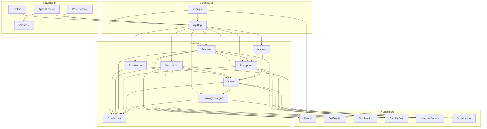

# Componentes del reto

Bloques de código que se escriben para el reto con varias salas, datos organizados y entrada limpia.
Salen de los requisitos aprobados (`../requirements-analysis/requirements.md`), del código actual
(`aidlc/spaces/default/codekb/Reto_Desinformacion_Colegios/component-inventory.md` y
`code-structure.md`, «Mapa de secciones de `servidor.py`») y de tus respuestas en
`domain-design-questions.md` (Q1-Q7).

Aquí no se elige el hosting ni cómo se despliega: eso va en el ADR (NFR Requirements y NFR Design). La
base de datos, el banco en JSON y el almacenamiento del navegador son dependencias de los componentes,
no componentes.

## Cómo leer este documento

1. **Diagrama de componentes** y **Resumen**: qué bloques hay y quién llama a quién (5 minutos).
2. **Dueño de cada dato**: qué bloque es dueño de cada dato.
3. **Por qué cada bloque va aparte** y **Alternativas descartadas**: las decisiones; el detalle de cada
   una está en `decisions.md`.
4. El bloque `yaml` del final es la fuente para las etapas siguientes; no hace falta leerlo entero.

## Diagrama de componentes

Las flechas van de quien llama hacia quien es llamado. El núcleo puro no llama a nadie.



Texto alternativo: cuatro capas. **Navegador**: AppEstudiante (usa Graficos), PanelDocente y Tablero,
que llaman a ApiHttp. **Borde**: ApiHttp despacha a los servicios; Arranque levanta ApiHttp, carga el
Banco y abre la Persistencia. **Servicios**: Acceso, Salas, CatalogoColegios, Inscripcion, Examen,
Resultados, Exportacion y Persistencia; todos guardan y leen a través de Persistencia. **Núcleo puro**:
Banco, Calificacion, Clasificacion, CicloDeSala, LimpiezaEntrada y Experimento, que reciben datos y
devuelven datos sin base, reloj ni HTTP.

## Resumen

| Componente | Capa | Para qué | Depende de | Lo usan | Entidades |
|---|---|---|---|---|---|
| Banco | Núcleo puro | Carga y valida el banco de preguntas y arma el examen de cada participante. | — | Examen, Resultados, Exportacion, Arranque | Mision, Pregunta |
| Calificacion | Núcleo puro | Califica una respuesta con crédito parcial y calcula el bono de tiempo. | — | Examen | — |
| Clasificacion | Núcleo puro | Ordena a los participantes de una sala en un orden total sin empates. | — | Resultados | — |
| CicloDeSala | Núcleo puro | Reglas del estado de una sala y del tiempo de cada intento. | — | Salas, Inscripcion, Examen, Resultados | — |
| LimpiezaEntrada | Núcleo puro | Normaliza y valida el texto que llega del navegador. | — | CatalogoColegios, Salas, Inscripcion | — |
| Experimento | Núcleo puro | Estadistica del experimento de clase entre los grupos A y B de una sala. | — | Resultados | — |
| Persistencia | Servicios | Lee y escribe en el almacén todos los datos del reto. | — | CatalogoColegios, Salas, Inscripcion, Examen, Resultados, Exportacion, Arranque | — |
| CatalogoColegios | Servicios | Catalogo único de colegios del semillero. | LimpiezaEntrada, Persistencia | Salas, ApiHttp | Colegio |
| Salas | Servicios | Crea, configura y cierra las salas en paralelo. | CicloDeSala, LimpiezaEntrada, CatalogoColegios, Persistencia | Inscripcion, Acceso, Examen, Resultados, Exportacion, ApiHttp | Sala |
| Acceso | Servicios | Decide quien puede hacer cada cosa. | Salas, Inscripcion | ApiHttp | — |
| Inscripcion | Servicios | Inscribe y deja entrar a los participantes de una sala. | Salas, LimpiezaEntrada, CicloDeSala, Persistencia | Acceso, Examen, ApiHttp | Participante |
| Examen | Servicios | Lleva el intento de cada participante: comenzar, responder y entregar. | Banco, Calificacion, CicloDeSala, Salas, Inscripcion, Persistencia | ApiHttp | Intento, Respuesta, Evento |
| Resultados | Servicios | Arma las vistas de una sala: estado del participante, tablero y resumen del panel. | Banco, Clasificacion, Experimento, CicloDeSala, Salas, Persistencia | ApiHttp | — |
| Exportacion | Servicios | Arma los CSV de hoy y el paquete de datos de una sala. | Salas, Banco, Persistencia | ApiHttp | — |
| ApiHttp | Borde (E/S) | Recibe las peticiones HTTP y las despacha con una tabla de rutas. | Acceso, Salas, CatalogoColegios, Inscripcion, Examen, Resultados, Exportacion | Arranque, AppEstudiante, PanelDocente, Tablero | — |
| Arranque | Borde (E/S) | Arranca el servidor con su configuración. | ApiHttp, Banco, Persistencia | — | — |
| AppEstudiante | Navegador | Aplicación del estudiante en el navegador (estudiante.js). | ApiHttp, Graficos | — | — |
| PanelDocente | Navegador | Panel del docente y del semillero (admin.js). | ApiHttp | — | — |
| Tablero | Navegador | Pantalla para proyectar de una sala (tablero.html). | ApiHttp | — | — |
| Graficos | Navegador | Dibuja en SVG los gráficos del banco (gráficos.js). | — | AppEstudiante | — |

## Dueño de cada dato

Cada dato tiene un solo dueño. El detalle de tipos y valores permitidos va en Functional Design.

| Entidad | Componente dueño | Identificador | Atributos | Referencias |
|---|---|---|---|---|
| Mision | Banco | `id` | titulo, orden, preguntas | — |
| Pregunta | Banco | `id` | mision, tipo, puntos, enunciado, opciones, clave, explicacion, variantes, requiere, revelar_tras | — |
| Colegio | CatalogoColegios | `id_colegio` | nombre, nombre_normalizado, creado | — |
| Sala | Salas | `id_sala` | codigo, estado, duracion_min, modo_sorpresa, retro, evento, reloj_global, clave_huella, colegios, creada, abierta, cerrada | Colegio (CatalogoColegios) |
| Participante | Inscripcion | `id` | codigo, token, nombre, colegio, grado, integrantes, n_integrantes, grupo, semilla, creado | Sala (Salas), Colegio (CatalogoColegios) |
| Intento | Examen | `participante_id` | inicio, fin, estado, motivo_fin, puntos, bono, total, tiempo_usado, tiempo_respuestas, salidas | Participante (Inscripcion) |
| Respuesta | Examen | `participante_id + pregunta_id` | variante, respuesta, fraccion, puntos, max_puntos, momento | Participante (Inscripcion), Pregunta (Banco) |
| Evento | Examen | `participante_id + tipo + momento` | tipo, momento | Participante (Inscripcion) |

**Participante e Intento:** hoy son una sola tabla, `participantes`. Aquí se separan en dos dueños.
Inscripcion es dueña de los datos de la persona (quién es, de qué sala y colegio). Examen es dueño de lo
que pasa en el reto (inicio, entrega, puntos y bono). Así cada bloque escribe solo lo suyo. Si la base
sigue con una sola tabla o con dos se decide en Functional Design.

## Dependencias externas

| Componente | Dependencia | Tipo | Para qué |
|---|---|---|---|
| Banco | banco_preguntas.json | other | banco generado por construir_banco.py; solo lectura |
| Persistencia | SQLite (u otro almacén que elija el ADR) | database | guardar salas, catálogo, participantes, intentos, respuestas y eventos |
| AppEstudiante | localStorage | other | guardar el token del participante |
| PanelDocente | sessionStorage | other | guardar la clave durante la sesión |

## Por qué cada bloque va aparte

| Componente | Por qué va aparte |
|---|---|
| Banco | Cambia cuando se regenera el banco, no cuando cambia el servidor; esconde la decisión de cómo se arma y se oculta el examen (FR6) |
| Calificacion | Reglas de puntaje que no pueden cambiar (FR2.1); se prueban solas, sin base |
| Clasificacion | El orden total es un invariante del proyecto (NFR11); aislarlo hace imposible un empate por accidente |
| CicloDeSala | Decide estados y tiempo con la hora como argumento (Q4-A): se puede probar sin esperar ni hilos |
| LimpiezaEntrada | Reglas de entrada limpia (FR10) que comparten inscripción, catálogo y salas |
| Experimento | Estadística del experimento de clase, sin relación con la calificación |
| Persistencia | Es lo único que cambia si el ADR cambia de almacén (Q5-C, FR7.3) |
| CatalogoColegios | Vive más que una sala: su ciclo de vida es de años (Q2-A) |
| Salas | Dueña del estado y de la clave de cada sala; de ella depende la separación entre retos en paralelo (FR11) |
| Acceso | Una sola puerta para claves y tokens; evita que una ruta olvide revisar la sala (FR11.5, FR9.5) |
| Inscripcion | Dueña de quién es cada participante; cambia con las reglas de entrada, no con las del examen |
| Examen | Dueño de lo que pasa durante el intento; concentra «una respuesta por pregunta» (FR2.4) |
| Resultados | Lo que ve cada pantalla; ahí se esconden las fugas antes de «resultados» (FR6.1) |
| Exportacion | Formato estable de los datos del semillero (FR9), que cambia por razones distintas a la API |
| ApiHttp | Traduce HTTP y JSON; la tabla de rutas reemplaza la cadena de `if` (FR7.2) |
| Arranque | Configuración por entorno y modos actuales (FR5.4), separada de las rutas |
| AppEstudiante, PanelDocente, Tablero, Graficos | Ya existen en `web/`; solo cambian donde lo dicen FR10.3 y FR11 |

## Alternativas de partición

- **Opción A: pocos módulos por capa (elegida, Q1-A).** El núcleo queda en `nucleo/`, con un módulo por
  decisión; los servicios, la persistencia, la exportación, la API HTTP y el arranque van aparte. Cada
  módulo cabe en un PR de 400 líneas o menos y el núcleo se prueba sin servidor. Es reversible: un
  módulo se puede partir después sin tocar a quien lo llama.
- **Opción B: un archivo por componente (descartada).** Tendría unos 20 archivos para un servidor que
  hoy tiene 913 líneas, con más importaciones cruzadas y sin una ganancia que hoy haga falta.
- **Opción C: un solo `servidor.py` ordenado (descartada).** Es el cambio más pequeño, pero sigue
  mezclando reglas, SQL y HTTP, y no cumple FR7.1 (núcleo puro separado).

Recomendación: A, por la regla de un módulo por cada decisión que puede cambiar (Parnas, en
`.claude/rules/python-code.md`). Los componentes de arriba son bloques lógicos: varios pueden vivir en
un mismo módulo. Cómo se agrupan en archivos y unidades lo decide Units Generation.

**Alternativas descartadas** (detalle en `decisions.md`): lista de colegios por sala (Q2-B), clave de
sala escrita a mano (Q3-B), hilo vigilante (Q4-B), un almacén fijado desde el dominio (Q5-A/B) e ids
opacos guardados en la base (Q6-B).

## Catálogo (fuente para las etapas siguientes)

```yaml
components:
  - name: Banco
    summary: "Carga y valida el banco de preguntas y arma el examen de cada participante."
    behaviour: "Lee banco_preguntas.json una vez al arrancar y rechaza un banco que no sume 1.000 puntos, con ids repetidos o sin versión. Arma el examen de un participante a partir de su semilla: variante, orden de opciones e identificadores opacos derivados de la semilla con una función pura (FR6.2, Q6-A), y traduce los opacos de vuelta a los ids del banco al calificar. La vista pública de una pregunta nunca trae clave, explicación ni veredicto antes de resultados (FR6, NFR8). Nunca sirve el banco como archivo."
    responsibilities:
      - "validar el banco al cargar (1.000 puntos, ids únicos, versión)"
      - "examen por participante: variantes, orden e ids opacos"
      - "vista pública de cada pregunta sin respuestas"
      - "revelar claves y explicaciones solo en resultados"
    depends_on: []
    dependents:
      - component: Examen
        interaction: "examen del participante y traducción de ids opacos"
      - component: Resultados
        interaction: "vista pública y revelado en resultados"
      - component: Exportacion
        interaction: "huella del banco"
      - component: Arranque
        interaction: "cargar el banco"
    external_dependencies:
      - name: "banco_preguntas.json"
        kind: other
        purpose: "banco generado por construir_banco.py; solo lectura"
    entities:
      - name: Mision
        identifier: "id"
        attributes: [titulo, orden, preguntas]
      - name: Pregunta
        identifier: "id"
        attributes: [mision, tipo, puntos, enunciado, opciones, clave, explicacion, variantes, requiere, revelar_tras]
  - name: Calificacion
    summary: "Califica una respuesta con crédito parcial y calcula el bono de tiempo."
    behaviour: "Funciones puras: valida la forma de la respuesta según el tipo de pregunta (tabla por tipo, no cadena de if), calcula la fracción de crédito parcial de los 10 tipos y el bono 20 x (puntos/1.000) x (1 - t_ultima/duracion). Da exactamente los mismos puntos que hoy (FR2.1, FR2.2). No lee base ni reloj: recibe la pregunta, la respuesta y los tiempos."
    responsibilities:
      - "validar la forma de una respuesta por tipo"
      - "fracción de crédito parcial"
      - "bono de tiempo"
    depends_on: []
    dependents:
      - component: Examen
        interaction: "calificar y calcular el bono"
    entities: []
  - name: Clasificacion
    summary: "Ordena a los participantes de una sala en un orden total sin empates."
    behaviour: "Función pura sobre una lista de intentos finalizados: total desc, puntos desc, momento de la última respuesta asc, hora de entrega asc, inscripción asc (FR2.3, NFR11). Dos participantes nunca comparten puesto. Calcula puesto, podio, top 10 y nota."
    responsibilities:
      - "orden total con desempates actuales"
      - "puesto y podio"
      - "nota sobre 5"
    depends_on: []
    dependents:
      - component: Resultados
        interaction: "ranking de la sala"
    entities: []
  - name: CicloDeSala
    summary: "Reglas del estado de una sala y del tiempo de cada intento."
    behaviour: "Tabla de transiciones permitidas inscripción -> abierto -> cerrado -> resultados (FR7.4, FR1.1) y estados del participante (FR1.2). Decide con la hora del servidor, pasada como argumento, si un intento venció y cuál es su hora de entrega: min(ahora, inicio + duración) (FR3, Q4-A, Q7-A). Sin hilo: quien consulta aplica el vencimiento antes de responder."
    responsibilities:
      - "tabla de transiciones de la sala"
      - "estados del intento"
      - "vencimiento al consultar con la hora del servidor"
    depends_on: []
    dependents:
      - component: Salas
        interaction: "validar cada cambio de estado"
      - component: Inscripcion
        interaction: "saber si la sala admite inscripciones"
      - component: Examen
        interaction: "vencimiento y estado del intento"
      - component: Resultados
        interaction: "aplicar vencimiento antes de mostrar"
    entities: []
  - name: LimpiezaEntrada
    summary: "Normaliza y valida el texto que llega del navegador."
    behaviour: "Funciones puras: Unicode NFC, quitar caracteres de control e invisibles, juntar espacios, recortar al largo; validar nombre (>= 3 letras), grado (9, 10, 11), colegio obligatorio de la lista, integrantes separados por comas (FR10.1, FR10.2, FR10.4, FR10.5). Calcula el nombre normalizado de un colegio para detectar duplicados en el catálogo. No cambia mayúsculas ni tildes de lo que se muestra."
    responsibilities:
      - "normalizar texto"
      - "validar campos de inscripción"
      - "normalizar integrantes"
      - "nombre normalizado de colegio"
    depends_on: []
    dependents:
      - component: CatalogoColegios
        interaction: "normalizar nombres y detectar duplicados"
      - component: Salas
        interaction: "limpiar el nombre del evento"
      - component: Inscripcion
        interaction: "limpiar y validar los campos"
    entities: []
  - name: Experimento
    summary: "Estadistica del experimento de clase entre los grupos A y B de una sala."
    behaviour: "Funciones puras sobre las respuestas de una sala: proporciones por grupo y las tres diapositivas del experimento, igual que hoy, ahora por sala (FR11.2)."
    responsibilities:
      - "resumen del experimento por grupo A/B"
    depends_on: []
    dependents:
      - component: Resultados
        interaction: "diapositivas del experimento"
    entities: []
  - name: Persistencia
    summary: "Lee y escribe en el almacén todos los datos del reto."
    behaviour: "Unica capa que habla con la base: SQL parametrizado, transacciones y copias consistentes (VACUUM INTO). Toda consulta lleva la sala (FR11.2). Si el ADR elige un almacén por sala o una base con columna de sala lo decide el hosting (Q5-C); un puerto con dos implementaciones solo si el ADR trae una segunda real (FR7.3). No contiene reglas del reto."
    responsibilities:
      - "acceso a datos por sala"
      - "transacciones"
      - "copia consistente de la base de una sala"
      - "borrado de una sala"
    depends_on: []
    dependents:
      - component: CatalogoColegios
        interaction: "guardar y leer colegios"
      - component: Salas
        interaction: "guardar y leer salas"
      - component: Inscripcion
        interaction: "guardar participantes"
      - component: Examen
        interaction: "guardar intentos, respuestas y eventos"
      - component: Resultados
        interaction: "leer intentos y respuestas de la sala"
      - component: Exportacion
        interaction: "leer filas y copia de la base de la sala"
      - component: Arranque
        interaction: "abrir el almacén"
    external_dependencies:
      - name: "SQLite (u otro almacén que elija el ADR)"
        kind: database
        purpose: "guardar salas, catálogo, participantes, intentos, respuestas y eventos"
    entities: []
  - name: CatalogoColegios
    summary: "Catalogo único de colegios del semillero."
    behaviour: "El semillero, con su clave general, agrega o corrige colegios. Cada colegio tiene un identificador estable entre retos y años (Q2-A); un nombre que normalizado ya existe se rechaza como duplicado. Las salas eligen de este catálogo cuales participan (FR10.3)."
    responsibilities:
      - "alta y corrección de colegios"
      - "rechazo de duplicados"
      - "consulta del catálogo"
    depends_on:
      - component: LimpiezaEntrada
        interaction: "normalizar nombres y detectar duplicados"
        style: sync
      - component: Persistencia
        interaction: "guardar y leer colegios"
        style: sync
    dependents:
      - component: Salas
        interaction: "validar la lista de colegios de la sala"
      - component: ApiHttp
        interaction: "rutas del catálogo"
    entities:
      - name: Colegio
        identifier: "id_colegio"
        attributes: [nombre, nombre_normalizado, creado]
  - name: Salas
    summary: "Crea, configura y cierra las salas en paralelo."
    behaviour: "La clave general del semillero crea una sala; el servidor genera su clave docente larga y aleatoria, la muestra una vez y guarda solo su huella; el semillero puede regenerarla y la anterior deja de servir (FR11.5, Q3-C). Cada sala tiene su código, su estado, su duración, su configuración y su lista de colegios (FR11.1). Aplica la tabla de CicloDeSala al cambiar de estado. Reiniciar o borrar una sala no toca las demás (FR11.6)."
    responsibilities:
      - "crear y cerrar salas"
      - "clave de sala: generar, regenerar, verificar huella"
      - "configuración de la sala"
      - "cambio de estado con la tabla de transiciones"
      - "reiniciar y borrar una sala"
    depends_on:
      - component: CicloDeSala
        interaction: "validar cada cambio de estado"
        style: sync
      - component: LimpiezaEntrada
        interaction: "limpiar el nombre del evento"
        style: sync
      - component: CatalogoColegios
        interaction: "validar la lista de colegios de la sala"
        style: sync
      - component: Persistencia
        interaction: "guardar y leer salas"
        style: sync
    dependents:
      - component: Inscripcion
        interaction: "resolver la sala por su código y su lista de colegios"
      - component: Acceso
        interaction: "comparar la clave con la huella de la sala"
      - component: Examen
        interaction: "duración y reloj de la sala"
      - component: Resultados
        interaction: "estado y configuración de la sala"
      - component: Exportacion
        interaction: "fecha, código y metadatos de la sala"
      - component: ApiHttp
        interaction: "rutas de salas y del panel"
    entities:
      - name: Sala
        identifier: "id_sala"
        attributes: [codigo, estado, duracion_min, modo_sorpresa, retro, evento, reloj_global, clave_huella, colegios, creada, abierta, cerrada]
        references:
          - entity: Colegio
            owned_by: CatalogoColegios
            relationship: "cada sala ofrece varios colegios del catálogo"
  - name: Acceso
    summary: "Decide quien puede hacer cada cosa."
    behaviour: "Compara en tiempo constante la clave general del semillero (secreto del hosting) y la clave de cada sala, que solo llega por la cabecera X-Clave-Admin (NFR9). Una clave de sala solo abre su sala; cualquier otra devuelve 403 (FR11.5, FR9.5). Resuelve el token de sesión del participante. Nunca registra una clave."
    responsibilities:
      - "verificar clave del semillero"
      - "verificar clave de sala contra su sala"
      - "resolver el token del participante"
    depends_on:
      - component: Salas
        interaction: "comparar la clave con la huella de la sala"
        style: sync
      - component: Inscripcion
        interaction: "resolver el token del participante"
        style: sync
    dependents:
      - component: ApiHttp
        interaction: "nivel de acceso de cada ruta"
    entities: []
  - name: Inscripcion
    summary: "Inscribe y deja entrar a los participantes de una sala."
    behaviour: "Inscribe con el código de sala, limpiando y validando todo en el servidor (FR10). El colegio debe estar en la lista de la sala. Rechaza un nombre repetido con el mismo colegio (por identificador) y grado en la misma sala. Genera el código de 5 caracteres, el token y la semilla, y asigna el grupo A/B alternado dentro de la sala (FR1.3, FR11.2). Solo inscribe con la sala en inscripción o abierto."
    responsibilities:
      - "inscribir participante en una sala"
      - "entrar con código"
      - "grupo A/B por sala"
      - "control de nombre repetido"
    depends_on:
      - component: Salas
        interaction: "resolver la sala por su código y su lista de colegios"
        style: sync
      - component: LimpiezaEntrada
        interaction: "limpiar y validar los campos"
        style: sync
      - component: CicloDeSala
        interaction: "saber si la sala admite inscripciones"
        style: sync
      - component: Persistencia
        interaction: "guardar participantes"
        style: sync
    dependents:
      - component: Acceso
        interaction: "resolver el token del participante"
      - component: Examen
        interaction: "datos del participante"
      - component: ApiHttp
        interaction: "registro y entrada"
    entities:
      - name: Participante
        identifier: "id"
        attributes: [codigo, token, nombre, colegio, grado, integrantes, n_integrantes, grupo, semilla, creado]
        references:
          - entity: Sala
            owned_by: Salas
            relationship: "cada participante pertenece a una sala"
          - entity: Colegio
            owned_by: CatalogoColegios
            relationship: "cada participante es de un colegio del catálogo"
  - name: Examen
    summary: "Lleva el intento de cada participante: comenzar, responder y entregar."
    behaviour: "Comienza el intento con la hora del servidor (reloj global o individual, FR3.1). Acepta cada pregunta una sola vez (FR2.4), traduce ids opacos con Banco, califica con Calificacion y guarda la respuesta. Antes de responder aplica el vencimiento de CicloDeSala. Entrega por pedido, por tiempo o al cerrar la sala, con el bono de Calificacion. Registra salidas de pestaña como eventos."
    responsibilities:
      - "comenzar intento"
      - "responder una vez por pregunta"
      - "entregar y calcular bono"
      - "vencimiento al consultar"
      - "eventos de salida de pestaña"
    depends_on:
      - component: Banco
        interaction: "examen del participante y traducción de ids opacos"
        style: sync
      - component: Calificacion
        interaction: "calificar y calcular el bono"
        style: sync
      - component: CicloDeSala
        interaction: "vencimiento y estado del intento"
        style: sync
      - component: Salas
        interaction: "duración y reloj de la sala"
        style: sync
      - component: Inscripcion
        interaction: "datos del participante"
        style: sync
      - component: Persistencia
        interaction: "guardar intentos, respuestas y eventos"
        style: sync
    dependents:
      - component: ApiHttp
        interaction: "comenzar, responder, entregar"
    entities:
      - name: Intento
        identifier: "participante_id"
        attributes: [inicio, fin, estado, motivo_fin, puntos, bono, total, tiempo_usado, tiempo_respuestas, salidas]
        references:
          - entity: Participante
            owned_by: Inscripcion
            relationship: "cada participante tiene un intento"
      - name: Respuesta
        identifier: "participante_id + pregunta_id"
        attributes: [variante, respuesta, fraccion, puntos, max_puntos, momento]
        references:
          - entity: Participante
            owned_by: Inscripcion
            relationship: "cada respuesta es de un participante"
          - entity: Pregunta
            owned_by: Banco
            relationship: "cada respuesta contesta una pregunta del banco"
      - name: Evento
        identifier: "participante_id + tipo + momento"
        attributes: [tipo, momento]
        references:
          - entity: Participante
            owned_by: Inscripcion
            relationship: "cada evento es de un participante"
  - name: Resultados
    summary: "Arma las vistas de una sala: estado del participante, tablero y resumen del panel."
    behaviour: "Vista del participante, vista pública del tablero y resumen del panel docente, siempre de una sola sala (FR11.4). Antes de resultados no entrega veredicto, clave ni multitud_acierta (FR6.1). Usa Clasificacion para el ranking, Experimento para las diapositivas y Banco para revelar en resultados. Aplica el vencimiento antes de armar cada vista."
    responsibilities:
      - "vista del participante"
      - "vista pública del tablero por sala"
      - "resumen del panel docente"
    depends_on:
      - component: Banco
        interaction: "vista pública y revelado en resultados"
        style: sync
      - component: Clasificacion
        interaction: "ranking de la sala"
        style: sync
      - component: Experimento
        interaction: "diapositivas del experimento"
        style: sync
      - component: CicloDeSala
        interaction: "aplicar vencimiento antes de mostrar"
        style: sync
      - component: Salas
        interaction: "estado y configuración de la sala"
        style: sync
      - component: Persistencia
        interaction: "leer intentos y respuestas de la sala"
        style: sync
    dependents:
      - component: ApiHttp
        interaction: "estado, público y resumen"
    entities: []
  - name: Exportacion
    summary: "Arma los CSV de hoy y el paquete de datos de una sala."
    behaviour: "Los dos CSV actuales salen igual que hoy (FR4.3). El paquete AAAA-MM-DD_<sala>_reto.zip trae participantes, respuestas, eventos y colegios en CSV UTF-8 con ISO 8601 y punto decimal, la copia de la base de la sala y metadatos.json con la huella del banco y la versión de la app (FR9.1, FR9.2). Usa ids del banco, nunca los opacos; no incluye tokens ni claves (FR9.5)."
    responsibilities:
      - "CSV de resultados y respuestas"
      - "paquete .zip de la sala"
      - "metadatos del reto"
    depends_on:
      - component: Salas
        interaction: "fecha, código y metadatos de la sala"
        style: sync
      - component: Banco
        interaction: "huella del banco"
        style: sync
      - component: Persistencia
        interaction: "leer filas y copia de la base de la sala"
        style: sync
    dependents:
      - component: ApiHttp
        interaction: "CSV y paquete"
    entities: []
  - name: ApiHttp
    summary: "Recibe las peticiones HTTP y las despacha con una tabla de rutas."
    behaviour: "Tabla de (metodo, ruta) a función con el nivel de acceso de cada ruta (FR7.2). Mantiene las rutas y claves JSON que usa web/js/ (FR4.1) y agrega las rutas de salas, catálogo y paquete. Valida el cuerpo una vez en la frontera. Es el único try amplio: responde 500 sin detalles y registra la traza. Sirve las páginas y estáticos sin cambios visibles (FR4.2)."
    responsibilities:
      - "tabla de rutas"
      - "conversión JSON de entrada y salida"
      - "códigos de error"
      - "estáticos"
    depends_on:
      - component: Acceso
        interaction: "nivel de acceso de cada ruta"
        style: sync
      - component: Salas
        interaction: "rutas de salas y del panel"
        style: sync
      - component: CatalogoColegios
        interaction: "rutas del catálogo"
        style: sync
      - component: Inscripcion
        interaction: "registro y entrada"
        style: sync
      - component: Examen
        interaction: "comenzar, responder, entregar"
        style: sync
      - component: Resultados
        interaction: "estado, público y resumen"
        style: sync
      - component: Exportacion
        interaction: "CSV y paquete"
        style: sync
    dependents:
      - component: Arranque
        interaction: "levantar el servidor HTTP"
      - component: AppEstudiante
        interaction: "rutas del estudiante"
      - component: PanelDocente
        interaction: "rutas /api/admin/*"
      - component: Tablero
        interaction: "GET /api/publico de su sala"
    entities: []
  - name: Arranque
    summary: "Arranca el servidor con su configuración."
    behaviour: "Lee argumentos y variables de entorno (PORT, RETO_CLAVE, RETO_DATOS, RETO_URL_PUBLICA...), carga el banco, abre el almacén y levanta ApiHttp. Mantiene los modos de red local, túnel temporal y modo prueba (FR5.4). Sin hilo vigilante (Q4-A)."
    responsibilities:
      - "configuración por argumentos y entorno"
      - "arranque de los modos actuales"
    depends_on:
      - component: ApiHttp
        interaction: "levantar el servidor HTTP"
        style: sync
      - component: Banco
        interaction: "cargar el banco"
        style: sync
      - component: Persistencia
        interaction: "abrir el almacén"
        style: sync
    dependents: []
    entities: []
  - name: AppEstudiante
    summary: "Aplicación del estudiante en el navegador (estudiante.js)."
    behaviour: "Inscripcion con código de sala, ahora con el colegio como lista (FR10.3), sala de espera, misiones, entrega, resultados y revisión. Solo cuenta regresiva: el tiempo lo mide el servidor."
    responsibilities:
      - "pantallas del estudiante"
      - "colegio como lista"
    depends_on:
      - component: ApiHttp
        interaction: "rutas del estudiante"
        style: sync
      - component: Graficos
        interaction: "dibujar los gráficos de las preguntas"
        style: sync
    dependents: []
    external_dependencies:
      - name: "localStorage"
        kind: other
        purpose: "guardar el token del participante"
    entities: []
  - name: PanelDocente
    summary: "Panel del docente y del semillero (admin.js)."
    behaviour: "Panel de una sala con su clave: pasos del reto, configuración, participantes, CSV, paquete y reiniciar. Con la clave del semillero: crear y cerrar salas, regenerar claves y mantener el catálogo de colegios (FR11.5)."
    responsibilities:
      - "panel de la sala"
      - "panel del semillero"
    depends_on:
      - component: ApiHttp
        interaction: "rutas /api/admin/*"
        style: sync
    dependents: []
    external_dependencies:
      - name: "sessionStorage"
        kind: other
        purpose: "guardar la clave durante la sesión"
    entities: []
  - name: Tablero
    summary: "Pantalla para proyectar de una sala (tablero.html)."
    behaviour: "Muestra la inscripción, el reloj de referencia, el ranking en vivo y las diapositivas de resultados de una sola sala (FR11.4)."
    responsibilities:
      - "tablero de una sala"
    depends_on:
      - component: ApiHttp
        interaction: "GET /api/publico de su sala"
        style: sync
    dependents: []
    entities: []
  - name: Graficos
    summary: "Dibuja en SVG los gráficos del banco (gráficos.js)."
    behaviour: "Sin librerías ni cambios; lo usa AppEstudiante."
    responsibilities:
      - "gráficos SVG"
    depends_on: []
    dependents:
      - component: AppEstudiante
        interaction: "dibujar los gráficos de las preguntas"
    entities: []
```
