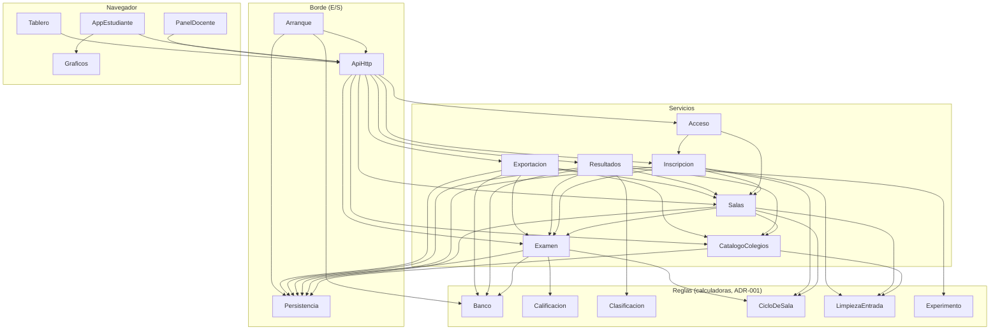

# Componentes del reto

Bloques lógicos del reto con varias salas, datos limpios y entrada limpia. Salen de los requisitos
aprobados (`../requirements-analysis/requirements.md`), de los ADR-001 a ADR-007 aprobados
(`decisions.md`) y del código actual (`aidlc/spaces/default/codekb/Reto_Desinformacion_Colegios/component-inventory.md`
y `code-structure.md`, «Mapa de secciones de `servidor.py`»).

**Valen para cada versión de la nube** (FR12.2: Render, Cloudflare, Cloudflare Containers, Apps Script y
GitHub Pages). La versión local, `2_Aplicacion_Reto/`, no cambia (FR12.1). Son bloques lógicos, no
archivos: en cada opción varios pueden vivir en un mismo módulo, y cómo se agrupan lo deciden Units
Generation y el ADR de cada opción (FR12.2b). Aquí no se elige el hosting, el lenguaje ni la forma del
almacén.

## Cómo leer este documento

1. **Diagrama** y **Resumen**: qué bloques hay y quién llama a quién (5 minutos).
2. **Dueño de cada dato**: quién escribe cada dato (ADR-007).
3. **Cómo se sabe la sala** y **Por qué cada bloque va aparte**: las reglas que cruzan bloques.
4. El bloque `yaml` del final es la fuente para las etapas siguientes; no hace falta leerlo entero.

## Diagrama de componentes

Las flechas van de quien llama hacia quien es llamado. Las reglas no llaman a nadie.



Texto alternativo: cuatro capas. **Navegador**: AppEstudiante (usa Graficos), PanelDocente y Tablero
llaman a ApiHttp. **Borde**: ApiHttp despacha a los servicios; Persistencia es lo único que habla con el
almacén; Arranque lee la configuración, carga el Banco, abre la Persistencia y levanta ApiHttp.
**Servicios**: CatalogoColegios, Salas, Acceso, Inscripcion, Examen, Resultados y Exportacion. Examen es
el único que escribe la entrega: Salas al cerrar, y Resultados y Exportacion antes de leer, le piden a
Examen que aplique la regla; Inscripcion le pide borrar los eventos de un participante eliminado.
Resultados y Exportacion leen el nombre definitivo de cada colegio en CatalogoColegios. **Reglas**: Banco, Calificacion, Clasificacion,
CicloDeSala, LimpiezaEntrada y Experimento reciben datos y la hora, y devuelven datos.

## Resumen

| Componente | Capa | Para qué | Depende de | Lo usan | Entidades |
|---|---|---|---|---|---|
| Banco | Reglas | Valida el banco y arma el examen de cada participante con ids opacos. | — | Examen, Resultados, Exportacion, Arranque | Mision, Pregunta |
| Calificacion | Reglas | Califica una respuesta con crédito parcial y calcula el bono. | — | Examen | — |
| Clasificacion | Reglas | Ordena a los participantes de una sala sin empates. | — | Resultados | — |
| CicloDeSala | Reglas | Transiciones de la sala y hora de entrega con su motivo. | — | Salas, Inscripcion, Examen | — |
| LimpiezaEntrada | Reglas | Normaliza y valida el texto que llega del navegador. | — | CatalogoColegios, Salas, Inscripcion | — |
| Experimento | Reglas | Estadística del experimento A/B de una sala. | — | Resultados | — |
| CatalogoColegios | Servicios | Catálogo único de colegios, con provisionales del día. | LimpiezaEntrada, Persistencia | Salas, Resultados, Exportacion, ApiHttp | Colegio |
| Salas | Servicios | Crea, configura, cambia de estado, reinicia y borra cada sala. | CicloDeSala, LimpiezaEntrada, CatalogoColegios, Examen, Persistencia | Inscripcion, Acceso, Resultados, Exportacion, ApiHttp | Sala |
| Acceso | Servicios | Decide quién puede hacer cada cosa y sobre qué sala. | Salas, Inscripcion | ApiHttp | — |
| Inscripcion | Servicios | Inscribe, deja entrar y elimina participantes. | Salas, LimpiezaEntrada, CicloDeSala, Examen, Persistencia | Acceso, ApiHttp | Participante |
| Examen | Servicios | Comenzar, responder, entregar y las acciones del docente sobre el reto. | Banco, Calificacion, CicloDeSala, Persistencia | Salas, Inscripcion, Resultados, Exportacion, ApiHttp | Respuesta, Evento |
| Resultados | Servicios | Vista del participante, tablero y resumen del panel de una sala. | Examen, Banco, Clasificacion, Experimento, Salas, CatalogoColegios, Persistencia | ApiHttp | — |
| Exportacion | Servicios | CSV de hoy, paquete de datos y copia de «Reiniciar» de una sala. | Examen, Salas, CatalogoColegios, Banco, Persistencia | ApiHttp | CopiaDeSala |
| ApiHttp | Borde (E/S) | Recibe las peticiones y las despacha con su nivel de acceso. | Acceso, Salas, CatalogoColegios, Inscripcion, Examen, Resultados, Exportacion | Arranque, AppEstudiante, PanelDocente, Tablero | — |
| Persistencia | Borde (E/S) | Lee y escribe en el almacén de la opción. | — | CatalogoColegios, Salas, Inscripcion, Examen, Resultados, Exportacion, Arranque | — |
| Arranque | Borde (E/S) | Arranca la versión con su configuración y sus secretos. | ApiHttp, Banco, Persistencia | — | — |
| AppEstudiante | Navegador | Pantallas del estudiante (`estudiante.js`). | ApiHttp, Graficos | — | — |
| PanelDocente | Navegador | Panel del docente y del semillero (`admin.js`). | ApiHttp | — | — |
| Tablero | Navegador | Pantalla para proyectar de una sala (`tablero.html`). | ApiHttp | — | — |
| Graficos | Navegador | Gráficos SVG del banco (`graficos.js`). | — | AppEstudiante | — |

## Dueño de cada dato

Cada dato tiene un solo dueño. Los tipos y valores permitidos van en Functional Design.

| Entidad | Componente dueño | Identificador | Atributos | Referencias |
|---|---|---|---|---|
| Mision | Banco | `id` | titulo, subtitulo, intro, preguntas, glosario, dossier (titulo, graficos, revelar_tras), lectura | — |
| Pregunta | Banco | `id` | tipo, puntos, enunciado, respuesta, explicacion, requiere, solo_grupo, variantes, tolerancia, opciones, items, partes, categorias, publicaciones, experimento, estilo, unidad, simulador, tabla, min, max, paso, grafico, entero | — |
| Colegio | CatalogoColegios | `id_colegio` | nombre, nombre_normalizado, provisional, unido_a, creado | — |
| Sala | Salas | `id_sala` | codigo, estado, duracion_min, modo_sorpresa, retro, evento, reloj_global, clave_huella, colegios, creada, abierta, cerrada | Colegio |
| Participante | Inscripcion (datos de la persona) y Examen (datos del reto) | `id` | codigo, token, nombre, colegio, grado, integrantes, n_integrantes, grupo, semilla, creado; estado, inicio, fin, motivo_fin, puntos, bono, total, tiempo_usado, tiempo_respuestas, salidas | Sala, Colegio |
| Respuesta | Examen | `participante_id + pregunta_id` | variante, respuesta, fraccion, puntos, max_puntos, momento | Participante, Pregunta |
| Evento | Examen | `id_evento` | tipo, momento | Participante |
| CopiaDeSala | Exportacion | `id_copia` | creada, contenido (solo las filas de la sala) | Sala |

Los nombres de Mision y Pregunta son los del banco (`banco_preguntas.json`: 10 misiones y 42 preguntas,
contadas por nombre de campo). El `id` de Participante crece con el orden de inscripción en cada almacén,
porque es el último desempate (R-15).

**Participante, una sola entidad con dos dueños (ADR-007).** Inscripcion escribe quién es la persona y
la crea. Examen escribe el estado (`registrado`, `en_curso`, `finalizado`, `no_inicio`, `descalificado`)
y lo que pasa en el reto. Las acciones del docente se reparten igual:

| Acción | Dueño | Regla |
|---|---|---|
| Inscribir | Inscripcion | Crea el participante en `registrado` |
| `eliminar` | Inscripcion | Solo en `registrado` o `no_inicio`; le pide a Examen borrar sus eventos |
| `finalizar`, `descalificar`, `reactivar` | Examen | Cambian el estado con las reglas de hoy |
| Entregar por tiempo o por cierre | Examen | Regla de ADR-004, idempotente |

**Evento** lleva su propio `id_evento`, porque dos eventos del mismo tipo en el mismo instante no se
distinguirían de otro modo y el paquete de FR9.2 necesita filas que se unan sin ambigüedad (R-08).

**Cada dato lleva su sala (ADR-005):** Participante la tiene; Respuesta y Evento, a través de su
participante. Cómo lo guarda cada almacén va en el ADR de cada opción.

## Cómo se sabe la sala en cada petición

Regla de Acceso y ApiHttp (ADR-005, R-03):

| Quién pide | Nivel de acceso | Cómo se sabe la sala |
|---|---|---|
| Tablero | Público | `/tablero?sala=KQMT` pide `/api/publico?sala=KQMT` |
| Estudiante al inscribirse | Público | El código de sala que escribe |
| Estudiante inscrito | Token | La sala de su inscripción |
| Estudiante que vuelve | Público | Su código personal, único en todo el servicio |
| Docente | Clave de sala | La clave empieza con el código: `KQMT-…`; se separa, se busca la sala y el resto se compara con la huella en tiempo constante |
| Semillero | Clave del semillero | Cada acción nombra la sala |

**El código de sala lo pone el servidor y no cambia (R-12).** Se genera al crear la sala, es único en
todo el servicio y no se edita después, porque la clave `KQMT-…` y la inscripción dependen de él. Hoy el
panel deja editarlo (`web/js/admin.js`, campo «Código de sala»): en las versiones de la nube ese campo
se muestra sin poder editarse. Es parte del cambio de salas (FR11) y va en el contrato de la API.

**Búsquedas de todo el servicio (R-16).** Toda consulta de participantes, respuestas y eventos lleva la
sala. Son de todo el servicio, sin sala: el código personal, el token, el catálogo de colegios y la
búsqueda de la sala por su código o por el prefijo de la clave.

## La entrega tiene un solo dueño

Regla de CicloDeSala y Examen (ADR-004, R-01, R-09):

- hora de entrega = la menor entre ahora, `inicio + duración` y la hora de cierre de la sala; motivo
  `tiempo` o `cierre`, según cuál llegó primero;
- al cerrar la sala, quien nunca empezó pasa a `no_inicio`;
- solo Examen la escribe, y la aplica **antes de cualquier operación sobre una sala** (ADR-004): comenzar,
  responder, registrar un evento, entregar y las acciones del docente. Salas al cerrar, y Resultados y
  Exportacion antes de leer, le piden a Examen aplicarla (R-13);
- es idempotente: un participante pasa de `en_curso` a `finalizado` una sola vez, dentro de una
  transacción. El mecanismo de cada plataforma va en su ADR.

## Revisar y escribir sin cruzarse

Hoy un solo candado (`LOCK` en `servidor.py`) hace que las peticiones pasen de a una. En la nube no hay un
candado global, así que cada operación de «revisar y luego escribir» de una sala corre sin cruzarse con
otra de la **misma sala** (R-10):

| Operación | Qué revisa antes de escribir |
|---|---|
| Responder (Examen) | Que siga `en_curso`, que la pregunta no esté respondida y que su `requiere` sí; luego suma puntos |
| Comenzar (Examen) | Que esté `registrado` y la sala abierta |
| Entregar (Examen) | Que siga `en_curso` |
| Inscribir (Inscripcion) | Nombre repetido, grupo A/B alternado y código personal único |
| Registrar un evento (Examen) | Que siga `en_curso`; luego suma `salidas` |
| `finalizar`, `descalificar`, `reactivar` (Examen) | El estado actual del participante |
| `eliminar` (Inscripcion) | Que esté `registrado` o `no_inicio` |
| Cambiar el estado de la sala (Salas) | La transición permitida; al cerrar, la entrega de los que siguen `en_curso` |
| Reiniciar (Exportacion y Salas) | Todo junto, como una sola operación: copiar y después borrar |

Las salas distintas no se esperan entre sí. Por eso lo que es único en todo el servicio no se revisa
dentro de una sala: el código personal, el código de sala y el nombre normalizado de un colegio se
garantizan en el almacén para todo el servicio (por ejemplo, una restricción de unicidad). Si dos
salas generan a la vez el mismo código personal o de sala, la segunda genera otro. El nombre de un
colegio lo escribe una persona: si un provisional repite uno que ya existe (normalizado), se rechaza y
se le ofrece al docente el colegio existente. El mecanismo de cada caso
(transacción, Durable Object, `LockService`) va en el ADR de cada opción (FR12.2b).

## Copias y borrado de una sala

- **Qué lleva una copia (R-11).** El paquete de datos y la copia de «Reiniciar» llevan **todas las filas
  de la sala** y ninguna de otra; eso es «completa» en FR4.3 y FR9.1. No llevan las columnas `token`,
  `semilla`, `codigo` personal ni `clave_huella`, porque con ellas se podría entrar como otro participante
  o atacar la clave (FR9.5). Los dos CSV de hoy (FR4.3) salen igual que hoy, solo para la clave de la
  sala.
Son dos acciones distintas:

| Acción | Quién | Qué borra | Qué conserva |
|---|---|---|---|
| **Reiniciar** | Docente, con la clave de su sala | Participantes, respuestas y eventos de la sala; vacía `abierta` y `cerrada`, como hoy, y la sala vuelve a «inscripción» | La sala, su clave, sus colegios y **todas sus copias** |
| **Borrar la sala** | Semillero, al cerrar el reto | Todo lo de la sala, copias incluidas (NFR10.1, FR8.2) | Nada de esa sala |

- **«Reiniciar» (R-17).** Exportacion arma la copia, la guarda como CopiaDeSala y después le pide a Salas
  reiniciar, todo como una sola operación. El docente descarga las copias desde el panel.
- **Borrado en bloque.** Reiniciar y borrar la sala borran de una vez, sin pasar por cada dueño. Es la
  única excepción a la regla de dueños: en los dos casos lo borrado deja de existir para el reto.

## Cambios que el docente ve en el panel

Son parte del cambio de salas (FR11) y se listan en el contrato de la API (Contract Design). Quedan
como excepciones aprobadas a «no cambiar la conducta visible» con la aprobación de esta etapa por el
humano (2026-10-25), sin editar `requirements.md`, que ya está aprobado:

- el código de sala se muestra sin poder editarse (R-12);
- la lista de copias de «Reiniciar», con un botón para descargar cada una;
- para el semillero, la acción «Borrar la sala», con sus copias;
- la elección de colegios del catálogo y el colegio provisional (FR10.3, ADR-002).

## Pendiente para NFR Design (OQ8, R-20)

- Cuántas salas puede haber a la vez como máximo, según la cuota gratuita de cada opción (NFR6).
- Si una sala vencida se cierra sola o la cierra el docente.

## Dependencias externas

| Componente | Dependencia | Tipo | Para qué |
|---|---|---|---|
| Banco | `banco_preguntas.json` | other | banco generado por `construir_banco.py`; solo lectura, copiado a cada opción |
| Persistencia | Almacén de cada opción (SQLite, D1 o Durable Object, Sheets…) | database | guardar catálogo, salas, participantes, respuestas, eventos y copias de «Reiniciar» |
| Arranque | Secretos del hosting | other | clave del semillero y secreto de los ids opacos |
| AppEstudiante | `localStorage` | other | guardar el token del participante |
| PanelDocente | `sessionStorage` | other | guardar la clave durante la sesión |

## Por qué cada bloque va aparte

| Componente | Por qué va aparte |
|---|---|
| Banco, Calificacion, Clasificacion, CicloDeSala, LimpiezaEntrada, Experimento | Son las «calculadoras» de ADR-001: reciben datos y la hora y se prueban sin servidor ni base, con los mismos casos en Python y en JS (FR7.1, FR10.5, NFR12) |
| CatalogoColegios | Vive más que una sala: el mismo colegio tiene el mismo id durante años (ADR-002) |
| Salas | Dueña del estado y de la clave de cada sala; de ella depende la separación entre salas (FR11) |
| Acceso | Una sola puerta para claves y tokens, con la regla de cómo se sabe la sala; evita que una ruta olvide revisarla (FR11.5, FR9.5) |
| Inscripcion | Escribe quién es cada participante; cambia con las reglas de entrada (ADR-007) |
| Examen | Escribe lo que pasa en el reto y es el único dueño de la entrega (ADR-004, ADR-007, FR2.4) |
| Resultados | Lo que ve cada pantalla; ahí se esconden las respuestas antes de «resultados» (FR6.1) |
| Exportacion | Formato estable de los datos del semillero (FR9), que cambia por razones distintas a la API |
| ApiHttp | Traduce HTTP y JSON y declara el nivel de acceso de cada ruta (FR7.2) |
| Persistencia | Lo único que cambia entre almacenes. Si es un módulo aparte o va dentro de cada servicio lo decide el ADR de cada opción (FR7.3) |
| Arranque | Configuración y secretos de cada hosting, separados de las rutas |
| AppEstudiante, PanelDocente, Tablero, Graficos | Se copian de `2_Aplicacion_Reto/web/` a la carpeta `web/` de cada opción; solo cambian donde lo dicen FR10.3 y FR11 |

## Qué se decidió en cada ADR

- **ADR-001**: las reglas como «calculadoras»; lo demás va directo contra la base de cada plataforma.
- **ADR-002**: catálogo único del semillero; el docente elige de ahí y agrega «provisional» el día del
  reto (R-06).
- **ADR-003**: clave de sala generada por el servidor, regenerable, solo se guarda su huella.
- **ADR-004**: el tiempo vence al consultar; Examen es el único dueño de la entrega (R-01, R-09).
- **ADR-005**: cada dato lleva su sala; la copia de una sala lleva solo sus filas (R-03, R-05).
- **ADR-006**: ids opacos con HMAC de la semilla.
- **ADR-007**: un solo Participante con un dueño por cada grupo de datos (R-02).

**Simulacro (R-04).** `simulacro.py` no cambia y sigue corriendo solo contra la versión local, que tampoco
cambia (FR12.1). Las versiones de la nube se verifican con la prueba común (FR12.3), cuya parte base
repite las 29 comprobaciones sin debilitar ninguna. Por eso no hace falta una sala por defecto ni otro
modo de compatibilidad.

## Catálogo (fuente para las etapas siguientes)

```yaml
components:
  - name: Banco
    summary: "Valida el banco y arma el examen de cada participante con ids opacos."
    behaviour: "Regla (ADR-001). Recibe el banco ya leído y lo rechaza si no suma 1.000 puntos, tiene ids repetidos o no tiene versión. Arma el examen de un participante a partir de su semilla: variante, orden de opciones e ids opacos con HMAC de la semilla, la pregunta y la opción (ADR-006, FR6.2), y traduce los opacos de vuelta a los ids del banco. Muestra a cada grupo solo sus preguntas (solo_grupo) y mantiene el dossier bloqueado hasta responder la pregunta de revelar_tras: la evidencia no sale del servidor antes. La vista pública nunca trae respuesta, explicación ni veredicto antes de resultados (FR6, NFR8). El banco nunca se sirve como archivo."
    responsibilities:
      - "validar el banco (1.000 puntos, ids únicos, versión)"
      - "examen por participante: variantes, orden e ids opacos"
      - "vista pública de cada pregunta sin respuestas"
      - "revelar claves y explicaciones solo en resultados"
      - "pregunta visible según el grupo (solo_grupo)"
      - "dossier bloqueado hasta revelar_tras"
    depends_on: []
    dependents:
      - component: Examen
        interaction: "examen del participante y traducción de ids opacos"
      - component: Resultados
        interaction: "vista pública y revelado en resultados"
      - component: Exportacion
        interaction: "huella del banco"
      - component: Arranque
        interaction: "validar el banco al arrancar"
    external_dependencies:
      - name: "banco_preguntas.json"
        kind: other
        purpose: "banco generado por construir_banco.py; solo lectura, copiado a cada opción"
    entities:
      - name: Mision
        identifier: "id"
        attributes: [titulo, subtitulo, intro, preguntas, glosario, dossier, lectura]
      - name: Pregunta
        identifier: "id"
        attributes: [tipo, puntos, enunciado, respuesta, explicacion, requiere, solo_grupo, variantes, tolerancia, opciones, items, partes, categorias, publicaciones, experimento, estilo, unidad, simulador, tabla, min, max, paso, grafico, entero]
  - name: Calificacion
    summary: "Califica una respuesta con crédito parcial y calcula el bono."
    behaviour: "Regla (ADR-001). Valida la forma de la respuesta según el tipo de pregunta y sus campos (min, max, entero, tolerancia, items, partes…), calcula la fracción de crédito parcial de los 10 tipos y el bono 20 x (puntos/1.000) x (1 - t_ultima/duracion). Da exactamente los mismos puntos que hoy (FR2.1, FR2.2, NFR11). Recibe la pregunta, la respuesta y los tiempos; no lee base ni reloj."
    responsibilities:
      - "validar la forma de una respuesta por tipo"
      - "fracción de crédito parcial"
      - "bono de tiempo"
    depends_on: []
    dependents:
      - component: Examen
        interaction: "calificar y calcular el bono"
    entities: []
  - name: Clasificacion
    summary: "Ordena a los participantes de una sala sin empates."
    behaviour: "Regla (ADR-001) sobre los participantes finalizados de una sala: total desc y puntos desc (los dos redondeados a 9 decimales), tiempo_respuestas asc (segundos desde inicio hasta la última respuesta, con tope en la duración), hora de entrega (fin) asc e id asc, que crece con el orden de inscripción (FR2.3, NFR11). Dos participantes nunca comparten puesto. Calcula puesto, podio, top 10 y nota."
    responsibilities:
      - "orden total con los desempates de hoy"
      - "puesto y podio"
      - "nota sobre 5"
    depends_on: []
    dependents:
      - component: Resultados
        interaction: "ranking de la sala"
    entities: []
  - name: CicloDeSala
    summary: "Transiciones de la sala y hora de entrega con su motivo."
    behaviour: "Regla (ADR-001). Lista de transiciones de la sala que ofrece el panel; rechaza las demás (FR7.4, FR1.1). Estados del participante (FR1.2). Con la hora como argumento calcula la hora de entrega: la menor entre ahora, inicio + duración y la hora de cierre de la sala, con motivo tiempo o cierre; al cerrar, quien nunca empezó pasa a no_inicio (ADR-004, FR3)."
    responsibilities:
      - "transiciones permitidas de la sala"
      - "estados del participante"
      - "hora de entrega y motivo"
      - "si la sala admite inscripciones"
    depends_on: []
    dependents:
      - component: Salas
        interaction: "validar cada cambio de estado"
      - component: Inscripcion
        interaction: "saber si la sala admite inscripciones"
      - component: Examen
        interaction: "hora de entrega y estado del participante"
    entities: []
  - name: LimpiezaEntrada
    summary: "Normaliza y valida el texto que llega del navegador."
    behaviour: "Regla (ADR-001): Unicode NFC, quitar caracteres de control e invisibles, juntar espacios, recortar al largo; validar nombre (>= 3 letras), grado (9, 10, 11), colegio de la lista de la sala, integrantes separados por comas (FR10.1, FR10.2, FR10.4, FR10.5). Calcula el nombre normalizado de un colegio para detectar duplicados. No cambia mayúsculas ni tildes de lo que se muestra."
    responsibilities:
      - "normalizar texto"
      - "validar campos de inscripción"
      - "normalizar integrantes"
      - "nombre normalizado de colegio"
    depends_on: []
    dependents:
      - component: CatalogoColegios
        interaction: "normalizar nombres y detectar duplicados"
      - component: Salas
        interaction: "limpiar el nombre del evento y del colegio provisional"
      - component: Inscripcion
        interaction: "limpiar y validar los campos"
    entities: []
  - name: Experimento
    summary: "Estadística del experimento A/B de una sala."
    behaviour: "Regla (ADR-001) sobre las respuestas de una sala: proporciones por grupo y las tres diapositivas del experimento, igual que hoy, ahora por sala (FR11.2). Excluye a los descalificados, como hoy."
    responsibilities:
      - "resumen del experimento por grupo A/B"
    depends_on: []
    dependents:
      - component: Resultados
        interaction: "diapositivas del experimento"
    entities: []
  - name: CatalogoColegios
    summary: "Catálogo único de colegios, con provisionales del día."
    behaviour: "El semillero, con su clave, agrega y corrige colegios; un nombre que normalizado ya existe se rechaza y se ofrece el colegio existente, también cuando es un provisional (ADR-002, FR10.3). Cada colegio tiene un id_colegio estable entre retos y años. Un colegio agregado por un docente el día del reto queda marcado provisional; el semillero después lo confirma o lo une con uno existente (unido_a), y el paquete de datos y las pantallas usan el id y el nombre del colegio definitivo."
    responsibilities:
      - "alta y corrección de colegios por el semillero"
      - "rechazo de duplicados"
      - "colegio provisional: crear, confirmar, unir"
      - "id definitivo de un colegio"
    depends_on:
      - component: LimpiezaEntrada
        interaction: "normalizar nombres y detectar duplicados"
        style: sync
      - component: Persistencia
        interaction: "guardar y leer colegios"
        style: sync
    dependents:
      - component: Salas
        interaction: "elegir colegios para la sala y agregar provisionales"
      - component: Resultados
        interaction: "nombre definitivo de cada colegio"
      - component: Exportacion
        interaction: "id definitivo de cada colegio"
      - component: ApiHttp
        interaction: "rutas del catálogo"
    entities:
      - name: Colegio
        identifier: "id_colegio"
        attributes: [nombre, nombre_normalizado, provisional, unido_a, creado]
  - name: Salas
    summary: "Crea, configura, cambia de estado, reinicia y borra cada sala."
    behaviour: "El semillero crea una sala; el servidor genera su código, único en todo el servicio y que no cambia después (R-12), y su clave con el prefijo del código (KQMT-…), la muestra una vez y guarda solo su huella; el semillero puede regenerarla y la anterior deja de servir (ADR-003, FR11.5). El docente, con la clave de su sala, configura la sala y elige del catálogo sus colegios, o agrega uno provisional (ADR-002). Cambia de estado con las transiciones de CicloDeSala, sin cruzarse con otra operación de la misma sala (R-10); al cerrar, pide a Examen entregar con la hora del cierre (ADR-004). Reiniciar vacía abierta y cerrada, deja la sala en inscripción, borra en bloque los participantes, respuestas y eventos de la sala y conserva sus copias; borrar la sala borra todo, copias incluidas. Ninguna de las dos toca las demás salas (FR11.6, R-17)."
    responsibilities:
      - "crear salas y generar su código único y su clave"
      - "regenerar la clave y verificar la huella"
      - "configuración y colegios de la sala"
      - "cambio de estado con las transiciones permitidas"
      - "reiniciar una sala (conserva sus copias)"
      - "borrar una sala con sus copias"
    depends_on:
      - component: CicloDeSala
        interaction: "validar cada cambio de estado"
        style: sync
      - component: LimpiezaEntrada
        interaction: "limpiar el nombre del evento y del colegio provisional"
        style: sync
      - component: CatalogoColegios
        interaction: "elegir colegios para la sala y agregar provisionales"
        style: sync
      - component: Examen
        interaction: "entregar al cerrar la sala"
        style: sync
      - component: Persistencia
        interaction: "guardar y leer salas"
        style: sync
    dependents:
      - component: Inscripcion
        interaction: "resolver la sala por su código y su lista de colegios"
      - component: Acceso
        interaction: "buscar la sala por el prefijo de la clave y comparar la huella"
      - component: Resultados
        interaction: "estado y configuración de la sala"
      - component: Exportacion
        interaction: "metadatos de la sala y reiniciarla después de la copia"
      - component: ApiHttp
        interaction: "rutas de salas y del panel"
    entities:
      - name: Sala
        identifier: "id_sala"
        attributes: [codigo, estado, duracion_min, modo_sorpresa, retro, evento, reloj_global, clave_huella, colegios, creada, abierta, cerrada]
        references:
          - entity: Colegio
            owned_by: CatalogoColegios
            relationship: "cada sala ofrece varios colegios del catálogo"
  - name: Acceso
    summary: "Decide quién puede hacer cada cosa y sobre qué sala."
    behaviour: "Dos claves (NFR9): la del semillero, secreto del hosting, abre todas las salas y cada acción nombra la sala; la de sala empieza con el código de la sala, se separa, se busca la sala y el resto se compara con la huella en tiempo constante. Las dos llegan solo por la cabecera X-Clave-Admin; una clave de sala no abre otra (FR11.5, FR9.5). Resuelve el token del participante y su sala (ADR-005). Nunca registra una clave."
    responsibilities:
      - "verificar la clave del semillero"
      - "verificar la clave de sala por su prefijo"
      - "resolver el token y la sala del participante"
    depends_on:
      - component: Salas
        interaction: "buscar la sala por el prefijo de la clave y comparar la huella"
        style: sync
      - component: Inscripcion
        interaction: "resolver el token del participante"
        style: sync
    dependents:
      - component: ApiHttp
        interaction: "nivel de acceso y sala de cada petición"
    entities: []
  - name: Inscripcion
    summary: "Inscribe, deja entrar y elimina participantes."
    behaviour: "Inscribe con el código de sala, limpiando y validando todo en el servidor (FR10). El colegio debe estar en la lista de la sala. Rechaza un nombre repetido con el mismo id_colegio y grado en la misma sala. Genera el código personal de 5 caracteres, único en todo el servicio (ADR-005, FR11.3), el token y la semilla, y asigna el grupo A/B alternado dentro de la sala (FR1.3). Solo inscribe con la sala en inscripción o abierto. Revisar repetido, asignar grupo y código y guardar corre sin cruzarse con otra inscripción de la misma sala (R-10). Escribe solo los datos de la persona (ADR-007). Elimina a un participante solo en registrado o no_inicio, sin cruzarse con otra operación de la misma sala, y pide a Examen borrar sus eventos."
    responsibilities:
      - "inscribir participante en una sala"
      - "entrar con el código personal"
      - "grupo A/B por sala"
      - "control de nombre repetido"
      - "eliminar participante"
    depends_on:
      - component: Salas
        interaction: "resolver la sala por su código y su lista de colegios"
        style: sync
      - component: LimpiezaEntrada
        interaction: "limpiar y validar los campos"
        style: sync
      - component: CicloDeSala
        interaction: "saber si la sala admite inscripciones"
        style: sync
      - component: Examen
        interaction: "borrar los eventos del participante eliminado"
        style: sync
      - component: Persistencia
        interaction: "guardar y borrar participantes"
        style: sync
    dependents:
      - component: Acceso
        interaction: "resolver el token del participante"
      - component: ApiHttp
        interaction: "registro, entrada y eliminar"
    entities:
      - name: Participante
        identifier: "id"
        attributes: [codigo, token, nombre, colegio, grado, integrantes, n_integrantes, grupo, semilla, creado, estado, inicio, fin, motivo_fin, puntos, bono, total, tiempo_usado, tiempo_respuestas, salidas]
        references:
          - entity: Sala
            owned_by: Salas
            relationship: "cada participante pertenece a una sala"
          - entity: Colegio
            owned_by: CatalogoColegios
            relationship: "cada participante es de un colegio del catálogo"
  - name: Examen
    summary: "Comenzar, responder, entregar y las acciones del docente sobre el reto."
    behaviour: "Escribe el estado y los datos del reto de Participante (ADR-007). Comienza con la hora del servidor (reloj global o individual, FR3.1). Acepta cada pregunta una sola vez y solo si su requiere ya fue respondida (FR2.4); traduce ids opacos con Banco, califica con Calificacion y guarda la respuesta. Es el único dueño de la entrega (ADR-004): aplica la hora de entrega de CicloDeSala antes de cualquier operación sobre una sala (comenzar, responder, evento, entregar y acciones del docente), al cerrar la sala y cuando Resultados o Exportacion se lo piden (R-13); entregar es idempotente y va en una transacción (R-09). Comenzar, responder, registrar un evento, entregar, finalizar, descalificar y reactivar revisan y escriben sin cruzarse con otra operación de la misma sala (R-10). Recibe la sala (duración, reloj, cierre) de quien lo llama. Hace finalizar, descalificar y reactivar. Registra salidas de pestaña como eventos y borra los de un participante eliminado."
    responsibilities:
      - "comenzar"
      - "responder una vez por pregunta, en el orden de requiere"
      - "entregar por pedido, tiempo o cierre, idempotente"
      - "finalizar, descalificar y reactivar"
      - "eventos de salida de pestaña"
    depends_on:
      - component: Banco
        interaction: "examen del participante y traducción de ids opacos"
        style: sync
      - component: Calificacion
        interaction: "calificar y calcular el bono"
        style: sync
      - component: CicloDeSala
        interaction: "hora de entrega y estado del participante"
        style: sync
      - component: Persistencia
        interaction: "guardar el reto, respuestas y eventos en una transacción"
        style: sync
    dependents:
      - component: Salas
        interaction: "entregar al cerrar la sala"
      - component: Inscripcion
        interaction: "borrar los eventos del participante eliminado"
      - component: Resultados
        interaction: "aplicar la entrega antes de leer"
      - component: Exportacion
        interaction: "aplicar la entrega antes de leer"
      - component: ApiHttp
        interaction: "comenzar, responder, entregar y acciones del docente"
    entities:
      - name: Respuesta
        identifier: "participante_id + pregunta_id"
        attributes: [variante, respuesta, fraccion, puntos, max_puntos, momento]
        references:
          - entity: Participante
            owned_by: Inscripcion
            relationship: "cada respuesta es de un participante"
          - entity: Pregunta
            owned_by: Banco
            relationship: "cada respuesta contesta una pregunta del banco"
      - name: Evento
        identifier: "id_evento"
        attributes: [tipo, momento]
        references:
          - entity: Participante
            owned_by: Inscripcion
            relationship: "cada evento es de un participante"
  - name: Resultados
    summary: "Vista del participante, tablero y resumen del panel de una sala."
    behaviour: "Arma la vista del participante, la vista pública del tablero (pedida con ?sala=) y el resumen del panel, siempre de una sola sala (FR11.4, ADR-005). Antes de leer pide a Examen aplicar la entrega. Antes de resultados no entrega veredicto, clave ni multitud_acierta (FR6.1). Usa Clasificacion para el ranking, Experimento para las diapositivas, Banco para revelar en resultados y CatalogoColegios para el nombre definitivo de cada colegio (R-18)."
    responsibilities:
      - "vista del participante"
      - "vista pública del tablero por sala"
      - "resumen del panel docente"
    depends_on:
      - component: Examen
        interaction: "aplicar la entrega antes de leer"
        style: sync
      - component: Banco
        interaction: "vista pública y revelado en resultados"
        style: sync
      - component: Clasificacion
        interaction: "ranking de la sala"
        style: sync
      - component: Experimento
        interaction: "diapositivas del experimento"
        style: sync
      - component: Salas
        interaction: "estado y configuración de la sala"
        style: sync
      - component: CatalogoColegios
        interaction: "nombre definitivo de cada colegio"
        style: sync
      - component: Persistencia
        interaction: "leer participantes y respuestas de la sala"
        style: sync
    dependents:
      - component: ApiHttp
        interaction: "estado, público y resumen"
    entities: []
  - name: Exportacion
    summary: "CSV de hoy, paquete de datos y copia de «Reiniciar» de una sala."
    behaviour: "Antes de leer pide a Examen aplicar la entrega (FR3.2). Los dos CSV salen igual que hoy (FR4.3). El paquete AAAA-MM-DD_<sala>_reto.zip trae participantes, respuestas, eventos y colegios en CSV UTF-8 con ISO 8601 y punto decimal, una copia de los datos que se puede volver a abrir con todas las filas de esa sala y ninguna de otra (ADR-005, R-05) y metadatos.json con la huella del banco y la versión (FR9.1, FR9.2). El paquete y la copia no llevan las columnas token, semilla, codigo personal ni clave_huella (FR9.5, R-11). Usa ids del banco y el id definitivo de cada colegio. Para «Reiniciar» arma la misma copia, la guarda como CopiaDeSala y después pide a Salas reiniciar, como una sola operación; reiniciar conserva las copias y el docente las descarga desde el panel (R-17)."
    responsibilities:
      - "CSV de resultados y respuestas"
      - "paquete .zip de la sala"
      - "copia de los datos de una sola sala, sin token, semilla, codigo ni clave_huella"
      - "copia de «Reiniciar» y lista de copias para descargar"
      - "metadatos del reto"
    depends_on:
      - component: Examen
        interaction: "aplicar la entrega antes de leer"
        style: sync
      - component: Salas
        interaction: "metadatos de la sala y reiniciarla después de la copia"
        style: sync
      - component: CatalogoColegios
        interaction: "id definitivo de cada colegio"
        style: sync
      - component: Banco
        interaction: "huella del banco"
        style: sync
      - component: Persistencia
        interaction: "leer las filas de la sala"
        style: sync
    dependents:
      - component: ApiHttp
        interaction: "CSV, paquete, reiniciar y descargar copias"
    entities:
      - name: CopiaDeSala
        identifier: "id_copia"
        attributes: [creada, contenido]
        references:
          - entity: Sala
            owned_by: Salas
            relationship: "cada copia es de una sala"
  - name: ApiHttp
    summary: "Recibe las peticiones y las despacha con su nivel de acceso."
    behaviour: "Cada ruta declara su nivel de acceso (público, token, clave de sala o clave del semillero) y una ruta sin nivel no responde (FR7.2). Cómo se despacha lo decide el ADR de cada opción. Mantiene las rutas y claves JSON que usa web/js/ (FR4.1); agrega ?sala= en /api/publico y las rutas de salas, catálogo y paquete, que van al contrato de la API. Valida el cuerpo una vez. Ante un error inesperado responde 500 sin detalles y registra la traza."
    responsibilities:
      - "nivel de acceso de cada ruta"
      - "conversión JSON de entrada y salida"
      - "códigos de error"
      - "páginas y estáticos"
    depends_on:
      - component: Acceso
        interaction: "nivel de acceso y sala de cada petición"
        style: sync
      - component: Salas
        interaction: "rutas de salas y del panel"
        style: sync
      - component: CatalogoColegios
        interaction: "rutas del catálogo"
        style: sync
      - component: Inscripcion
        interaction: "registro, entrada y eliminar"
        style: sync
      - component: Examen
        interaction: "comenzar, responder, entregar y acciones del docente"
        style: sync
      - component: Resultados
        interaction: "estado, público y resumen"
        style: sync
      - component: Exportacion
        interaction: "CSV, paquete, reiniciar y descargar copias"
        style: sync
    dependents:
      - component: Arranque
        interaction: "levantar el servicio HTTP"
      - component: AppEstudiante
        interaction: "rutas del estudiante"
      - component: PanelDocente
        interaction: "rutas /api/admin/*"
      - component: Tablero
        interaction: "GET /api/publico?sala="
    entities: []
  - name: Persistencia
    summary: "Lee y escribe en el almacén de la opción."
    behaviour: "Único bloque que habla con el almacén: consultas parametrizadas y transacciones. Toda consulta de participantes, respuestas y eventos lleva la sala (ADR-005, FR11.2); el código personal, el token, el catálogo y la búsqueda de una sala son de todo el servicio (R-16). La copia de una sala lleva solo sus filas, nunca la base entera (R-05). Cómo guarda la sala cada almacén y si es un módulo aparte o va dentro de cada servicio lo decide el ADR de cada opción (FR7.3, FR12.2b). No contiene reglas del reto."
    responsibilities:
      - "acceso a datos por sala"
      - "transacciones"
      - "copia de los datos de una sola sala"
      - "borrado en bloque al reiniciar (sin copias) y al borrar la sala (con copias)"
      - "unicidad en todo el servicio del código personal, el código de sala y el nombre normalizado de colegio"
    depends_on: []
    dependents:
      - component: CatalogoColegios
        interaction: "guardar y leer colegios"
      - component: Salas
        interaction: "guardar y leer salas"
      - component: Inscripcion
        interaction: "guardar y borrar participantes"
      - component: Examen
        interaction: "guardar el reto, respuestas y eventos en una transacción"
      - component: Resultados
        interaction: "leer participantes y respuestas de la sala"
      - component: Exportacion
        interaction: "leer las filas de la sala"
      - component: Arranque
        interaction: "abrir el almacén"
    external_dependencies:
      - name: "Almacén de cada opción (SQLite, D1 o Durable Object, Sheets...)"
        kind: database
        purpose: "guardar catálogo, salas, participantes, respuestas, eventos y copias"
    entities: []
  - name: Arranque
    summary: "Arranca la versión con su configuración y sus secretos."
    behaviour: "Lee la configuración y los secretos del hosting (clave del semillero, secreto de los ids opacos), valida el banco, abre el almacén y levanta ApiHttp. Sin hilo vigilante (ADR-004). Los modos de red local, túnel y modo prueba siguen en 2_Aplicacion_Reto/, que no cambia (FR5.4, FR12.1)."
    responsibilities:
      - "configuración y secretos del hosting"
      - "arranque de la versión"
    depends_on:
      - component: ApiHttp
        interaction: "levantar el servicio HTTP"
        style: sync
      - component: Banco
        interaction: "validar el banco al arrancar"
        style: sync
      - component: Persistencia
        interaction: "abrir el almacén"
        style: sync
    dependents: []
    external_dependencies:
      - name: "Secretos del hosting"
        kind: other
        purpose: "clave del semillero y secreto de los ids opacos"
    entities: []
  - name: AppEstudiante
    summary: "Pantallas del estudiante (estudiante.js)."
    behaviour: "Copiada a web/ de cada opción. Inscripción con código de sala y colegio como lista (FR10.3), espera, misiones, entrega, resultados y revisión. Solo cuenta regresiva: el tiempo lo mide el servidor. Las pantallas no cambian (FR11.3)."
    responsibilities:
      - "pantallas del estudiante"
      - "colegio como lista"
    depends_on:
      - component: ApiHttp
        interaction: "rutas del estudiante"
        style: sync
      - component: Graficos
        interaction: "dibujar los gráficos de las preguntas"
        style: sync
    dependents: []
    external_dependencies:
      - name: "localStorage"
        kind: other
        purpose: "guardar el token del participante"
    entities: []
  - name: PanelDocente
    summary: "Panel del docente y del semillero (admin.js)."
    behaviour: "Copiado a web/ de cada opción. Con la clave de sala: pasos del reto, configuración (el código de sala se ve pero no se edita, R-12), colegios de la sala y provisionales, participantes y sus acciones, CSV, paquete, reiniciar y la lista de copias para descargar. Con la clave del semillero: crear salas, regenerar claves, borrar una sala con sus copias y mantener el catálogo (FR11.5, ADR-002)."
    responsibilities:
      - "panel de la sala"
      - "panel del semillero"
    depends_on:
      - component: ApiHttp
        interaction: "rutas /api/admin/*"
        style: sync
    dependents: []
    external_dependencies:
      - name: "sessionStorage"
        kind: other
        purpose: "guardar la clave durante la sesión"
    entities: []
  - name: Tablero
    summary: "Pantalla para proyectar de una sala (tablero.html)."
    behaviour: "Copiado a web/ de cada opción. Se abre con /tablero?sala=<código> y muestra la inscripción, el reloj de referencia, el ranking en vivo y las diapositivas de resultados de esa sala (FR11.4, ADR-005)."
    responsibilities:
      - "tablero de una sala"
    depends_on:
      - component: ApiHttp
        interaction: "GET /api/publico?sala="
        style: sync
    dependents: []
    entities: []
  - name: Graficos
    summary: "Gráficos SVG del banco (graficos.js)."
    behaviour: "Copiado a web/ de cada opción, sin librerías ni cambios; lo usa AppEstudiante."
    responsibilities:
      - "gráficos SVG"
    depends_on: []
    dependents:
      - component: AppEstudiante
        interaction: "dibujar los gráficos de las preguntas"
    entities: []
```
