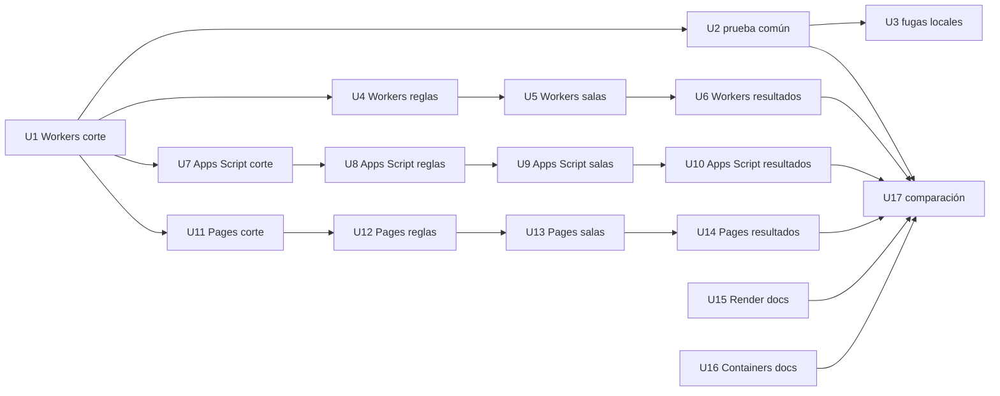

# Dependencias entre unidades

Quién depende de quién. Aquí no se elige el orden de construcción: eso va en Delivery Planning.

## Diagrama

La flecha va de la unidad que se necesita hacia la que depende de ella.



Texto alternativo: U1, el corte de Cloudflare Workers, es el primero, y de él dependen:
- la cadena de Workers (reglas, salas, resultados);
- los cortes de Apps Script (U7) y de GitHub Pages (U11), que usan la prueba común mínima de U1;
- la prueba común completa (U2).

Cada opción sigue su cadena: corte, reglas, salas y resultados. U3 necesita U2. U17 necesita U2, las
tres unidades de resultados (U6, U10, U14) y las dos de documentación (U15, U16). U15 y U16 no dependen de
nadie.

## Por qué existe cada dependencia

| Unidad | Depende de | Por qué |
|---|---|---|
| U2 | U1 | Completa la prueba común mínima que creó U1 |
| U3 | U2 | La corrección de fugas se verifica con la parte de fugas de la prueba común |
| U7, U11 | U1 | Se verifican con la prueba común mínima que creó U1. No usan código de `despliegues/cloudflare/` (FR12.2) |
| U4, U8, U12 | el corte de su opción | Usan la carpeta, el lenguaje y el runner que fijó el ADR del corte, y reemplazan su versión mínima de Banco y Calificacion |
| U5, U9, U13 | las reglas de su opción | Inscripción, examen y entrega llaman a las «calculadoras»; completan lo mínimo de Salas y Acceso del corte |
| U6, U10, U14 | las salas de su opción | Resultados y exportación leen salas, participantes y respuestas, y piden la entrega a Examen |
| U17 | U2, U6, U10, U14, U15, U16 | Llena la tabla con las mediciones de U2 cuando las tres opciones terminaron, y con las cifras de documentación |

**Si se abandona una opción.** Si una opción no pasa su corte o se abandona, el humano aprueba saltar sus
unidades restantes. Una unidad saltada ya no detiene a U17, y la opción queda en la tabla como «no pasa»,
con el motivo (FR12.6).

## Puntos de integración

| Entre | Qué se comparte | Cómo |
|---|---|---|
| La prueba común (U1, U2) y cada opción | La API HTTP que usa `web/js/` | La prueba llama por HTTP a la URL desplegada, con la clave en la cabecera `X-Clave-Admin` |
| Las unidades de una misma opción | El código de esa carpeta | Se llaman por funciones dentro del mismo servicio. Ninguna carpeta de opción depende de otra (FR12.2) |
| U2 y U17 | El archivo JSON de mediciones de U2 | U17 lo lee para llenar `despliegues/COMPARACION.md` |

## Trabajo en paralelo

- U1, U15 y U16 no dependen de nadie.
- Con U1 terminada, cuatro grupos de unidades no dependen entre sí, y los pueden trabajar a la vez
  personas o agentes distintos:
  - el resto de Workers (U4 a U6);
  - la cadena de Apps Script (U7 a U10);
  - la cadena de GitHub Pages (U11 a U14);
  - la prueba común y las fugas locales (U2, U3).

## Corte delgado

U1, el corte de Cloudflare Workers, es la primera unidad del grafo (elección del humano, 2026-10-25).
Es la única sin dependencias cuyo nombre va primero en orden alfabético (`u1-` antes que `u15-` y `u16-`).
Es una versión desplegada, aunque mínima:
- con la clave del semillero se crea y se abre una sala;
- un estudiante se inscribe y responde una pregunta;
- lo verifica la prueba común mínima que trae la misma unidad, junto con `GET /api/publico`.

Corre sin las unidades siguientes, porque trae lo mínimo de Salas, Acceso, CicloDeSala, Inscripcion,
Examen, Banco y Calificacion. Los cortes de Apps Script (U7) y de GitHub Pages (U11) son el primer punto
de control de su opción, y el humano aprueba uno por opción (requisitos, «Constraints»).

## Bloque de dependencias

```yaml
units:
  - name: u1-cloudflare-corte
    kind: service
    depends_on: []
  - name: u2-prueba-comun
    kind: library
    depends_on: [u1-cloudflare-corte]
  - name: u3-local-fugas
    kind: service
    depends_on: [u2-prueba-comun]
  - name: u4-cloudflare-reglas
    kind: library
    depends_on: [u1-cloudflare-corte]
  - name: u5-cloudflare-salas
    kind: service
    depends_on: [u4-cloudflare-reglas]
  - name: u6-cloudflare-resultados
    kind: service
    depends_on: [u5-cloudflare-salas]
  - name: u7-apps-script-corte
    kind: service
    depends_on: [u1-cloudflare-corte]
  - name: u8-apps-script-reglas
    kind: library
    depends_on: [u7-apps-script-corte]
  - name: u9-apps-script-salas
    kind: service
    depends_on: [u8-apps-script-reglas]
  - name: u10-apps-script-resultados
    kind: service
    depends_on: [u9-apps-script-salas]
  - name: u11-github-pages-corte
    kind: service
    depends_on: [u1-cloudflare-corte]
  - name: u12-github-pages-reglas
    kind: library
    depends_on: [u11-github-pages-corte]
  - name: u13-github-pages-salas
    kind: service
    depends_on: [u12-github-pages-reglas]
  - name: u14-github-pages-resultados
    kind: service
    depends_on: [u13-github-pages-salas]
  - name: u15-render-documentacion
    kind: spec
    depends_on: []
  - name: u16-cloudflare-containers-documentacion
    kind: spec
    depends_on: []
  - name: u17-comparacion
    kind: spec
    depends_on: [u2-prueba-comun, u6-cloudflare-resultados, u10-apps-script-resultados, u14-github-pages-resultados, u15-render-documentacion, u16-cloudflare-containers-documentacion]
```
